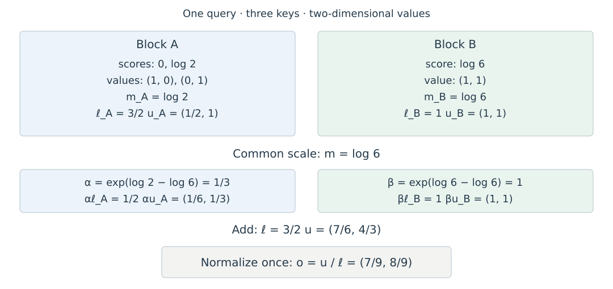

# 6.2 Online Softmax 与分块计算

Softmax 的分母是整行指数值之和，因此不能对每块独立归一化后直接拼接。Online Softmax 在读取新元素时，同时更新最大值和归一化分母；Milakov 与 Gimelshein 给出了这一递推及其可并行合并的形式。[原论文 §3—3.1](https://arxiv.org/html/1805.02867v2#S3)

Attention 还需要用这些权重汇总 Value。下面将归一化统计量与 Value 的加权和放在一起推导，得到 FlashAttention 所需的分块计算。

## 用三个量保存部分结果

固定一个 Query，令 $$s_j=q^\top k_j/\sqrt{d_h}$$ 为它对位置 $$j$$ 的分数，$$v_j\in\mathbb R^{d_v}$$ 为该位置的 Value。以下假设有效位置的分数均为有限值。对已经处理的非空位置集合 $$A$$，保存：

$$
\begin{aligned}
m_A&=\max_{j\in A}s_j,\\
\ell_A&=\sum_{j\in A}e^{s_j-m_A},\\
u_A&=\sum_{j\in A}e^{s_j-m_A}v_j.
\end{aligned}
$$

$$m_A$$ 控制指数的数值范围，$$\ell_A$$ 是归一化分母，$$u_A$$ 是尚未除以分母的 Value 加权和。前两者为标量，第三者为 $$d_v$$ 维向量；这些量的大小与集合中的位置数量无关。

假如到此结束，输出就是 $$o_A=u_A/\ell_A$$。继续读取新块时，保留 $$u_A$$ 与 $$\ell_A$$，可以将除法延迟到整行处理完毕。FlashAttention-2 的前向算法采用这一做法。[论文 §3.1.1、Algorithm 1](https://tridao.me/publications/flash2/flash2.pdf)

## 在同一尺度下合并两个块

设新块的位置集合为 $$B$$，且与 $$A$$ 不重叠。两个块的最大值可能不同，需要先统一指数的基准：

$$
\begin{aligned}
m&=\max(m_A,m_B),\\
\alpha&=e^{m_A-m},\qquad \beta=e^{m_B-m},\\
\ell&=\alpha\ell_A+\beta\ell_B,\\
u&=\alpha u_A+\beta u_B,\qquad o=u/\ell.
\end{aligned}
$$

重缩放的依据是指数恒等式：

$$
e^{m_A-m}\sum_{j\in A}e^{s_j-m_A}v_j
=\sum_{j\in A}e^{s_j-m}v_j.
$$

$$B$$ 的项作同样转换后，两部分恰好覆盖 $$A\cup B$$；分母也满足同一关系。因此，在实数运算下，合并结果等于对整行执行 Softmax 后再汇总 Value。浮点实现的舍入顺序会随分块方式变化，数值误差需另外检查。

图 6-2 使用三个位置的教学算例。分数为 $$[0,\log 2,\log 6]$$，对应 Value 为 $$[(1,0),(0,1),(1,1)]$$；前两个位置组成块 A，第三个位置组成块 B。图中不同颜色区分两个块的贡献。

<figure>
  
  <figcaption>
图 6-2　分块 Attention 的统计量合并
</figcaption>
</figure>

完整 Softmax 权重为 $$[1/9,2/9,6/9]$$，因此输出为 $$[7/9,8/9]$$，与图中的合并结果一致。若将两块各自的归一化输出简单平均，则得到 $$[2/3,5/6]$$。偏差来自两块对整行分母的贡献不同：本例中，块 B 的贡献是块 A 的两倍。

## Mask 与空块的处理

对一个 Query，统计量只覆盖 Mask 允许访问的位置。完全被屏蔽的块可以跳过；首个有效块直接初始化统计量，之后按合并公式更新。这样可以避开空块的 $$-\infty-(-\infty)$$ 运算。

如果整行都被屏蔽，Softmax 的分母为零，以上定义无法给出输出。实现需要明确约定该情况的行为，例如返回零向量或拒绝输入，并在测试中单独覆盖。本文数值检查采用拒绝空行的约定，不将其视作一般 Softmax 的数学结果。

图表来源与可编辑文件信息见[附录 C 参考文献、教学资源与本地源文件索引](../../appendices/references.md)。实现细节将在后续前向与反向计算小节展开。
