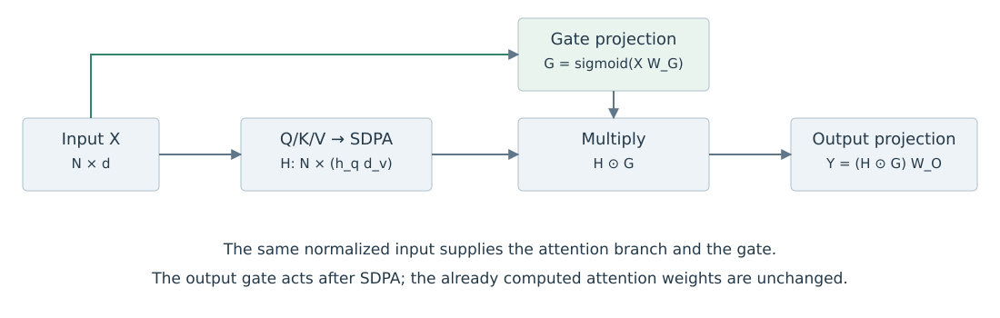
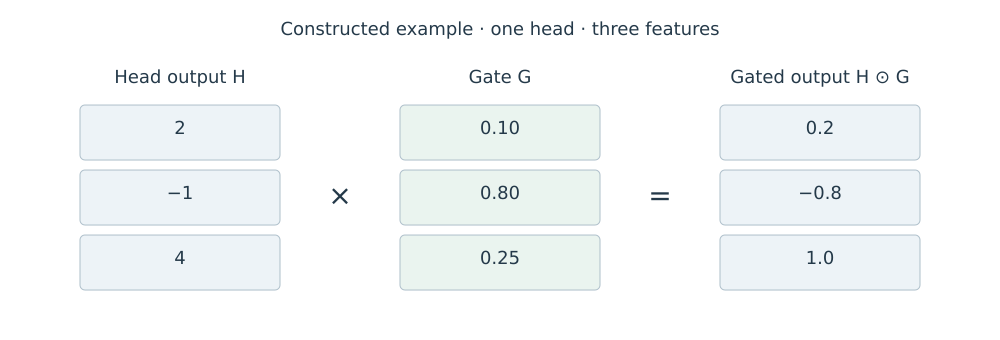

# 5.1 Attention 输出的 Gating

一个 Head 已经完成匹配和加权汇总后，仍可根据当前输入调节其输出。Gate 为每个位置生成一个标量或向量，与 Head 输出相乘。采用 Sigmoid 时，系数位于 0 与 1 之间。[Qiu et al.，§2.2](https://arxiv.org/html/2505.06708v1)

## 从权重分配到输出调节

省略 batch 维度，令输入 $$X\in\mathbb{R}^{N\times d}$$，第 $$a$$ 个 Query Head 的 Attention 权重为 $$A_a\in\mathbb{R}^{N\times N}$$。它读取所属 KV 组 $$g(a)$$ 的 Value，得到：

$$
H_a=A_aV_{g(a)}\in\mathbb{R}^{N\times d_v}.
$$

对于逐元素输出 Gate，令 $$W_a^G\in\mathbb{R}^{d\times d_v}$$，则：

$$
G_a=\operatorname{sigmoid}(XW_a^G),\qquad
\widetilde H_a=H_a\odot G_a,\qquad
Y=\operatorname{Concat}(\widetilde H_1,\ldots,\widetilde H_{h_q})W^O.
$$

$$\odot$$ 表示逐元素乘法，$$W^O\in\mathbb{R}^{h_qd_v\times d}$$ 为 Output Projection。$$X$$ 指 Attention 子层使用的输入；在所引论文的 Pre-Norm 设置中，是归一化后的隐藏状态。上式省略 bias。

| 对象 | 形状 | 系数沿哪个维度变化 |
| --- | --- | --- |
| Attention 权重 $$A_a$$ | $$N\times N$$ | Query 与 Key 的位置对 |
| 输出 Gate $$G_a$$ | $$N\times d_v$$ | Query 位置与输出特征 |
| 调节后输出 $$\widetilde H_a$$ | $$N\times d_v$$ | 保留 Head 输出形状 |

表 5-1　Attention 权重与输出 Gate

图中将所有 Head 输出拼成 $$H\in\mathbb{R}^{N\times h_qd_v}$$，对应的 Gate 也按相同次序拼接；这与逐 Head 相乘后再拼接等价。

<figure><figcaption>
图 5-1　SDPA 输出 Gate 的计算位置
</figcaption></figure>

## 一个逐元素算例

设某位置的 Head 输出为 $$[2,-1,4]$$，Gate 为 $$[0.1,0.8,0.25]$$，则调节后输出为 $$[0.2,-0.8,1]$$。以下数值是教学构造。

<figure><figcaption>
图 5-2　逐元素输出调节
</figcaption></figure>

Sigmoid Gate 对每个分量做非负缩放。分量的符号保持不变、绝对值不增加，但经过 $$W^O$$ 混合后，不同分量之间的抵消关系会改变；最终输出的某个分量仍可能增大。

例如 Head 输出 $$[1,-1]$$ 经列向量 $$W^O=[1,1]^{\mathsf T}$$ 投影得到 $$0$$。若 Gate 为 $$[0.9,0.1]$$，投影结果变为 $$0.8$$。因此，应分别观察 Gate 前后的 Head 输出、Output Projection 结果和 Residual Stream。

## 输出 Gate 的计算边界

固定本层输入和参数时，输出 Gate 位于 Attention 权重计算之后，不会回头修改本次已经得到的 $$A_a$$。下一层输入与训练梯度会受调节结果影响，因此多层模型在训练后可能形成不同的权重分布。两种变化应分别检查。

图示来源与许可见[图表来源](../../appendices/references.md#图表来源)。
