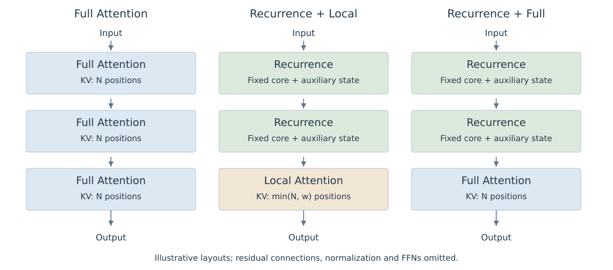
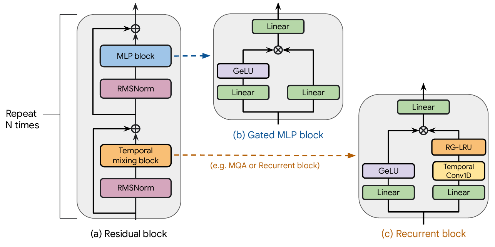

# 10.1 序列模块的组合方式

上一章的递推状态把历史压缩到固定大小的表示中，显式 KV 则保留各个历史位置的向量。混合架构可以同时使用这两种信息存储方式，也可以把不同连接范围的 Attention 放在不同层。首先需要明确组合发生在哪一层次，才能分析信息如何流动、缓存如何增长。

## 按层组合不同序列模块

Sequence Mixing 指让不同位置的信息参与当前位置的表示计算。Self-Attention、递推更新和沿序列的卷积都能承担这一作用。常规逐位置 FFN 则变换同一位置的通道表示。

层间组合在不同深度使用不同的 Sequence Mixer。例如，以 $$R$$ 表示递推模块、$$A$$ 表示 Attention 模块，可以构造重复的 $$R\rightarrow R\rightarrow A$$ 序列。每个模块处理前一层的输出。

图 10-1 用三个简化排列展示层类型与历史状态的对应关系。$$N$$ 为已处理长度，$$w$$ 为局部窗口；图中递推模块的核心及辅助状态维度固定。各框仅表示 Sequence Mixer，省略归一化、残差和 FFN。这是本书自行绘制的教学布局，不代表完整发布模型。

<figure>
  
  <figcaption>
图 10-1　层间组合与历史状态
</figcaption>
</figure>

Griffin 采用两个递推残差块接一个 Local Attention 残差块的配置，Attention 使用 MQA，默认窗口为 1024。该配置让部分层直接读取近期 KV，其他层通过 Real-Gated Linear Recurrent Unit（RG-LRU）的状态传递信息；这是 Griffin 使用的门控递推单元。[De et al.，§3，Griffin](https://arxiv.org/html/2402.19427v1#S3)

不同层的状态通常分别维护。Attention 层中的 Key 已由此前各层计算得到，可能包含更早上下文的信息。因此，Local Attention 的窗口限定本层直接访问的位置范围，不能单独作为完整模型的历史依赖边界。

Griffin 原图进一步说明模块如何接入网络：左侧残差块中的 Temporal Mixing 位置可放入 Attention 或递推模块，MLP 则保留为独立部分；右侧展开的递推模块包含短卷积与 RG-LRU。结合前述层比例，可区分“哪些层使用递推”与“一个递推层内部如何计算”。[原论文 Figure 2，PDF 第 3 页](https://arxiv.org/pdf/2402.19427v1#page=3)

<figure>
  
  <figcaption>
图 10-2　Griffin 的残差块与递推模块
</figcaption>
</figure>

## 层内组合不同计算分支

组合也可以发生在同一层内：不同 Head 使用不同连接范围，或多个分支分别计算后再融合。例如，一个教学构造是：

$$
y_t=W_o\,[\,y_t^{\mathrm{local}};y_t^{\mathrm{recurrent}}\,].
$$

其中两个分支读取同一层输入，分号表示拼接，$$W_o$$ 将拼接结果投影到输出维度。这一式子仅说明组合接口；具体模型还需定义各分支的更新、归一化、Gate 和残差连接。

| 组合位置 | 信息流 | 需要明确的接口 |
| --- | --- | --- |
| 不同层 | 后一模块处理前一模块的输出 | 层顺序、比例、残差及各层状态 |
| 同层不同 Head | Head 分别读取各自连接集合 | Head 分配、KV 共享及输出投影 |
| 同层不同分支 | 分支并行计算后融合 | 拼接或求和、Gate、归一化与各分支状态 |

表 10-1　序列模块的组合位置

如果两个 Attention 分支各自执行 Softmax，再将输出相加，它们的归一化分母是分开的；把连接集合合并后执行一次 Softmax，则使用共同分母。两种操作通常产生不同结果，设计或复现时应明确融合发生在打分、归一化还是输出阶段。

## 读取范围决定历史存储

组合方式还要与直接读取的历史范围一起描述。以下比较限定增量推理，并假定窗口外 KV 确实可以释放。

| 模块 | 直接读取的历史表示 | 随已处理长度 $$N$$ 的持久状态变化 |
| --- | --- | --- |
| Full Attention | 所有可见历史位置的 KV | KV 数量随 $$N$$ 增长 |
| 固定窗口 Local Attention | 最近窗口内的 KV | 窗口填满后，KV 数量有固定上限 |
| 固定维度递推模块 | 当前递推状态 | 核心状态大小固定；可能另有短卷积缓存 |
| 动态 Sparse Attention | 由选择器确定的历史 KV | 取决于保留策略；少读取不必然意味着少保存 |

表 10-2　序列模块的历史存储方式

因此，使用 Local Attention 的混合模型与保留少量 Full Attention 层的混合模型，长期缓存增长方式不同。DeltaNet 论文分别研究了交替加入 Sliding-window Attention，以及只把两层替换为 Global Attention 的配置。[Yang et al.，§3.4](https://arxiv.org/html/2406.06484v2#S3.SS4) 这些是不同的结构选择，后续需要分别统计状态与计算成本。

## MoE 与序列模块分开配置

Mixture-of-Experts（MoE）通过路由选择部分 Expert 处理每个 Token。在常见 FFN MoE 中，它主要改变逐位置计算的参数组织和激活量；Attention 与递推模块的组合则改变序列信息的传递方式，两者可以同时使用。

Jamba 就同时设置了这两个维度：论文配置以 1:7 的比例组合 Attention 与 Mamba 层，并每隔一层使用 MoE。序列模块比例决定多少层保存 Attention KV 或递推状态，Expert 数量与路由决定哪些参数参与该位置的 FFN 计算。[Lieber et al.，§2、Figure 1](https://arxiv.org/html/2403.19887v2#S2)

比较混合架构时，需要分别记录 Sequence Mixer 配置与 FFN/MoE 配置。若两者同时变化，质量或吞吐差异就包含多项因素；应通过相应消融实验判断贡献。

Expert 的选择、输出加权与负载均衡见[10.6 MoE 与 Expert Routing](moe-routing.md)。
