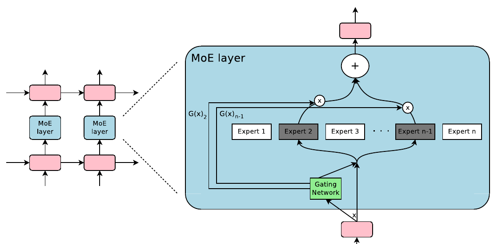

# 10.6 MoE 与 Expert Routing

前几节组合的是跨位置传递信息的序列模块。完整 Transformer Block 还包含逐位置的 FFN，这部分也影响参数容量和运行成本。常见的 FFN Mixture-of-Experts（MoE）用多个前馈子网络提供容量，并为每个 Token 选择其中一部分执行；Attention 则决定该 Token 从哪些历史表示读取信息。DeepSeek-V4 同时采用 CSA/HCA 和 DeepSeekMoE，提供了这两个设计维度共同使用的例子。[DeepSeek-V4，§2、Figure 2](https://arxiv.org/html/2606.19348v1#S2)

## 稀疏激活的 Expert

一个 FFN MoE 层包含多个参数独立、输入输出维度相同的 Expert，以及负责选择与加权的 Router。图 10-4 来自 Sparsely-Gated MoE 原论文：当前输入只交给两个被选中的 Expert，输出按 Gate 权重合并。原图左侧展示的是循环语言模型中的插入位置；右侧 MoE 模块说明稀疏激活的基本计算。[Shazeer et al.，§1.2—2、Figure 1](https://arxiv.org/pdf/1701.06538v1#page=2)

<figure>

<figcaption>
图 10-4　MoE 的稀疏激活与输出汇总
</figcaption>
</figure>

设当前 Token 的输入为 $$x\in\mathbb{R}^{d}$$，被选中的 Expert 集合为 $$\mathcal{E}(x)$$，每个 $$E_e(x)\in\mathbb{R}^{d}$$，对应的标量权重为 $$g_e(x)$$。MoE 子层的输出为：

$$
y(x)=\sum_{e\in\mathcal{E}(x)}g_e(x)E_e(x).
$$

这个式子省略残差连接。DeepSeekMoE 还设置始终参与计算的 Shared Experts，其输出另行相加。增加总 Expert 数可以扩大参数容量；每 Token 的 Expert 计算量主要取决于实际激活数及 Expert 大小。[Shazeer et al.，§2，式（1）](https://arxiv.org/pdf/1701.06538v1#page=3)；[DeepSeek-V4，§2.1](https://arxiv.org/html/2606.19348v1#S2.SS1)

## Score-based Routing 按输入选择 Expert

在常见的 Token-choice 路由中，每个 Token 根据自己的隐藏状态为各 Expert 打分，再选择 Top-k。本节讨论这种 Score-based Routing；评分函数、归一化和均衡策略随模型而定。

以 DeepSeek-V4 的非 Hash 层为例，设 $$z_e=x^\top w_e$$ 为 Router 的线性输出，$$b_e$$ 为负载均衡偏置，$$\alpha$$ 为路由缩放系数。官方实现按下式选择 Expert 并生成输出权重：

$$
\begin{aligned}
s_e&=\sqrt{\operatorname{Softplus}(z_e)},\\
\mathcal{E}(x)&=\operatorname{TopK}_e(s_e+b_e),\\
g_e(x)&=\alpha\frac{s_e}{\sum_{j\in\mathcal{E}(x)}s_j},\quad e\in\mathcal{E}(x).
\end{aligned}
$$

偏置影响选择集合，输出加权则使用选中 Expert 的原始分数。同一个 Token 在不同上下文中具有不同隐藏状态，因而可能选择不同的 Expert。[官方实现，固定版本 `b5968e9`，`Gate.forward`](https://huggingface.co/deepseek-ai/DeepSeek-V4-Pro/blob/b5968e9190ef611bbf34a7229255be88a0e937c1/inference/model.py#L546)

例如，三个 Expert 的原始分数为 $$[0.6,0.3,0.1]$$，偏置为 $$[-0.4,0,0.3]$$，则 Top-2 根据 $$[0.2,0.3,0.4]$$ 选择第二、第三个 Expert。当 $$\alpha=1$$ 时，它们的输出权重为 $$[0.75,0.25]$$。这是说明选择与加权区别的教学算例。

## Hash Routing 固定选择集合

Hash Routing 依据 Token ID 确定 Expert 索引。DeepSeek-V4 的前 3 个 MoE 层使用这种方式，后续层使用基于分数的选择。[§2.1、§4.2.1](https://arxiv.org/html/2606.19348v1#S4.SS2.SSS1)

官方实现用 `tid2eid` 保存 Token ID 到 Expert 索引的映射。固定的是选择集合；选中 Expert 的输出权重仍由当前隐藏状态的分数计算。因此，相同 Token ID 在同一 Hash 层选择相同 Expert，但其输入、权重和输出仍可随上下文变化。

| 路由机制 | 候选对象 | 选择依据 | 后续计算 |
| --- | --- | --- | --- |
| CSA 的 Lightning Indexer | 压缩历史 KV | 当前 Query 与索引 Key 的分数 | 对选中历史执行 Attention |
| MoE Score-based Routing | FFN Experts | 当前隐藏状态产生的 Expert 分数 | Expert 前馈计算与加权合并 |
| MoE Hash Routing | FFN Experts | Token ID 的预定映射 | 对固定集合计算输入相关权重并合并 |

表 10-9　历史选择与 Expert 选择

## 负载均衡与运行成本

若多数 Token 选择少数 Expert，承载它们的设备会成为瓶颈。DeepSeek-V4 延续 Auxiliary-loss-free 负载均衡策略，并保留较小的 Sequence-wise Balance Loss，以限制单条序列中的极端不均衡。名称中的 Auxiliary-loss-free 指该项均衡策略；模型训练仍包含报告明确列出的其他损失。[§2.1](https://arxiv.org/html/2606.19348v1#S2.SS1)

| 成本 | 需要记录的配置或测量 |
| --- | --- |
| 权重存储 | 总 Expert 数、Shared Experts、精度及跨设备分布 |
| 每 Token 计算 | 激活 Expert 数、单个 Expert 大小、Router 与 Shared Expert 成本 |
| Expert Parallel 通信 | Token 分发与输出回收的数据量、通信与计算重叠 |
| 批处理效率 | 各 Expert 接收的 Token 数、负载偏斜及容量策略 |

表 10-10　MoE 的资源成本

稀疏激活减少每 Token 执行的 Expert 计算，但全部 Expert 权重仍需由部署系统保存或按需加载。MoE 层不会直接缩小 Attention 的 KV Cache；比较完整模型时，应分别统计 Attention 状态、Expert 权重和通信成本。[Shazeer et al.，§1.1、§3](https://arxiv.org/pdf/1701.06538v1)；[DeepSeek-V4，§3.1](https://arxiv.org/html/2606.19348v1#S3.SS1)

图表来源与本地文件信息见[附录 C 参考文献、教学资源与本地源文件索引](../../appendices/references.md)。
