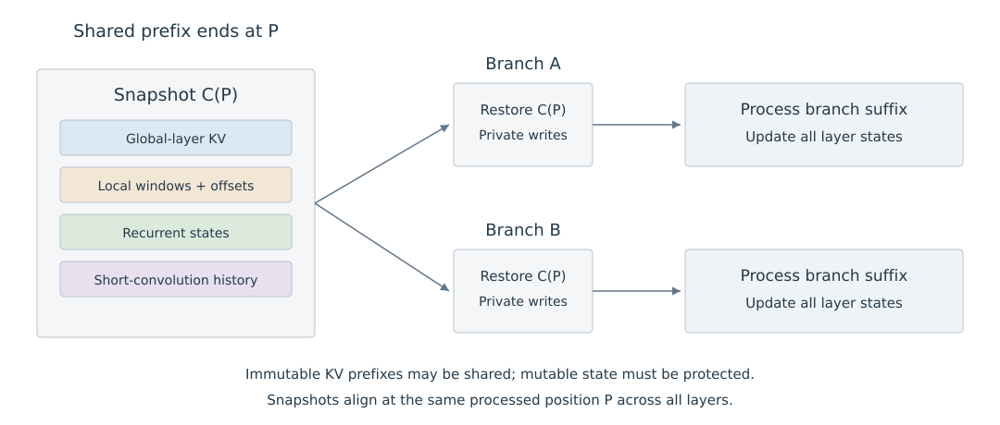

# 10.5 层间配置与状态管理

混合模型的持久状态由各层共同决定。相同的 Attention 层比例，可以对应不同的 Head 配置、窗口和递推维度；因此，应先按层列出需要保留的张量，再计算总量和设计复用方式。

## 按层汇总持久状态

设单个请求已处理 $$N$$ 个位置。对普通显式 KV 层 $$\ell$$，记其保留位置数为 $$n_\ell(N)$$、KV Head 数为 $$h_{\mathrm{kv},\ell}$$，Key 和 Value 维度分别为 $$d_{k,\ell},d_{v,\ell}$$，每标量字节数为 $$b_\ell$$。若两者使用同一精度，则有效载荷为：

$$
M_{\mathrm{KV},\ell}=n_\ell(N)h_{\mathrm{kv},\ell}
(d_{k,\ell}+d_{v,\ell})b_\ell.
$$

Full Attention 通常取 $$n_\ell(N)=N$$，固定窗口取 $$\min(N,w_\ell)$$。MLA 等压缩表示需改用实际缓存张量的形状；量化还要另计尺度、零点等元数据。

记递推层核心状态占 $$s_\ell$$ 字节，辅助状态占 $$c_\ell$$ 字节，则没有跨层或跨请求共享时，单请求总有效载荷为：

$$
M_{\mathrm{history}}(N)=
\sum_{\ell\in\mathcal A}M_{\mathrm{KV},\ell}(N)
+\sum_{\ell\in\mathcal R}s_\ell
+\sum_\ell c_\ell.
$$

$$\mathcal A$$ 与 $$\mathcal R$$ 分别表示 Attention 层和递推层；同层有多个分支时，对其实际状态分别计数。$$c_\ell$$ 包括短卷积历史、归一化累积量等未计入核心状态的张量，避免重复计数。

Griffin 的缓存分析分别统计 KV、RG-LRU 状态与短卷积历史：单个 RG-LRU 核心状态含 $$D_{\mathrm{RNN}}$$ 个标量，宽度为 4 的因果卷积还需保留 3 个历史位置的通道值。[Appendix F.4](https://arxiv.org/html/2402.19427v1#A6.SS4) 实际 Kernel 也可能为缓存分配更宽的缓冲区，分配量应另行测量。

## 层比例改变增长项

将总量写为“随上下文增长的部分”和“达到上限的部分”，有助于比较不同配置。以同一精度、同一 Head 配置的普通 KV 层为例，减少 Full Attention 层会降低随 $$N$$ 线性增长的系数；递推状态和填满后的局部窗口则贡献固定项。Jamba 用 Attention:Mamba 比例作为这种取舍的设计变量。[§2](https://arxiv.org/html/2403.19887v2#S2)

以下是本书构造的八层例子，不对应某个发布模型：两层 Full Attention、两层窗口为 1024 的 Local Attention、四层递推模块。Attention 每层有 4 个 KV Head，Key 与 Value 维度均为 128，每标量 2 字节；每个递推模块的核心及辅助状态合计 0.5 MiB。

| 已处理位置数 | 全局 KV | 局部 KV | 递推及辅助状态 | 合计 |
| ---: | ---: | ---: | ---: | ---: |
| 1024 | 4 MiB | 4 MiB | 2 MiB | 10 MiB |
| 4096 | 16 MiB | 4 MiB | 2 MiB | 22 MiB |
| 16384 | 64 MiB | 4 MiB | 2 MiB | 70 MiB |

表 10-7　混合模型的状态有效载荷

这里 $$1\,\mathrm{MiB}=2^{20}$$ 字节。表中不含模型权重、分页尾块、调度元数据及临时工作空间。改变这些层的顺序，在张量形状和保留规则不变时不会改变上述总量，但会改变信息经过各模块的次序，质量需要重新评价。

## Prefill 与 Decode 保持状态连续

分块 Prefill 的每个边界都对应“已经处理完哪些位置”。进入下一 Chunk 前，应保留各层在同一边界的递推状态、卷积历史和所需 KV，并继续使用正确的位置编号与窗口偏移。

例如，前一 Chunk 已处理位置 1—512，下一 Chunk 从 513 开始。递推层从 $$S_{512}$$ 继续更新，卷积层保留末尾所需输入，Attention 层保留规则要求的 KV。若只传递 KV 而重置递推状态，计算的就不是原输入的连续前缀。

Prefill 最后得到的持久状态可以供后续 Decode 使用。若还需要立即输出下一个 Token 的分布，必须保留或重新得到前缀末位置的输出；内部状态本身不自动包含最终 logits。这与第八章 Prefix Caching 的输出边界一致。

## 前缀复用与分支需要完整快照

把各层在位置 $$P$$ 后的全部必要状态记为 $$\mathcal C_P$$。对于确定性前向计算，相同输入前缀、模型参数和计算配置产生相同的 $$\mathcal C_P$$；复用它才能从同一边界继续处理后缀。这个条件由各层递推和 Attention 的因果依赖推出，具体服务框架是否支持这类缓存需检查其实现。

图 10-2 展示两个分支从同一位置继续的过程。快照需要包含模型实际使用的各类状态；不可变 KV 可以共享，可改写状态则必须保护原快照。图为本书自行绘制，表示逻辑要求，不限定复制或 Copy-on-Write 的具体实现。

<figure>
  
  <figcaption>
图 10-2　前缀状态快照与分支更新
</figcaption>
</figure>

| 状态 | 从相同前缀继续时的处理 | 分支后的变化 |
| --- | --- | --- |
| Full Attention KV | 复用前缀 KV | 追加各自后缀，可共享不可变前缀 |
| 局部窗口 KV | 恢复边界处的窗口内容及位置 | 窗口滚动，覆盖前需保护其他分支 |
| 递推状态 | 恢复该边界的状态快照 | 每步改写，分支需独立可写版本 |
| 短卷积等辅助状态 | 与核心状态在同一边界恢复 | 随各分支输入更新 |

表 10-8　混合模型的前缀状态复用

递推末状态通常不能按历史位置切片。缓存了 $$\mathcal C_{1024}$$，并不意味着能够直接得到 $$\mathcal C_{512}$$；若复用边界落在较早位置，需要已有检查点或从更早状态重算。分支生成和候选回滚同样需要保存相应边界，不能只修改 KV 的长度。

多请求调度时，状态还应关联请求身份、已处理位置和模型配置。没有共享时，总有效载荷可按请求求和；共享前缀后，应按实际物理张量计数。状态快照、复制和重算也会增加成本，应与节省的前缀计算一起评估。
