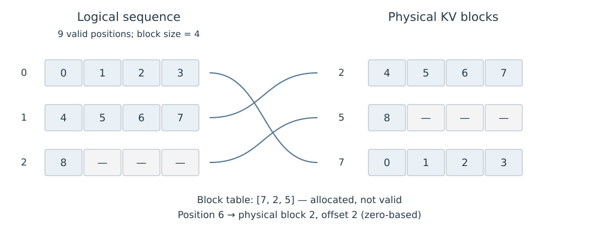

# 8.2 PagedAttention 与缓存分配

PagedAttention 用块表将序列中的逻辑位置映射到物理 KV 块，使相邻位置无需占据连续的物理块。分配器可以按需增加块，Attention kernel 则按映射读取正确的 Key 和 Value。[原论文 §4.1—4.3](https://arxiv.org/html/2309.06180v1#S4)

## 逻辑位置到物理块

采用从零开始的位置编号。块长为 $$b$$ 时，位置 $$t$$ 的逻辑块号与块内偏移为：

$$
j=\left\lfloor\frac tb\right\rfloor,\qquad o=t\bmod b.
$$

若块表为 $$T$$，则对应物理块号为 $$T[j]$$，位置地址由物理块、块内偏移、层和 Head 布局共同确定。以下为教学映射，块长为 4，序列已有 9 个位置：

| 逻辑块号 | 逻辑位置 | 物理块号 | 已填槽位 |
| --- | --- | --- | ---: |
| 0 | 0—3 | 7 | 4 |
| 1 | 4—7 | 2 | 4 |
| 2 | 8—11 | 5 | 1 |

表 8-3　逻辑块与物理块映射

图 8-1 按上表的教学算例展示非连续映射；灰色空槽已分配，但尚无有效 KV。

<figure>
  
  <figcaption>
图 8-1　KV Cache 的逻辑位置与物理块
</figcaption>
</figure>

例如位置 6 对应逻辑块 1、偏移 2，实际读取物理块 2 中偏移为 2 的槽位。逻辑位置 9—11 尚未产生有效 KV；即使物理空间已经分配，Attention 也必须按实际长度屏蔽这些槽位。

vLLM 的历史 kernel 设计文档展示了物理块号、KV Head 和块内偏移共同参与地址计算，以及归一化覆盖有效上下文的过程。该文档已标明不再描述当前代码，适合作为原理阅读材料。[Paged Attention，Key 与 Softmax 部分](https://docs.vllm.ai/en/latest/design/paged_attention/)

## 分页保持逻辑 Attention 不变

对固定 Query $$q$$，设有效位置集合为 $$\mathcal V$$，则输出仍为：

$$
o=\frac{\sum_{t\in\mathcal V}\exp(q^\top k_t/\sqrt{d_h})v_t}
{\sum_{t\in\mathcal V}\exp(q^\top k_t/\sqrt{d_h})}.
$$

将各项按物理块分组或重新排列，不改变实数运算下的和。实现必须保持每个 Key 与对应 Value、逻辑位置和 Mask 一致，并使用覆盖全部有效位置的共同分母。分页本身没有删除历史位置；浮点归约次序变化仍可能带来舍入差异。

PagedAttention 与 FlashAttention 处理不同环节：前者提供非连续 KV 的寻址方式，后者优化分块运算和中间数据访问。能否组合取决于具体 kernel 是否支持相应布局。

## 共享块与 Copy-on-Write

在模型、位置编码、Mask 与计算配置一致的条件下，两个序列具有相同的已计算前缀时，可以让各自的逻辑块表指向同一批物理块。若其中一个序列需要修改仍被其他序列引用的块，应先复制该块，再写入各自的新 KV。这是块粒度的 Copy-on-Write。[原论文 §4.4](https://arxiv.org/html/2309.06180v1#S4.SS4)

以块长 4、共享前缀长 6 为例：两个序列共享一个满块和一个含两项的尾块。它们随后分别处理不同 Token 时，可为其中一个序列复制尾块，保留其中前两个 KV，再分别追加。若共享前缀恰好长 8，则两个满块都可继续只读共享，新 Token 写入各自新申请的块。

| 操作 | 必须保持的关系 |
| --- | --- |
| 增加共享引用 | 物理块引用计数与逻辑映射同步 |
| 向共享尾块写入 | 先分离写入目标，避免改变另一序列的历史 |
| 解除请求引用 | 只回收不再需要保留的物理块 |
| 复用物理块 | 旧映射失效，新请求只能访问自己的有效位置 |

表 8-4　共享块的管理条件

块越大，块表条目通常越少，但尾块空槽和复制粒度也可能增加。比较块大小时，需要结合请求长度、共享前缀长度和 kernel 访问方式；分页节省的容量不会自动转化为相同比例的单请求加速。

图表来源与本地文件信息见[附录 C 参考文献、教学资源与本地源文件索引](../../appendices/references.md)。
