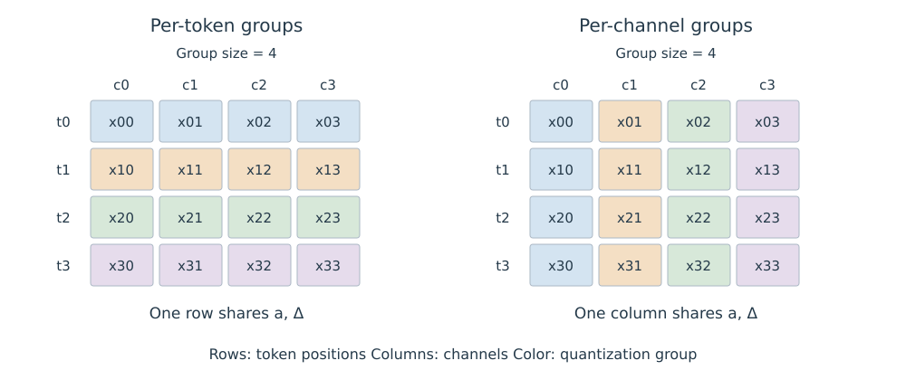

# 8.3 KV Cache Quantization

量化用较少的比特表示历史 Key 和 Value。其收益取决于三个选择：哪些元素共享量化参数、哪些位置保留较高精度，以及 Attention kernel 如何读取压缩数据。分页决定数据存放在哪里，量化进一步改变每份数据的表示与字节数。

## 量化分组与重建误差

以一组实数 $$x_1,\ldots,x_g$$ 为例，设最小值为 $$a$$、最大值为 $$b>a$$，使用 $$b_q$$ bit 的均匀量化：

$$
\Delta=\frac{b-a}{2^{b_q}-1},\qquad
u_i=\operatorname{round}\left(\frac{x_i-a}{\Delta}\right),\qquad
\hat x_i=a+\Delta u_i.
$$

整数 $$u_i$$ 存储离散编号，$$a,\Delta$$ 用于重建。忽略量化参数自身的舍入误差时，组内元素满足 $$|\hat x_i-x_i|\leq\Delta/2$$。常数组 $$a=b$$ 可存储常量并将编号置零，避免除以零。这里的 $$a$$ 是实数偏移；实现采用整数 Zero Point 时，应按其格式换算。

组内范围越宽，步长越大。若少数大幅值元素与小幅值元素共享参数，后者可用的分辨率就会降低。对形状为 $$N\times d$$ 的缓存，分组方向因此具有直接影响：

| 分组方式 | 一组包含的元素 | 共享参数的范围 |
| --- | --- | --- |
| Per-token | 同一位置、若干 Channel | 矩阵一行内的一段 |
| Per-channel | 同一 Channel、若干位置 | 矩阵一列内的一段 |

表 8-5　KV Cache 的量化分组方向

图 8-2 是分组长度为 4 的教学示意。同一组共享偏移与步长；颜色只区分分组，不表示元素大小。

<figure>
  
  <figcaption>
图 8-2　Per-token 与 Per-channel 量化分组
</figcaption>
</figure>

这里 $$N$$ 是历史位置数，$$d$$ 是对应 Key 或 Value 的维度；“Per-channel”表示每个 Channel 分别确定参数，组内元素来自不同位置。

## Key 与 Value 的误差作用不同

固定一个 Query $$q\in\mathbb R^{d_k}$$，令 $$K\in\mathbb R^{N\times d_k}$$、$$V\in\mathbb R^{N\times d_v}$$。把反量化后的数据写为 $$\hat K=K+E_K$$、$$\hat V=V+E_V$$，则：

$$
\begin{aligned}
s&=q^\top K^\top/\sqrt{d_k}, &\delta s&=q^\top E_K^\top/\sqrt{d_k},\\
p&=\operatorname{softmax}(s), &\hat p&=\operatorname{softmax}(s+\delta s),\\
o&=pV, &\hat o&=\hat p\hat V.
\end{aligned}
$$

这里 $$q$$ 是列向量，$$s,p,\hat p$$ 按 $$1\times N$$ 行向量书写，$$o,\hat o$$ 为 $$1\times d_v$$ 行向量。输出误差可精确拆分为：

$$
\hat o-o=(\hat p-p)V+\hat pE_V.
$$

Key 误差先改变分数，再通过 Softmax 改变信息分配；Value 误差则按实际权重进入输出。评价量化质量时，缓存张量的重建误差只是一个指标，还需要检查 Attention 输出和生成任务的变化。上述分解固定了本层 Query 与输入，完整生成过程还包含跨层及后续位置的误差传播。

## KIVI 的非对称分组与 Residual Cache

KIVI 根据所研究模型的数值分布，对 Key 使用 Per-channel 分组，对 Value 使用 Per-token 分组。Key 的异常大值集中于部分 Channel，分开量化可避免这些 Channel 扩大其他 Channel 的量化范围。论文的 Figure 1 展示分组方向，Figure 2 展示实际数值分布；这一选择由论文所测模型的观测和实验支持，迁移到其他模型或量化格式时仍需评估。[KIVI，§3.1—§3.2](https://arxiv.org/html/2402.02750v2#S3)

Decode 每步只追加少量位置，Key 的跨位置分组需要等待数据积累。KIVI 将历史划分为量化部分和高精度 Residual Cache，其更新方式如下：

| 对象 | 新数据写入 | 转入量化部分 |
| --- | --- | --- |
| Key | 先追加到 Residual Cache | 达到阈值后，按位置组批量量化并清空该 Residual Cache |
| Value | 先追加到近期队列 | 随队列推进，将最旧位置按 Per-token 方式量化 |

表 8-6　KIVI 的增量缓存更新

Key 的阈值须与分组长度兼容；两种 Residual Cache 的长度变化不同。论文还将反量化与矩阵乘法融合，以减少额外的数据搬运。[KIVI，§3.3、Figure 3](https://arxiv.org/html/2402.02750v2#S3.SS3)

## 实际容量与执行成本

设量化部分共有 $$n_q$$ 个标量、分组数为 $$G$$，每组量化参数占 $$m$$ 字节；高精度部分有 $$n_r$$ 个标量，每个占 $$s$$ 字节。若整数紧密打包，其容量估算为：

$$
M\approx\left\lceil\frac{n_qb_q}{8}\right\rceil+Gm+n_rs+M_{\mathrm{layout}}.
$$

$$M_{\mathrm{layout}}$$ 包括分组或分页对齐、索引等额外空间。若每组单独按字节对齐，应对各组分别取整后求和。

作为容量算例，32 个标量采用 2 bit 编码，需要 8 字节；若每组再存两个 16 bit 参数，则共 12 字节。相对于 32 个 16 bit 标量的 64 字节，压缩比为 $$64/12\approx5.33$$。这是忽略 Residual Cache 和对齐开销的自设格式算例；仅用 $$16/2=8$$ 会漏算量化参数。

执行时间还取决于解包、反量化、缓存写入以及 kernel 的支持。部署评估应同时记录位宽、分组长度、参数精度、Residual 长度、实际显存与 Decode 延迟，并在相同生成任务上比较质量。短上下文中，高精度部分与固定开销可能占较大比例；上下文增长会增加历史数据占比，是否转为主要瓶颈仍需测量。

图表来源与本地文件信息见[附录 C 参考文献、教学资源与本地源文件索引](../../appendices/references.md)。
