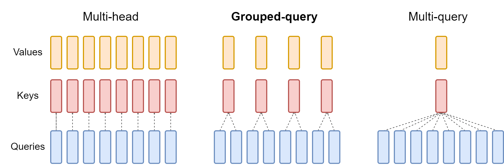

# 第 4 章 MQA、GQA 与 MLA 的 KV 表示优化

位置编码决定 Query 与 Key 如何利用顺序；自回归生成还面临另一个问题：每个历史位置需要保存多少 KV 数据。第二章的标准 MHA 为各 Head 保存独立的 Key 和 Value，长上下文会持续放大这部分存储与读取成本。本章比较两种结构选择：MQA/GQA 共享 KV Head，MLA 用共同的低维表示生成多个 Head 的 KV。

- [4.1 KV 表示与缓存成本](cache-cost.md)
- [4.2 MQA 与 GQA 的 Head 共享](head-sharing.md)
- [4.3 MLA 的 Latent Compression](latent-compression.md)
- [4.4 MLA 中的 RoPE 与投影合并](decoupled-rope.md)
- [4.5 KV 表示的质量与效率比较](comparison.md)

MLA 部分以 DeepSeek-V2 报告中的结构为例，连同其 Decoupled RoPE 解释缓存与投影合并。MQA/GQA 的 Head 共享与这一具体压缩设计分别推导，最后在明确维度和训练条件后比较。

## KV 表示与 Head 共享

MQA 让多个 Query Head 共用一组 Key 和 Value；GQA 为每组 Query Head 分配一组 KV。两者改变模型的 Head 组织。[Shazeer, 2019，§3](https://arxiv.org/html/1911.02150v1)；[Ainslie et al., 2023，§2.2](https://arxiv.org/html/2305.13245v3)

<figure align="center">

<figcaption>
图 4-1　MHA、GQA 与 MQA
</figcaption>
</figure>

图中 Query Head 数保持一致，KV Head 数随共享方式变化；各 Query Head 仍分别执行 Attention 计算。[Ainslie et al.，Figure 2](https://arxiv.org/html/2305.13245v3)

MLA 联合压缩 Key 与 Value 的表示，推理时缓存压缩后的 Latent 及必要的位置相关信息。它与 Head 共享的实现方式不同。[DeepSeek-AI, 2024，§2.1](https://arxiv.org/html/2405.04434v5)

图示来源与许可见[图表来源](../../appendices/references.md#图表来源)。
