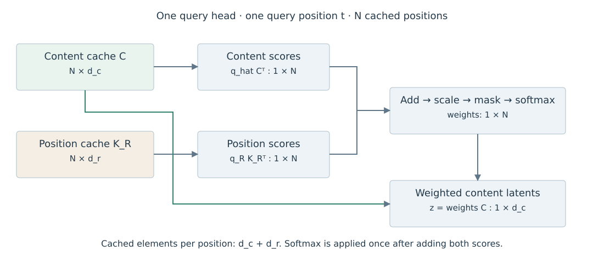

# 4.4 MLA 中的 RoPE 与投影合并

上一节将内容 Key 的 Up-projection 移到了 Query 一侧。这一步依赖投影矩阵对所有历史位置相同。RoPE 加入位置相关的旋转后，需要检查矩阵乘法的顺序。

## 位置旋转对投影合并的影响

沿用上一节的 $$U_a^K$$ 和 $$c_j$$，令 $$R_t$$、$$R_j$$ 为第三章定义的 RoPE 旋转矩阵。如果直接对内容 Query 和展开的 Key 应用 RoPE，点积为：

$$
(R_tq_{t,a}^C)^{\mathsf T}R_jU_a^Kc_j
=(q_{t,a}^C)^{\mathsf T}R_t^{\mathsf T}R_jU_a^Kc_j.
$$

右侧包含随历史位置 $$j$$ 变化的 $$R_t^{\mathsf T}R_j$$。一般情况下，不能像上一节那样只做一次与 $$j$$ 无关的 Query 变换，就复用相同的 Latent 点积形式。若保存展开且已旋转的历史 Key，仍可直接计算，但会增加缓存；若从 Latent 为每个位置重建 Key，则增加展开开销。这里讨论的是这一投影合并方式的限制。[DeepSeek-AI，§2.1.3](https://arxiv.org/html/2405.04434v5)

## 分离内容与位置分支

DeepSeek-V2 的 Decoupled RoPE 为内容点积保留不旋转的分支，另设位置分支。令其维度为 $$d_r$$，旋转后的向量为 $$q_{t,a}^R,k_j^R\in\mathbb{R}^{d_r}$$，其中位置 Key 在 Head 间共享。原论文从输入隐藏状态投影出位置 Key，从 Query 的压缩表示投影出各 Head 的位置 Query，再分别应用对应位置的 RoPE。拼接后：

$$
q_{t,a}=[q_{t,a}^C;q_{t,a}^R],\qquad
k_{j,a}=[U_a^Kc_j;k_j^R].
$$

因此完整分数可直接展开为两项之和：

$$
s_{tja}=\frac{\widehat q_{t,a}^{\mathsf T}c_j+(q_{t,a}^R)^{\mathsf T}k_j^R}{\sqrt{d_h+d_r}}+M_{tj},
\qquad
\widehat q_{t,a}=(U_a^K)^{\mathsf T}q_{t,a}^C.
$$

$$M_{tj}$$ 为 Mask 项。内容和位置分数先相加，再对历史位置做一次 Softmax；将两条分支分别归一化再相加会改变运算。Value 汇总仍采用上一节的 Latent 路径。分母来自拼接后的原始 Query/Key 维度 $$d_h+d_r$$，不是重排后的 $$d_c+d_r$$。[DeepSeek-AI，§2.1.3，式 (14)—(19)](https://arxiv.org/html/2405.04434v5)

| 分支 | 匹配项 | 历史缓存 |
| --- | --- | --- |
| 内容 | $$\widehat q_{t,a}^{\mathsf T}c_j$$ | 每个位置一份 $$c_j$$ |
| 位置 | $$(q_{t,a}^R)^{\mathsf T}k_j^R$$ | 每个位置一份 $$k_j^R$$ |
| Value 汇总 | $$\sum_j\alpha_{tja}c_j$$ | 复用内容 Latent |

表 4-8　MLA 的内容与位置分支

图中将历史向量按行排列为 $$C\in\mathbb{R}^{N\times d_c}$$ 和 $$K_R\in\mathbb{R}^{N\times d_r}$$，Query 也写成行向量。两份缓存分别生成分数，内容 Latent 还用于最终的加权汇总。

<figure><figcaption>
图 4-4　MLA 的两类缓存与分数合并
</figcaption></figure>

## 缓存容量与执行方式

若每层维度一致、每个请求保留 $$N$$ 个位置、共有 $$L$$ 层及 $$B$$ 个请求，两个缓存分量均按每元素 $$s$$ 字节存储，则：

$$
\text{MLA Cache bytes}=LBN(d_c+d_r)s.
$$

这里不再乘 Key/Value 的系数 $$2$$，因为共同的 $$c_j$$ 同时用于内容 Key 与 Value。不同精度、不同层配置或跨设备复制，需要按实际分量分别求和。

该容量对应缓存 Latent 与位置 Key 的实现。若执行中同时保留展开后的 K/V，其额外内存也应计入。Prefill 可以采用适合大矩阵的展开路径，Decode 可以采用 Latent 路径；只要使用相同参数、分数缩放和 Mask，两者在实数运算下表达同一层计算。具体实现的舍入误差与执行速度需分别测量。

固定的 RoPE 配置支持缓存位置 Key。若运行时改变频率或位置映射，缓存一致性条件见[3.4 RoPE Scaling 与上下文扩展](../position-encoding/context-extension.md)。

图示来源与许可见[图表来源](../../appendices/references.md#图表来源)。
