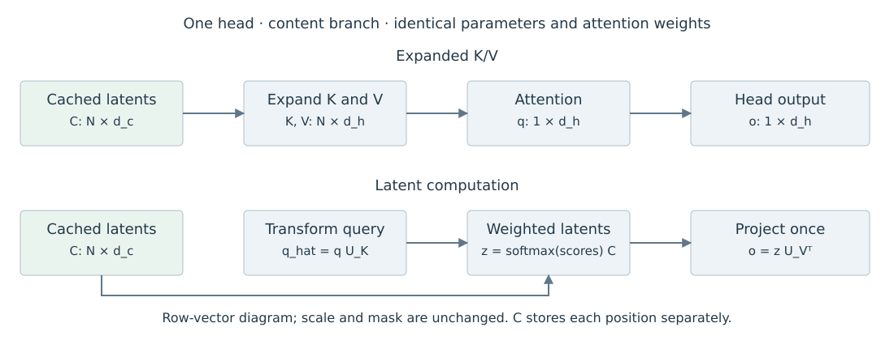

# 4.3 MLA 的 Latent Compression

Multi-head Latent Attention（MLA）让多个 Head 的 Key 和 Value 由共同的低维向量生成。它保存这一 Latent 表示，并利用线性运算的重排减少历史 KV 的展开。DeepSeek-V2 将该结构与单独的位置分支结合；本节先推导内容分支，位置分支在 4.4 展开。[DeepSeek-AI，§2.1.2—2.1.3](https://arxiv.org/html/2405.04434v5)

## 共同的 Latent 与独立的投影

沿用列向量约定，令位置 $$j$$ 的输入为 $$x_j\in\mathbb{R}^d$$，KV Latent 为 $$c_j\in\mathbb{R}^{d_c}$$。对 Head $$a$$，用 $$U_a^K,U_a^V\in\mathbb{R}^{d_h\times d_c}$$ 生成内容 Key 与 Value：

$$
c_j=Dx_j,\qquad k_{j,a}^C=U_a^Kc_j,\qquad v_{j,a}=U_a^Vc_j,
\quad D\in\mathbb{R}^{d_c\times d}.
$$

上标 $$C$$ 表示内容分支。这里按原论文的简化线性形式说明维度；若 Latent 后使用 RMSNorm 等操作，下面的重排从实际送入 Up-projection 的 $$c_j$$ 开始成立，不跨越该归一化操作。

| 表示 | 每个位置的维度 | Head 之间的关系 |
| --- | --- | --- |
| 输入 $$x_j$$ | $$d$$ | 共同输入 |
| KV Latent $$c_j$$ | $$d_c$$ | 共同保存 |
| 内容 Key $$k_{j,a}^C$$ | 每个 Head 为 $$d_h$$ | 由不同 $$U_a^K$$ 生成 |
| Value $$v_{j,a}$$ | 每个 Head 为 $$d_h$$ | 由不同 $$U_a^V$$ 生成 |

表 4-6　MLA 内容分支的表示

共同保存 $$c_j$$，仍可通过不同投影生成各 Head 的 K/V。模型在训练时学习这些投影；一般的 MHA 权重并不自动具有相同的分解结构。后面的等价推导比较的是同一个 MLA 模型的两种计算顺序。

下面将两种计算顺序并列展示。图中使用行向量：$$C$$ 的第 $$j$$ 行为 $$c_j^{\mathsf T}$$，$$q$$ 和 $$\widehat q$$ 分别为正文对应列向量的转置；图中 $$U_K,U_V$$ 对应当前 Head 的 $$U_a^K,U_a^V$$。

<figure><figcaption>
图 4-2　MLA 内容分支的计算重排
</figcaption></figure>

DeepSeek-V2 还对 Query 使用单独的低秩投影，以降低训练激活内存。Query 分支处理当前输入，不构成历史 KV 缓存；其压缩维度不计入本章的缓存容量式。[DeepSeek-AI，§2.1.2，式 (12)—(13)](https://arxiv.org/html/2405.04434v5)

## 将 Key 投影移到 Query 一侧

令当前 Query 的内容向量为 $$q_{t,a}^C\in\mathbb{R}^{d_h}$$。代入 Key 的生成式：

$$
\begin{aligned}
(q_{t,a}^C)^{\mathsf T}k_{j,a}^C
&=(q_{t,a}^C)^{\mathsf T}U_a^Kc_j\\
&=\left((U_a^K)^{\mathsf T}q_{t,a}^C\right)^{\mathsf T}c_j.
\end{aligned}
$$

定义 $$\widehat q_{t,a}=(U_a^K)^{\mathsf T}q_{t,a}^C\in\mathbb{R}^{d_c}$$。于是，对每个历史位置先展开 Key 再做点积，可以改成先转换当前 Query，再与缓存的 Latent 做点积。转换 Query 的开销不随历史位置数增加。

这是矩阵乘法结合律给出的恒等式。若原分数除以 $$\sqrt{d_h}$$，重排后仍保留该因子；点积的内部维度改为 $$d_c$$，不会把模型原来的缩放定义自动改成 $$\sqrt{d_c}$$。

## 将 Value 投影移到加权汇总之后

令 $$\alpha_{tja}$$ 为 Head $$a$$ 对历史位置 $$j\leq t$$ 的归一化权重。只要两条计算路径采用相同分数、Mask 和缩放，权重就相同。原 Head 输出可写成：

$$
\begin{aligned}
o_{t,a}
&=\sum_{j\leq t}\alpha_{tja}U_a^Vc_j\\
&=U_a^V\underbrace{\sum_{j\leq t}\alpha_{tja}c_j}_{z_{t,a}},
\qquad z_{t,a}\in\mathbb{R}^{d_c}.
\end{aligned}
$$

因此可以先在 Latent 空间中汇总，再映射到 Head 输出。将 Output Projection 分成每个 Head 对应的块 $$W_a^O\in\mathbb{R}^{d\times d_h}$$，还有：

$$
y_t=\sum_a W_a^Oo_{t,a}
=\sum_a (W_a^OU_a^V)z_{t,a}.
$$

训练好的线性投影可以按上述方式合并，或由 kernel 在执行时安排运算。浮点实现会因累加顺序不同而产生舍入误差。

| 计算环节 | 显式展开路径 | Latent 路径 |
| --- | --- | --- |
| 内容匹配 | 先生成每个历史 Key | 先变换当前 Query |
| 信息汇总 | 对展开后的 Value 求加权和 | 对 Latent 求加权和 |
| 输出投影 | Head 输出经 $$W_a^O$$ | Latent 汇总结果经 $$W_a^OU_a^V$$ |

表 4-7　MLA 内容分支的两种计算顺序

上述推导说明哪些历史中间张量可以省去。具体速度仍取决于 $$d_c$$、Head 数、序列长度、投影执行方式及 kernel；压缩缓存与减少总 FLOPs 是不同的计数问题。

图示来源与许可见[图表来源](../../appendices/references.md#图表来源)。
