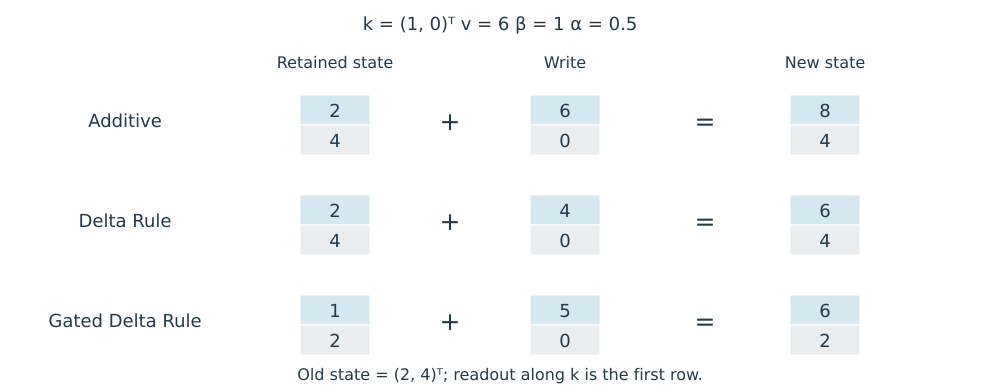

# 9.4 DeltaNet 与 Gated DeltaNet 的状态更新

衰减可以减弱旧状态，却不能单独判断某个 Key 对应的内容是否需要更新。例如，同一个 Key 先后写入两个不同 Value 时，简单相加会混合新旧关联。Delta Rule 先用当前 Key 读取已有内容，再根据它与目标 Value 的差值修正状态，使写入同时依赖输入与已有记忆。

Schlag 等人在 2021 年将这种误差修正引入 Linear Transformer 的 Fast Weight 更新；2024 年的 DeltaNet 工作进一步解决其沿序列维度的高效并行训练。[Schlag et al.，§4.2](https://proceedings.mlr.press/v139/schlag21a/schlag21a.pdf) · [Yang et al.，§3](https://arxiv.org/html/2406.06484v2#S3)

## 根据读取误差修正状态

沿用本章 $$S\in\mathbb R^{d_k\times d_v}$$ 的约定，Key、Query 和 Value 均为列向量。先用当前 Key 读取旧状态：

$$
\hat v_t=S_{t-1}^\top k_t,\qquad e_t=v_t-\hat v_t.
$$

DeltaNet 的更新与读取可以写为：

$$
\begin{aligned}
S_t&=S_{t-1}+\beta_t k_te_t^\top\\
&=(I-\beta_t k_tk_t^\top)S_{t-1}+\beta_t k_tv_t^\top,\\
o_t&=S_t^\top q_t.
\end{aligned}
$$

$$\beta_t$$ 控制修正强度，$$I$$ 为 $$d_k\times d_k$$ 单位矩阵。Yang 等人给出的 DeltaNet 使用输入相关的 Sigmoid 产生 $$\beta_t\in(0,1)$$。这里将论文状态矩阵转置，以保持本章形状一致。[§2.2](https://arxiv.org/html/2406.06484v2#S2.SS2)

与只写入 $$k_tv_t^\top$$ 相比，Delta Rule 额外减去当前 Key 从旧状态读出的内容。若当前读取已经等于目标，误差为零，本次修正也为零。

## Key 范数决定修正幅度

把更新后的状态再次用于同一 Key，可直接得到：

$$
S_t^\top k_t=\hat v_t+\beta_t\|k_t\|_2^2(v_t-\hat v_t).
$$

当 $$\|k_t\|_2=1$$ 时，读取结果变为：

$$
S_t^\top k_t=(1-\beta_t)\hat v_t+\beta_tv_t.
$$

Yang 等人的 DeltaNet 在 Q/K 投影后使用 SiLU，再进行 L2 归一化，使非零 Key 满足上述单位范数条件。[§3.3](https://arxiv.org/html/2406.06484v2)

因此，单位 Key 和 $$\beta_t=1$$ 是“把当前 Key 的读取替换为目标 Value”的充分条件。若 Key 未归一化，有效修正强度还包含范数平方，不能只看 $$\beta_t$$。

对另一个 Key $$u$$，更新带来的读取变化为：

$$
(S_t-S_{t-1})^\top u=\beta_t(k_t^\top u)e_t.
$$

与当前 Key 正交的方向不受这次修正影响；相关方向则会发生变化。Delta Rule 针对的是状态中的 Key 方向，而不是一个可独立寻址的历史 Token 槽位。

## 在线梯度更新的解释

固定当前 $$k_t,v_t$$，定义状态的平方误差：

$$
\mathcal L_t(S)=\frac12\|S^\top k_t-v_t\|_2^2,
\qquad
\nabla_S\mathcal L_t=k_t(S^\top k_t-v_t)^\top.
$$

从 $$S_{t-1}$$ 出发，以步长 $$\beta_t$$ 做一次梯度下降，就得到上述 Delta Rule。这是在前向计算内部更新临时状态的解释；模型的投影参数仍通过训练学习。[Gated DeltaNet，§3.1](https://arxiv.org/html/2412.06464v1#S3.SS1)

### Test-Time Training 的状态更新

Test-Time Training（TTT）将序列状态解释为一个内部模型的参数，并在处理输入时更新这些参数。这里讨论 Sun 等人的 TTT 层：输入经不同投影形成训练输入、重建目标和读取输入；内部更新压缩当前序列的信息，外层训练则学习这些投影及网络其余参数。[Sun et al.，§2.1—2.3](https://arxiv.org/html/2407.04620v1#S2.SS1)

与上式对应，取内部模型 $$f(k;S)=S^\top k$$，使用带 $$1/2$$ 系数的平方误差，并在每一步从当前状态做一次梯度下降，就得到 Delta Rule。这个对应关系依赖内部模型、损失和更新方式。论文中的 TTT-Linear 还包含 LayerNorm、残差连接与 mini-batch 更新，TTT-MLP 则采用两层 MLP 作为内部模型。[§2.7](https://arxiv.org/html/2407.04620v1#S2.SS7)

原文 [Figure 6](https://arxiv.org/html/2407.04620v1#S2.F6) 用短代码区分内部状态的更新与外层参数的训练，可与本节梯度公式对照阅读。

## Gated DeltaNet 先衰减再修正

Gated DeltaNet 增加标量状态衰减 $$\alpha_t\in(0,1)$$：

$$
S_t=\alpha_t(I-\beta_t k_tk_t^\top)S_{t-1}+\beta_t k_tv_t^\top.
$$

等价地，先令 $$\bar S_{t-1}=\alpha_tS_{t-1}$$，再执行：

$$
S_t=\bar S_{t-1}+\beta_tk_t\big(v_t-\bar S_{t-1}^\top k_t\big)^\top.
$$

误差必须相对于**衰减后的状态**计算。$$\alpha_t$$ 调整整个旧状态的保留程度，$$\beta_t$$ 控制当前 Key 方向上的修正。[Yang et al.，§3.1，式 (8)](https://arxiv.org/html/2412.06464v1#S3.SS1)

以下为自设算例：Key 维度为 2，Value 为标量，旧状态为 $$(2,4)^\top$$。当前 $$k_t=(1,0)^\top$$、$$v_t=6$$，修正强度取 $$\beta_t=1$$，衰减取 $$\alpha_t=0.5$$。

图 9-3 将保留的状态与本步写入分开：加法直接写入 6，Delta Rule 写入误差 4，Gated Delta Rule 相对于衰减后状态写入误差 5。图为本书自行绘制的算例。

<figure>
  
  <figcaption>
图 9-3　加法写入与 Delta 修正
</figcaption>
</figure>

普通 Delta Rule 保留正交方向；Gated Delta Rule 先将该方向衰减到 2，再把当前 Key 的读取修正到 6。如果错误地使用未衰减状态计算误差，第一方向只会得到 $$1+(6-2)=5$$，与论文公式不同。

这些规则保持状态尺寸不变，核心更新仍是矩阵缩放、矩阵–向量读取和外积写入。它们改善信息更新方式，但多个相关 Key 的相互影响仍存在；9.6 将结合检索任务分析这一限制。
