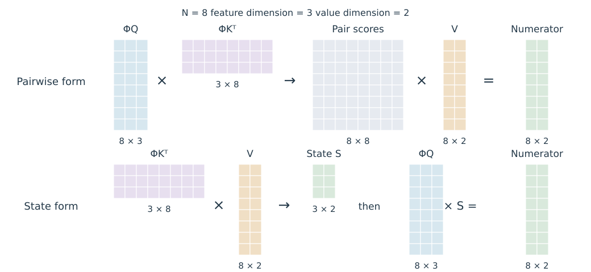

# 9.1 从 Softmax Attention 到 Kernel Attention

沿序列压缩 KV，仍然会让 Query 逐条读取压缩后的历史。Kernel Attention 从计算形式入手：若相似度可以分解为有限维 Query 特征与 Key 特征的内积，就能先汇总历史，再让不同 Query 读取共同状态。下面先推导这一重排，随后区分“选择新核函数”和“近似 Softmax 核”两条路线。

## 用核函数定义权重

令 $$q_i,k_j\in\mathbb R^{d_k}$$、$$v_j\in\mathbb R^{d_v}$$ 为列向量。先考虑所有 Query 都读取同一组 $$N$$ 个 Key 的情形。用非负相似度 $$\kappa(q,k)$$ 定义归一化输出：

$$
o_i=\frac{\sum_{j=1}^{N}\kappa(q_i,k_j)v_j}
{\sum_{j=1}^{N}\kappa(q_i,k_j)}.
$$

分母必须大于零。取 $$\kappa(q,k)=\exp(q^\top k/\sqrt{d_k})$$，即得到标准 Softmax Attention；选择其他核函数，则定义另一种权重分配。[Katharopoulos et al.，§3.1—§3.2，式 (3)—(5)](https://proceedings.mlr.press/v119/katharopoulos20a/katharopoulos20a.pdf)

若存在有限维特征映射 $$\phi:\mathbb R^{d_k}\to\mathbb R^{d_\phi}$$，使 $$\kappa(q,k)=\phi(q)^\top\phi(k)$$，可以把与 Query 无关的历史项预先相加：

$$
S=\sum_{j=1}^{N}\phi(k_j)v_j^\top,
\qquad z=\sum_{j=1}^{N}\phi(k_j),
\qquad o_i^\top=\frac{\phi(q_i)^\top S}{\phi(q_i)^\top z}.
$$

$$S\in\mathbb R^{d_\phi\times d_v}$$ 汇总特征与 Value 的外积，$$z\in\mathbb R^{d_\phi}$$ 保存归一化所需的特征总和。非负特征是保证核值非负的一种充分条件；若特征可能全为零，仍需处理零分母。

## 结合律改变中间张量

将各位置的特征按行排列为 $$\Phi_Q,\Phi_K\in\mathbb R^{N\times d_\phi}$$，Value 按行排列为 $$V\in\mathbb R^{N\times d_v}$$。输出的未归一化分子满足：

$$
(\Phi_Q\Phi_K^\top)V=\Phi_Q(\Phi_K^\top V).
$$

图 9-1 用小尺寸矩阵展示两种乘法顺序，格子表示张量元素，输出均为归一化前的分子。图为本书依据上述公式绘制的教学示意。

<figure>
  
  <figcaption>
图 9-1　Kernel Attention 的计算重排
</figcaption>
</figure>

| 计算顺序 | 先构造的张量 | 后续读取 |
| --- | --- | --- |
| 先计算 Query–Key 相似度 | $$N\times N$$ 的特征内积矩阵 | 对 Value 加权 |
| 先汇总 Key–Value 外积 | $$d_\phi\times d_v$$ 的状态 $$S$$ | 每个 Query 读取状态 |

表 9-1　Kernel Attention 的两种计算顺序

重排后，状态构造与全部 Query 的读取成本为 $$O(Nd_\phi d_v)$$，还需计算特征映射和归一化。只有在特征、Value 维度固定时，这部分计算量才随序列长度线性增长；较大的 $$d_\phi$$ 仍可能带来明显成本。

## 核的选择与 Softmax 的区别

Katharopoulos 等人的 Linear Transformer 使用逐元素映射 $$\phi(x)=\operatorname{ELU}(x)+1$$。当 ELU 参数为 1 时，其每个分量为：

$$
\phi(x)_a=\begin{cases}x_a+1,&x_a\ge0,\\e^{x_a},&x_a<0.\end{cases}
$$

该映射在实数运算中严格为正，因而在非空历史上产生正分母。它选择了新的相似度函数；矩阵结合律保证的是该特征核内部两种计算方式相同。[§3.2.1，式 (7)](https://proceedings.mlr.press/v119/katharopoulos20a/katharopoulos20a.pdf)

一个一维自设算例可以直接看到差别：取 $$q=1$$、$$k_1=0,k_2=1$$、$$v_1=0,v_2=1$$。Softmax Attention 的输出是 $$e/(1+e)\approx0.7311$$；上述特征核给出相似度 2 和 4，输出为 $$2/3\approx0.6667$$。

标准指数点积核在一般连续输入域上的精确特征展开为无限维。有限维近似可以建立另一条路线，但需要控制近似误差；直接用 ELU 特征替换它，则应作为模型设计选择进行训练和评价。[§3.2.1](https://proceedings.mlr.press/v119/katharopoulos20a/katharopoulos20a.pdf)

## Performer 用随机特征近似 Softmax 核

Performer 的 FAVOR+（Fast Attention Via Positive Orthogonal Random Features）以指数点积核为近似目标。先把缩放吸收到输入中：令 $$x=q/d_k^{1/4}$$、$$y=k/d_k^{1/4}$$，则 $$x^\top y=q^\top k/\sqrt{d_k}$$。

对标准高斯向量 $$\omega\sim\mathcal N(0,I)$$，定义正值特征：

$$
f_\omega(x)=\exp\!\left(\omega^\top x-\frac{\|x\|_2^2}{2}\right).
$$

利用高斯矩母函数，可以得到：

$$
\begin{aligned}
\mathbb E_\omega[f_\omega(x)f_\omega(y)]
&=\exp\!\left(-\frac{\|x\|_2^2+\|y\|_2^2}{2}\right)
\exp\!\left(\frac{\|x+y\|_2^2}{2}\right)\\
&=\exp(x^\top y).
\end{aligned}
$$

因此，采样 $$m$$ 个随机向量并令

$$
\phi_m(x)=\frac{1}{\sqrt m}
\begin{bmatrix}f_{\omega_1}(x)&\cdots&f_{\omega_m}(x)\end{bmatrix}^\top,
\qquad \widehat\kappa(x,y)=\phi_m(x)^\top\phi_m(y),
$$

就得到指数核的随机估计。上式是独立高斯采样的基本构造；FAVOR+ 进一步使用具有适当边缘分布的 Orthogonal Random Features 来降低估计方差。当随机特征数 $$m>d_k$$ 时，正交约束在各个 $$d_k$$ 维块内施加，不要求全部 $$m$$ 个方向两两正交。这里的约束作用于采样方向，与输入 Key 之间是否正交无关。[Choromanski et al.，Lemma 1、§2 与 Appendix B.2](https://arxiv.org/pdf/2009.14794v4)

固定一组随机特征后，前面的状态汇总与计算重排仍然成立，状态大小变为 $$m\times d_v$$。所有参与同一次状态汇总的 Key 与 Query 必须使用一致的随机映射；在 Decode 中更换映射，原有状态便不能直接继续使用。

## 核误差与归一化输出误差

独立采样构造满足 $$\mathbb E[\widehat\kappa]=\kappa$$，但归一化输出是两个随机量的比值，其期望一般不等于精确输出。对于固定 Query，记精确分子、分母为 $$n=\sum_j\kappa_jv_j$$、$$d=\sum_j\kappa_j>0$$，估计误差为 $$\Delta n,\Delta d$$。只要 $$d+\Delta d>0$$，有：

$$
\widehat o-o
=\frac{\Delta n-o\,\Delta d}{d+\Delta d}.
$$

这个恒等式说明，评价近似时要同时检查分子和分母。随机特征数、输入向量范数和采样方式都会影响误差；增加特征数也会增大状态与计算成本。浮点实现还需控制指数溢出、下溢和分母稳定性。

三种操作应分别判断：ELU+1 **更换相似度核**；正随机特征**近似指数核**；在选定的有限特征下，结合律**等价重排计算**。核估计性质、Attention 输出误差和训练后任务质量分别对应不同的验证对象。

本节所有 Query 共享同一历史集合。自回归模型中，每个位置只能读取自己的前缀，下一节将历史汇总改成随位置推进的状态。
