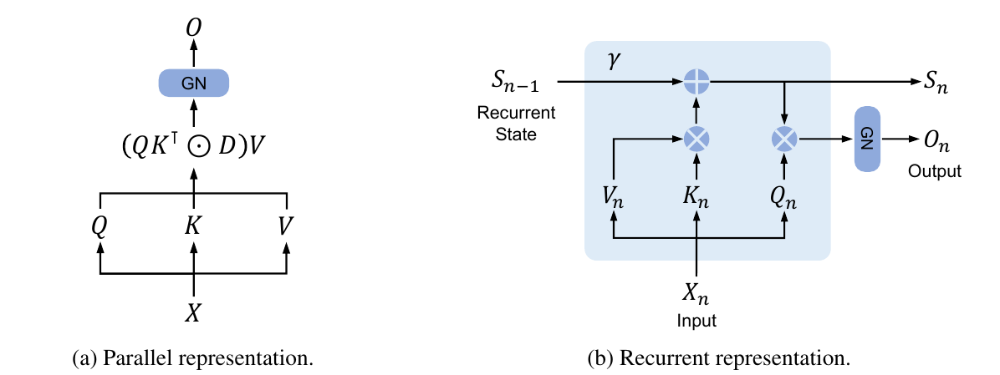

# 9.3 状态衰减与 Gated Linear Attention

9.2 的加法状态持续累积写入，所有历史项都留在同一个状态中。若希望根据时间或当前输入调节旧信息的保留程度，可以在写入之前引入衰减。本节先用一个带标量 Gate 的教学构造解释作用，再比较 RetNet、早期 RWKV 与 GLA 的具体更新形式。

## 从累积到衰减

先用标量 Gate 说明机制。令 $$u_t=\phi(k_t)$$，并在 9.2 的归一化构造中对两个状态施加相同的 $$\gamma_t\in(0,1]$$：

$$
S_t=\gamma_tS_{t-1}+u_tv_t^\top,
\qquad z_t=\gamma_tz_{t-1}+u_t.
$$

这里是本书在前节公式上加入衰减的教学构造。零初始状态下，展开可得：

$$
S_t=\sum_{j=1}^{t}\left(\prod_{r=j+1}^{t}\gamma_r\right)u_jv_j^\top,
\qquad
z_t=\sum_{j=1}^{t}\left(\prod_{r=j+1}^{t}\gamma_r\right)u_j.
$$

空乘积为 1，因此当前写入不受本步 Forget Gate 缩放。若 $$\gamma_t=\gamma$$ 恒定，第 $$j$$ 次写入的系数为 $$\gamma^{t-j}$$；若 Gate 随输入变化，保留程度还取决于中间经过的输入。

| Gate | 距写入 1 步 | 距写入 4 步 | 距写入 16 步 |
| --- | ---: | ---: | ---: |
| $$\gamma=0.5$$ | 0.5 | 0.0625 | 0.0000153 |
| $$\gamma=0.9$$ | 0.9 | 0.6561 | 0.1853 |

表 9-3　固定衰减的累积系数

表中是幂函数算例，表示历史项进入状态的系数。归一化后的输出还取决于所有历史项及当前 Query，不能将这些系数直接当作 Attention 权重。

## RetNet 与 RWKV 的固定衰减

固定衰减可以按 Head 或 Channel 设置，使不同状态保留不同时间尺度的信息。2023 年的 RetNet 与 RWKV 分别采用矩阵状态和逐通道累积：

- **RetNet**：Retention 用固定系数衰减矩阵状态，再加入当前 Key–Value 外积；不同 Head 使用不同的衰减系数。Q/K 包含位置旋转，读取后使用 GroupNorm 与 Swish 输出 Gate。它不使用前述教学构造的归一化状态 $$z_t$$。[Sun et al.，§2.1—2.2](https://arxiv.org/html/2307.08621v4#S2.SS1)
- **RWKV（2023 年论文版本）**：WKV 在每个 Channel 内累积加权 Value 与权重和，再逐元素相除；历史项按相对距离指数衰减，当前项另有权重偏置。衰减参数经训练学习，但处理序列时固定；Receptance Gate 调节读取后的输出。这一路径按 Channel 汇总历史，不通过当前 Query 与历史 Key 的点积选择信息。[Peng et al.，§3.1—3.3、Appendix D](https://arxiv.org/html/2305.13048v2#S3)

RetNet 原图将两种计算方式并列：左侧通过带衰减矩阵 $$D$$ 的位置配对计算整段输出，右侧先用 $$\gamma$$ 衰减旧状态，再加入当前 Key–Value 外积，由 Query 读取新状态。两条路径都显示 GN（GroupNorm）；它与 9.2 中用 $$z_t$$ 构造的分母归一化不同。原图沿用论文的行向量记法，正文按列向量书写。[原论文 Figure 3，PDF 第 4 页](https://arxiv.org/pdf/2307.08621v4#page=4)

<figure>
  
  <figcaption>
图 9-2　RetNet 的并行计算与递推计算
</figcaption>
</figure>

与固定衰减相比，输入相关衰减可以在每一步调整历史项的保留程度。下面的 GLA 采用这一设计，并按通道调节矩阵状态中的各行。

## GLA 的逐通道 Gate

这里的 Gated Linear Attention（GLA）特指 Yang 等人提出的模型，将输入相关的 Gate 施加到矩阵状态。沿用列向量记法，其一般形式为：

$$
G_t=\alpha_t\beta_t^\top,\qquad
S_t=G_t\odot S_{t-1}+k_tv_t^\top,\qquad
r_t=S_t^\top q_t.
$$

这里 $$q_t,k_t,\alpha_t\in\mathbb R^{d_k}$$，$$v_t,\beta_t,r_t\in\mathbb R^{d_v}$$，$$S_t\in\mathbb R^{d_k\times d_v}$$；$$\odot$$ 为逐元素乘法。Gate 的各分量控制对应状态行或列的保留。[Yang et al.，§3.1，式 (8)—(11)](https://arxiv.org/html/2312.06635v3#S3.SS1)

论文的模型配置将 $$\beta_t$$ 固定为全 1 向量，只学习 $$\alpha_t$$，于是：

$$
S_t=\operatorname{diag}(\alpha_t)S_{t-1}+k_tv_t^\top.
$$

每个 Key Channel 对应一行状态，并共享该行上的衰减系数。令 $$a_t$$ 为当前输入经低秩投影得到的 Gate logits，论文实验采用 $$\log\alpha_t=\log\sigma(a_t)/16$$，即逐元素取 $$\alpha_t=\sigma(a_t)^{1/16}$$；投影的中间维度为 16。这个变换使 Gate 比直接使用同一 Sigmoid 输出更接近 1，减缓历史状态的衰减。[§3.1，脚注 8；§3.4](https://arxiv.org/html/2312.06635v3#S3.SS4)

这里的 $$r_t$$ 是未归一化读取，不使用 9.2 的 $$z_t$$ 分母。论文在各 Head 读取后采用 LayerNorm，再对拼接结果施加输出 Gate 和投影。理解 GLA 时，应把状态更新、读取后的归一化和输出 Gating 分开。[§3.4](https://arxiv.org/html/2312.06635v3#S3.SS4)

## 历史贡献沿时间累乘

对仅有行 Gate 的形式，设 $$S_0=0$$，定义逐元素乘积：

$$
a_{t,j}=\prod_{r=j+1}^{t}\alpha_r\in\mathbb R^{d_k}.
$$

将递推逐次展开，得到：

$$
S_t=\sum_{j=1}^{t}(a_{t,j}\odot k_j)v_j^\top,
\qquad
r_t=\sum_{j=1}^{t}\big[q_t^\top(a_{t,j}\odot k_j)\big]v_j.
$$

该式直接显示每次历史写入经过哪些 Gate。某个 Channel 上 Gate 变小时，该行中此前累积的多次写入会一起衰减；Gate 并未单独定位其中某个历史 Token。需要针对特定 Key 修正已存内容时，要进一步改变写入规则，这是下一节 Delta Rule 的出发点。

GLA 的 Query、Key 可以带符号，方括号内的系数也可能为负。因此，这个读取式是历史 Value 的线性组合，并不具有非负且和为 1 的概率权重约束。

## 状态 Gate 与输出 Gate

| 作用位置 | 直接改变的量 | 在固定后续输入下的影响 |
| --- | --- | --- |
| 状态 Gate | 写入新信息前的 $$S_{t-1}$$ | 当前及后续状态读取 |
| 输出 Gate | 本步读取结果 | 本步向下一模块传递的结果 |

表 9-4　两类 Gate 的作用位置

例如，标量旧状态为 4，新写入为 1，状态 Gate 为 0.5，则新状态为 3。若先得到未衰减状态 5，再对输出乘 0.5，则输出为 2.5，保存的状态仍为 5。这是固定输入下的算例；在完整网络中，输出改变还可能经后续层和生成过程影响未来输入。

时间累乘可能产生很小的数。并行实现若用两个长前缀乘积的比值恢复区间衰减，可能遭遇下溢或除以极小值；GLA 论文据此讨论 Log-space 和分块计算。[§3.2—§3.3](https://arxiv.org/html/2312.06635v3#S3.SS2) 9.5 将进一步说明如何在保持这些衰减关系的同时安排并行运算。
