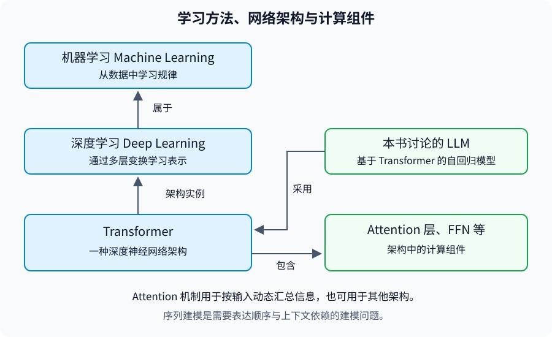

# 第 1 章 大模型 Attention 的总体框架与技术演进

## 从机器学习到序列建模

机器学习（Machine Learning）研究如何从数据中学习规律，使模型能够对新输入进行预测或生成。在本书涉及的神经网络中，训练通过数据和学习目标调整参数；推理则使用学到的参数处理输入。

深度学习（Deep Learning）是机器学习的一类方法，通过多层可学习的变换构建表示。这里的“表示”指供模型计算的数值形式，例如文本中每个位置对应的向量。网络不仅学习如何从输入得到输出，也学习中间信息如何表达与组合。[Goodfellow et al., 2016，Chapter 1](https://www.deeplearningbook.org/contents/intro.html)

对于语言等序列数据，单个位置的信息往往不足以确定其含义。理解指代、识别语义关系或预测后续文本，都需要结合上下文。因此，序列建模需要解决一个基本问题：**如何在不同位置之间传递和汇总信息？**

注意力机制（Attention Mechanism，以下简称 Attention 机制）提供了一种方法：根据当前输入计算不同位置之间的匹配关系，再按相应权重汇总信息。本书重点讨论的 Softmax Attention 使用非负、归一化的权重；后续其他形式会明确其计算定义。Attention 机制是模型中的计算组件，并不等同于完整模型，也不意味着模拟了人类注意力的全部过程。[Vaswani et al., 2017，§3.2](https://arxiv.org/html/1706.03762v7)

## Attention 机制、Transformer 与 LLM

图 1-1a　概念关系示意，由本书绘制。箭头分别标明方法归属、架构采用与组件关系，不表示统一的包含关系或历史顺序。依据为《Deep Learning》Chapter 1 与 Transformer 原论文 §3。

| 概念 | 所处层次 | 本书关注的问题 |
| --- | --- | --- |
| 机器学习、深度学习 | 学习方法及其类别 | 如何从数据学习参数与表示 |
| 序列建模 | 建模问题 | 如何表达顺序及不同位置的依赖 |
| Attention 机制 | 信息汇总机制 | 如何根据输入计算权重并组合信息 |
| Transformer | 神经网络架构 | 如何将 Attention 层、FFN 等组件组织成网络 |
| 大语言模型（Large Language Model，LLM） | 以大规模语言建模为基础的模型类别 | 如何利用上下文完成语言任务 |

Transformer 将 Attention 机制用于序列表示计算，同时包含前馈网络（Feed-Forward Network，FFN）、残差连接和归一化等组件。[Vaswani et al., 2017，§3.1—3.3](https://arxiv.org/html/1706.03762v7) 本书聚焦基于 Transformer 的自回归 LLM；“LLM”本身不规定唯一架构，Attention 机制也可用于其他架构和任务。

## 从基本机制到优化问题

输入序列变长时，位置之间的信息交互会增加计算与存储成本；逐步生成文本时，还需要考虑历史信息的保存与复用。因此，本书先说明 Attention 机制的基本计算，再区分表示、连接模式、实现和缓存管理等改进方向。详细推导与实现放在后续章节。

图 1-1b　本书绘制的技术路线图。分支表示设计问题与章节归属；连线不表示方法之间存在时间上的继承关系。

| 本节 | 要回答的问题 |
| --- | --- |
| [1.1 Attention 机制的基本思想与模型中的作用](attention-in-llms.md) | 为什么需要上下文信息，Attention 机制如何汇总这些信息？ |
| [1.2 从 Seq2Seq 中的 Attention 到 Transformer](from-seq2seq-to-transformer.md) | 从动态读取 Encoder 状态到 Self-Attention，架构发生了什么改变？ |
| [1.3 LLM 中的计算瓶颈、KV Cache 与 Long Context](bottlenecks-and-context.md) | 为什么长输入、逐 Token 生成和长上下文能力需要分别分析？ |
| [1.4 Attention 的结构改进、计算优化与架构扩展](optimization-landscape.md) | MQA、FlashAttention、PagedAttention、Linear Attention 分别改变什么？ |
| [1.5 主要技术路线的演进关系与比较维度](evolution-and-comparison.md) | 哪些路线能够组合，比较方法时需要控制哪些条件？ |

本章从学习方法与序列建模问题入手，不要求预先熟悉 LLM 架构。公式部分需要向量、矩阵乘法和基本概率知识；Softmax 的作用在 1.1 中说明。符号见[附录 A 英文术语、数学符号与补充推导](../../appendices/foundations.md)，原始论文与教学材料见[附录 C 参考文献、教学资源与本地源文件索引](../../appendices/references.md)。
