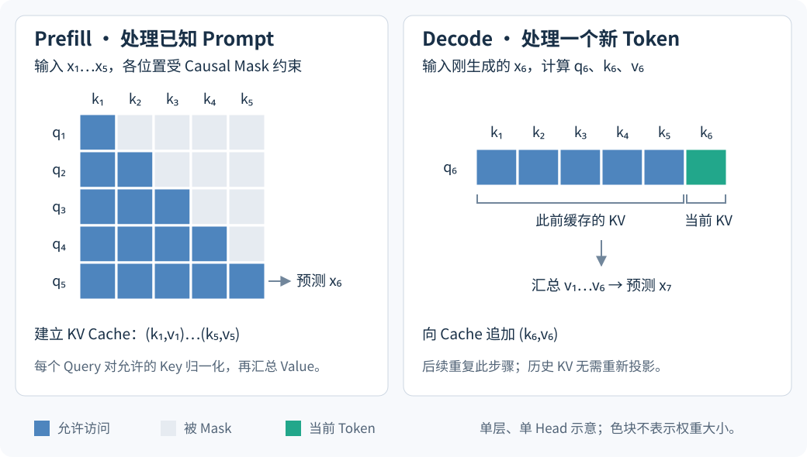

# 1.4 LLM 中的计算瓶颈、KV Cache 与 Long Context

讨论 Attention 成本时，先确定计算阶段。一次处理完整输入，与每次只处理一个新 Token，使用的参数可以相同，但矩阵形状、缓存行为和瓶颈不同。

## Training、Prefill 与 Decode

图 1-6　本书绘制的单层计算示意。Prefill 的最后一个位置用于产生首个新 Token 的预测；随后每个 Decode 步骤处理新输入 Token 并预测再下一个 Token。图中仅展示 Attention 的位置关系，预测还需经过模型后续计算及输出头；Batch、其他 Head、投影和 FFN 均省略。计算阶段依据 [Kwon et al., 2023，§2.2](https://arxiv.org/html/2309.06180v1)。

| 阶段 | 已知输入与计算方式 | 与缓存相关的特点 |
| --- | --- | --- |
| Training | 已知训练序列，在 Mask 下并行计算并反向传播 | 需要处理梯度及激活保存或重算 |
| Prefill | 处理已知 Prompt 的多个位置 | 建立各层 KV Cache，得到首个新 Token 的预测 |
| Decode | 常规自回归场景中每个请求处理一个新 Token | 读取此前 KV，追加当前 KV，得到下一步预测 |

Prefill 也可以按块执行；上述区别关注的是已知 Prompt 与新生成 Token 的数据依赖。[Kwon et al., 2023，§2.2](https://arxiv.org/html/2309.06180v1)；[Jiang et al., 2023，§2](https://arxiv.org/html/2310.06825v1)

## Dense Attention 的计算与存储成本

令 $$B$$ 为 Batch Size，$$N$$ 为序列长度，$$h_q$$ 为 Query Head 数，$$d_h$$ 为每个 Head 的维度。这里假设 Key 与 Value 的维度均为 $$d_h$$，仅统计 Attention 核心运算；线性投影、FFN、反向传播和系统调度另行计算。

| 计算对象 | 主要算术复杂度 | 原因 |
| --- | --- | --- |
| 长度 $$N$$ 的 Dense Self-Attention 前向计算 | $$\Theta(Bh_qN^2d_h)$$ | Query–Key 匹配和 Value 汇总都涉及位置对 |
| 当前可访问 KV 共 $$N$$ 个位置时的一步 Decode | $$\Theta(Bh_qNd_h)$$ | 每个 Head 只有一个当前 Query，访问范围包含当前 Token 的 KV |
| 显式保存的 Attention 分数或权重矩阵 | $$\Theta(Bh_qN^2)$$ 个元素 | 每个 Head 有一个位置对矩阵 |

Causal Mask 将有效位置对限制为三角区域，但仍有 $$N(N+1)/2$$ 个位置对，渐近阶仍为二次。上表最后一行描述显式保存矩阵的实现；FlashAttention 可避免将完整矩阵写入显存，因此二次运算量不意味着必须占用二次规模的中间显存。[Vaswani et al., 2017，Table 1](https://arxiv.org/html/1706.03762v7)；[Dao et al., 2022，§3](https://arxiv.org/html/2205.14135v2)

单步 Decode 的成本随历史长度增长。生成整个回答时，还要累加各步骤的成本，不能用“一步关于 $$N$$ 为线性”推断任意长度生成的总成本也是线性。

小 Batch 的 Decode 可能受到读取模型参数与 KV 的带宽限制；瓶颈随 Batch、上下文长度、硬件与 Kernel 实现变化。[Shazeer, 2019，§2.4.1](https://arxiv.org/html/1911.02150v1)

## KV Cache 的内容与容量

对于固定参数、固定前缀的 Causal Transformer，已经算出的历史 KV 可以在后续步骤复用。KV Cache 按层保存这些 Key 与 Value，减少重复计算；它不同于模型参数，也不同于本步骤的 Attention 权重矩阵。[Kwon et al., 2023，§2.2](https://arxiv.org/html/2309.06180v1)

假设模型共有 $$L$$ 层，每层保留全部 $$N$$ 个 Token，各请求长度相同，实际存储 $$h_{kv}$$ 组 KV，且每个元素占 $$s$$ 字节，则：

$$
\text{KV Cache bytes}=2LBNh_{kv}d_hs.
$$

系数 $$2$$ 对应 Key 和 Value。该式由张量元素数直接相乘得到，不包括分页预留、元数据、量化参数、跨设备复制或其他模型内存；不同层采用不同配置时应逐层求和。

以下为假设配置的容量算例：$$L=32$$、$$B=1$$、$$N=8192$$、$$h_q=32$$、$$d_h=128$$，KV 使用每元素 $$2$$ 字节。

| KV 组织 | $$h_{kv}$$ | KV 数据容量 |
| --- | ---: | ---: |
| Multi-Head Attention（MHA） | 32 | 4 GiB |
| Grouped-Query Attention（GQA） | 8 | 1 GiB |
| Multi-Query Attention（MQA） | 1 | 128 MiB |

其中 $$1$$ GiB 为 $$2^{30}$$ 字节，$$1$$ MiB 为 $$2^{20}$$ 字节。这是容量计算，不是实测显存或速度结果。GQA/MQA 通过共享 KV Head 改变这一项成本；容量缩小的倍数不能直接当作推理加速倍数。[Ainslie et al., 2023，§2.2](https://arxiv.org/html/2305.13245v3)

Multi-Head Latent Attention（MLA）采用另一种缓存表示，其容量不能通过将上式中的 $$h_{kv}$$ 设为 $$1$$ 来估算；需要计入 Latent 表示与位置相关的缓存项。[DeepSeek-AI, 2024，§2.1.2—2.1.4](https://arxiv.org/html/2405.04434v5)

## Long Context 的三个条件

| 条件 | 要解决的问题 | 对应检查 |
| --- | --- | --- |
| 资源可承受 | 运算量、显存及缓存访问能否支撑目标长度 | Prefill 时间、Decode 时间、峰值显存 |
| 位置处理适配 | 更长的位置与距离是否超出训练时的使用范围 | Position Encoding、扩展方法及训练设置 |
| 信息能够有效使用 | 模型能否读取并利用长上下文中的相关信息 | 不同位置的检索、问答、多段信息整合等任务 |

Position Interpolation 针对 Rotary Position Embedding（RoPE）的位置范围提出重映射并配合适应训练，其作用应与计算、缓存优化区分。[Chen et al., 2023，§2.3](https://arxiv.org/html/2306.15595v2)

Lost in the Middle 在其研究的模型和任务中发现，相关信息的位置会影响回答表现。这说明接受更长输入与有效利用其中信息需要分别评估；该论文的结果不能自动推广为所有后续模型的固定行为。[Liu et al., 2023，§3.1—3.3](https://arxiv.org/html/2307.03172v1)

下一节：[1.5 Attention 的结构改进、计算优化与架构扩展](optimization-landscape.md)。
