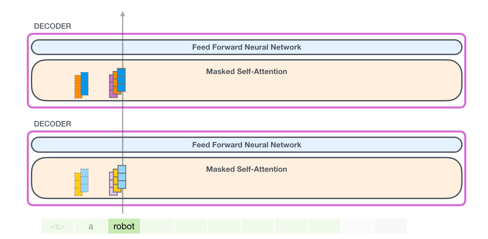
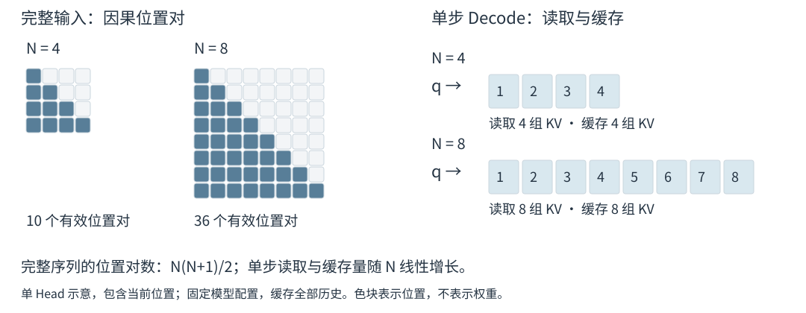
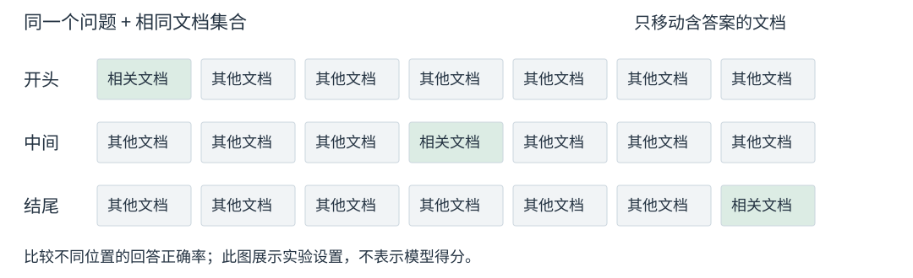

# 1.3 LLM 中的 Attention 成本与长上下文需求

Decoder-only 语言模型逐步生成文本，并通过 Attention 读取已有上下文。下面从生成与缓存机制出发，解释输入变长时的计算成本，以及有效使用长上下文所需的条件。

## 自回归生成与 KV Cache

Next-token Prediction 根据已有序列估计后续 Token 在词表上的概率分布。模型通过 Causal Self-Attention 汇总当前及此前的信息，再由输出层给出分布；系统选取一个 Token，追加到序列末尾，继续生成。这一循环称为自回归生成（Autoregressive Generation）。[Kwon et al.，§2.1—2.2](https://arxiv.org/html/2309.06180v1)

<figure align="center">

<figcaption>
图 1-7　自回归生成中的反馈循环
</figcaption>
</figure>

[原始动画](https://jalammar.github.io/images/xlnet/gpt-2-autoregression-2.gif)展示输出追加到输入的反馈过程。图中的英文词语用于示意，实际 Token 边界由 Tokenizer 决定。

每轮生成都会再次读取历史信息。Attention 层将输入表示映射为 Query、Key 和 Value：Query 与 Key 决定匹配权重，Value 提供被汇总的内容。在参数和前缀固定的 Causal Transformer 中，历史位置的表示不受后来追加内容的影响，因此各层已算出的 Key 和 Value 可以保存在 **KV Cache** 中复用。新位置只需计算自己的 QKV，并读取历史 KV。[Shazeer，§2.3—2.4](https://arxiv.org/html/1911.02150v1)

<figure align="center">

<figcaption>
图 1-8　历史 KV 的逐层复用
</figcaption>
</figure>

图中处理 `robot` 时，各层复用 `a` 的 KV，并追加当前位置的 KV。缓存减少了重复计算，也使保存全部历史时的显存占用随序列增长。

## Prefill、Decode 与长度相关的成本

**Prefill** 处理已知的提示文本（Prompt），在因果约束下计算多个位置并建立 KV Cache；模型利用最后一个位置的输出生成首个新 Token。此后每轮 **Decode** 处理刚生成的 Token，读取并更新缓存，再生成后续内容。[Kwon et al.，§2.2](https://arxiv.org/html/2309.06180v1)

<figure align="center">

<figcaption>
图 1-9　Prefill 与 Decode
</figcaption>
</figure>

图中只展示单层 Attention 的位置关系，生成概率还需经过模型后续计算及输出层。长 Prompt 可以分块执行 Prefill。[Jiang et al.，§2](https://arxiv.org/html/2310.06825v1)

在模型配置固定、采用 Dense Attention 并缓存全部历史 KV 时，完整序列的位置对计算随长度呈二次增长；单步 Decode 的历史读取量和 KV Cache 容量则随长度线性增长。图 1-10 以单个 Head 为例：序列从 4 个位置增至 8 个，因果位置对从 10 个增至 36 个，单步读取的 KV 从 4 组增至 8 组。[Vaswani et al.，Table 1](https://arxiv.org/html/1706.03762v7)；[Shazeer，§2.4](https://arxiv.org/html/1911.02150v1)

<figure align="center">

<figcaption>
图 1-10　序列长度与 Attention 成本
</figcaption>
</figure>

二次运算量与中间显存占用需要分别分析：FlashAttention 可以通过分块计算避免保存完整分数矩阵。实际延迟还取决于硬件、一次同时处理的序列数（Batch Size）和实现；小 Batch 的 Decode 可能主要受模型参数与 KV 的读取带宽限制。[Dao et al.，§3](https://arxiv.org/html/2205.14135v2)；[Shazeer，§2.4.1](https://arxiv.org/html/1911.02150v1)

## Long Context 的位置适配与信息使用

长上下文（Long Context）需要同时满足资源、位置处理和模型能力三个方面的要求。

| 方面 | 需要解决的问题 | 评估重点 |
| --- | --- | --- |
| 资源成本 | 支撑更长输入的计算、缓存和访存 | Prefill/Decode 耗时、峰值显存 |
| 位置适配 | 处理超出训练范围的位置与距离 | Position Encoding、扩展方法及训练设置 |
| 信息使用 | 从长文本中读取并利用相关信息 | 不同位置的检索、问答与信息整合 |

表 1-4　Long Context 的三个条件

例如，Position Interpolation 重映射 Rotary Position Embedding（RoPE）的位置索引，并配合适应训练扩展上下文窗口。能力评估则需要检查相关信息能否被有效使用。[Chen et al.，§2.3](https://arxiv.org/html/2306.15595v2)

Lost in the Middle 在多文档问答中移动含答案文档的位置，发现其评估模型的回答表现会随位置变化。下图用七份文档示意实验设置，未展示得分；这一结论限于论文评估的模型与任务。[Liu et al.，§3.1—3.3](https://arxiv.org/html/2307.03172v1)

<figure align="center">

<figcaption>
图 1-11　相关信息位置的对照设置
</figcaption>
</figure>

图示来源与许可见[图表来源](../../appendices/references.md#图表来源)。

下一节：[1.4 Attention 的主要改进方向与方法关系](optimization-landscape.md)。
