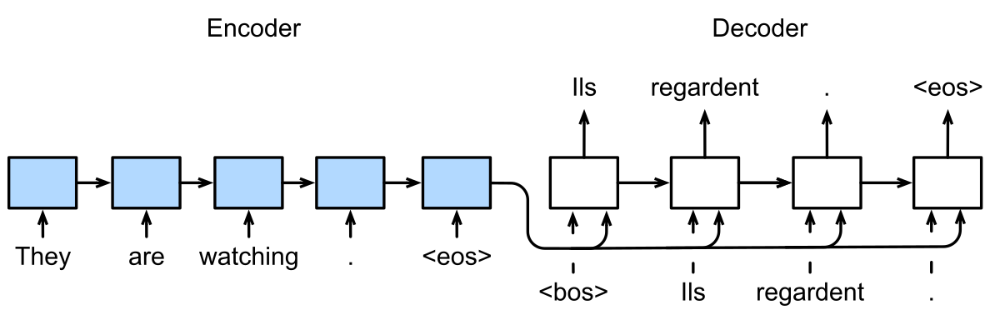
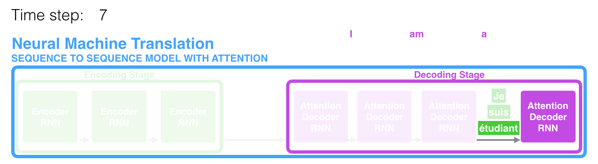
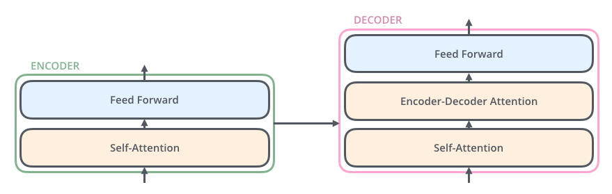

# 1.2 从 RNN 到 Transformer

在机器翻译中，模型既要表示原文，也要在生成译文时读取相关信息。本节沿这两个问题展开：先看 RNN 如何编码序列，再看 Attention 如何改善输入读取，最后说明 Self-Attention 如何成为 Transformer 的核心组件。这是一条解释关键变化的主线，并非 Attention 的完整发展史。

## RNN 中的序列表示

循环神经网络（Recurrent Neural Network，RNN）按顺序处理输入：每一步结合当前 Token 与上一步的隐藏状态，更新已读内容的表示。早期的序列到序列（Sequence-to-Sequence，Seq2Seq）模型用一个 RNN 作为编码器（Encoder）读取原文，再由另一个 RNN 作为解码器（Decoder）生成译文。

下面的例子将英语 “They are watching.” 翻译为法语 “Ils regardent.”。图中的 RNN 按时间步展开，各方框表示同一网络在不同位置的计算；Encoder 的最终状态传给 Decoder，成为生成译文的依据。`<bos>` 与 `<eos>` 分别标记序列开始和结束。[Zhang et al.，Dive into Deep Learning，§10.7](https://d2l.ai/chapter_recurrent-modern/seq2seq.html)

<figure align="center">

<figcaption>
图 1-4　RNN Encoder–Decoder
</figcaption>
</figure>

这种设计需要将原文的必要信息集中在一个固定维度的表示中。输入越长，需要保留的细节越多，单一表示就可能成为信息传递的瓶颈。这里讨论的是早期模型的一种实现，Seq2Seq 本身并不要求使用固定向量或 RNN。[Bahdanau et al.，§1—2](https://arxiv.org/html/1409.0473v7)

## Attention 按需读取输入信息

Attention 改变了 Encoder 向 Decoder 提供信息的方式：保留各输入位置的状态，在每个生成步骤重新计算权重，再将这些状态加权汇总。于是，生成不同的译文 Token 时，Decoder 可以读取不同的原文信息。

Jay Alammar 的图解以 “Je suis étudiant” 为例：译文已经生成 “I am a”，准备生成 “student” 时，对应 “étudiant” 的信息获得较高权重。颜色表示读取侧重，不是把某个词选出后丢弃其余输入；这是教学示意，不是本文运行模型得到的结果。[教程原文](https://jalammar.github.io/visualizing-neural-machine-translation-mechanics-of-seq2seq-models-with-attention/)

<figure align="center">

<figcaption>
图 1-5　翻译过程中的 Attention
</figcaption>
</figure>

Bahdanau 等人的模型采用这一动态汇总思路，但 Encoder 和 Decoder 仍是 RNN：Attention 改善了信息读取，序列表示仍需沿时间步递推。[原论文 §3](https://arxiv.org/html/1409.0473v7#S3)；计算定义见[Bahdanau Attention 的计算](../../appendices/foundations.md#bahdanau-attention-的计算)。

## Self-Attention 建模序列内部关系

另一个问题是：输入序列中的每个位置，能否直接读取其他位置的信息来更新自身表示？Self-Attention 将 Attention 用于同一序列内部；例如表示 “it” 时，可以汇总同一句话中 “animal” 所在位置的信息，而不必仅依靠状态逐步传递。

| 比较对象 | 信息如何到达当前位置 | 位置之间的计算依赖 |
| --- | --- | --- |
| RNN | 通过相邻时间步传递隐藏状态 | 当前状态依赖前一步状态 |
| Self-Attention | 按权重直接汇总允许访问的位置 | 给定该层输入后，多个位置可并行计算 |

表 1-2　RNN 与 Self-Attention

Self-Attention 在 Transformer 之前已有应用。2017 年的 Transformer 将它作为输入与输出序列内部建模的主要机制，去掉了架构中的 RNN，同时保留连接原文与译文的 Attention。这样缩短了远距离位置之间的信息传递路径，也提高了已知序列的并行处理能力；常规自回归生成仍需逐 Token 推进。[Vaswani et al.，§1—2、§4](https://arxiv.org/html/1706.03762v7)

## Transformer 的整体结构

原始 Transformer 仍采用 Encoder–Decoder 结构。下图中，竖向箭头表示层内计算，横向箭头表示 Decoder 读取 Encoder 的输出；每一侧的层可以重复堆叠。前馈网络（Feed-Forward Network，FFN）对各位置的表示分别进行变换，配合 Attention 逐层更新表示。

<figure align="center">

<figcaption>
图 1-6　Transformer 的 Encoder 与 Decoder
</figcaption>
</figure>

| Attention 所在位置 | 读取范围 | 在翻译中的作用 |
| --- | --- | --- |
| Encoder Self-Attention | 原文的全部有效位置 | 结合前后文表示原文 |
| Decoder Self-Attention | 译文当前位置及此前位置 | 处理已给定的译文前缀 |
| Encoder–Decoder Attention（Cross-Attention） | Encoder 的最终输出 | 将原文信息用于生成 |

表 1-3　Transformer 中的 Attention

Decoder 的 Self-Attention 需要限制读取范围，防止使用尚待预测的 Token，称为 Causal Self-Attention。图中未标出这一限制，也省略了残差连接与归一化；完整结构见原论文 Figure 1。“Self”与“Cross”区分信息来源，“Causal”描述访问限制，二者不是同一分类维度。[Vaswani et al.，§3.1—3.3](https://arxiv.org/html/1706.03762v7)

Transformer 的常见结构还包括侧重输入表示的 Encoder-only，以及无需独立 Encoder、根据已有文本继续生成的 Decoder-only；原始结构则称为 Encoder–Decoder。后文的大语言模型（Large Language Model，LLM）成本分析以 Decoder-only 为主，下一节先说明 Transformer 中 Attention 的计算方式。[Hugging Face，Transformer Architectures](https://huggingface.co/learn/llm-course/chapter1/6)

图示来源与许可见[首章图表来源](../../appendices/references.md#首章图表来源)。

下一节：[1.3 Transformer 中的 Attention 计算](attention-in-llms.md)。
