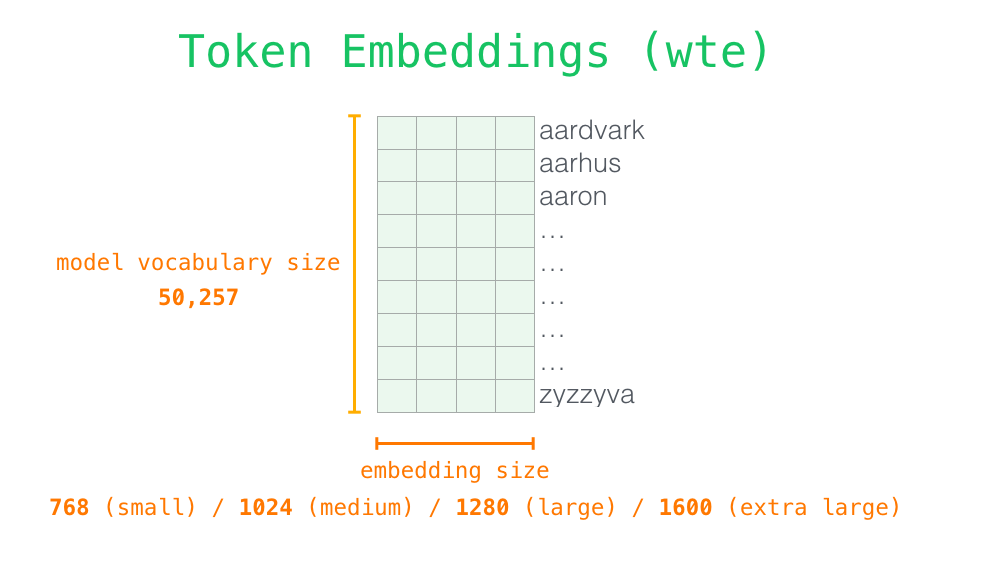

# 1.1 从 Representation Learning 到 Attention 机制

语言模型生成一句话，需要根据已有文本判断接下来可能出现什么。但文本中的信息并不彼此独立：一个词的含义可能取决于邻近的修饰语，一处代词可能指向前文的人物，回答问题所需的线索也可能分散在多个段落中。

模型如何表示这些信息，又如何将不同位置的信息联系起来？本节先介绍模型如何表示数据，再说明上下文建模的需求，以及注意力机制（Attention Mechanism）在 Transformer 与大语言模型中的作用。

## 表示学习（Representation Learning）

模型需要先将文本、图像等输入转换为可计算的数值形式，这种形式称为表示（Representation）。表示学习（Representation Learning）让模型通过训练学习这些表示，使其中的特征能够支持预测、分类等任务，而不完全依赖人工设计特征。[Goodfellow et al., 2016，Chapter 1](https://www.deeplearningbook.org/contents/intro.html)

文本中的嵌入（Embedding）是一个具体例子。分词器（Tokenizer）将文本切分为 Token，并转换为词表中的编号；嵌入层（Embedding Layer）再按编号读取参数矩阵中的一行，得到一个向量。编号用于定位，向量才参与后续网络计算。[Vaswani et al., 2017，§3.4](https://arxiv.org/html/1706.03762v7)

**Token 不固定对应一个字或一个单词。** 例如，Hugging Face 课程用英文单词 `tokenization` 说明子词分词（Subword Tokenization）：它可以拆成 `token` 和 `ization` 两个 Token，各自对应一个编号和一个向量。具体如何切分取决于所用 Tokenizer 与词表。[Hugging Face，Tokenizers：Subword tokenization](https://huggingface.co/learn/llm-course/chapter2/4?fw=pt#subword-tokenization)

图 1-1　Token Embedding 矩阵。每一行存放一个 Token 的向量，列数为向量维度；图中的词表大小和维度对应 GPT-2 系列。右侧英文单词仅作示意，不是实际词表条目的逐行展示，也不表示每个单词都是一个 Token。引自 Jay Alammar，*The Illustrated GPT-2*，Input Encoding，原图未修改，CC BY-NC-SA 4.0。[原文](https://jalammar.github.io/illustrated-gpt2/#input-encoding)；[许可](https://creativecommons.org/licenses/by-nc-sa/4.0/)。

训练时，任务误差通过反向传播影响 Embedding 等参数的更新；常规推理时，参数保持固定，根据编号取得向量。因此，表示学习不仅涉及“把文字变成数字”，更涉及这些数值如何通过训练适应任务。深度学习（Deep Learning）进一步使用多层可学习的变换提取和组合特征，使表示可以在网络中逐层更新。[Goodfellow et al., 2016，Chapter 1](https://www.deeplearningbook.org/contents/intro.html)

## 语言表示为什么需要上下文

同一个词在不同语境中可以表达不同含义。下图中的“苹果”分别指水果和公司，周围的词语提供了区分含义的线索。

图 1-2　相同词形在不同上下文中的含义。由本书使用 AI 生成的教学示意，不是真实事件照片或模型实验结果；例子不假定“苹果”一定被切分为一个 Token。

在相同词表与嵌入参数下，同一个 Token ID 查表得到的初始 Token Embedding 相同。模型需要在后续计算中结合上下文更新表示，才能区分当前语义；Attention 机制提供了在不同位置之间汇总信息的方式。[3Blue1Brown，Motivating Examples](https://www.3blue1brown.com/lessons/attention/)

## Attention 机制如何汇总信息

Attention 机制根据当前输入计算权重，并组合相应的向量。对于本书首先讨论的 Softmax Attention，可以依次理解为三个动作：比较当前位置与可访问位置的表示，将匹配分数归一化，再按权重汇总信息。正式的 Query、Key、Value 定义与计算公式留到下一节。

图 1-3　原教程中的 Self-Attention 可视化。右侧选中的是 `it`，左侧展示参与关联的输入位置；该图来自 Encoder 场景，不受自回归模型只能访问自身及前文的限制。引自 Jay Alammar，*The Illustrated Transformer*，原图未修改，CC BY-NC-SA 4.0。[原文及可视化背景](https://jalammar.github.io/illustrated-transformer/)；[许可](https://creativecommons.org/licenses/by-nc-sa/4.0/)。

图中的信息关联帮助解释 Attention 层的作用：它输出的是结合上下文的向量，而不是直接输出一条指代判断。一个 Head 的权重只描述特定层、特定输入下的一次信息汇总；模型的最终输出还取决于其他 Head、后续层与输出计算。

这种汇总是动态的。模型训练得到的投影等参数在常规推理中保持固定，但更换输入或当前位置后，匹配分数和权重会随之变化。区分“训练得到的参数”与“根据输入计算的权重”，是理解 Attention 机制的关键。[Shazeer, 2019，§2.1—2.3](https://arxiv.org/html/1911.02150v1)

## 基于 Transformer 的语言模型

Transformer 将 Attention 机制与其他网络组件组合起来，用于处理序列。大语言模型（Large Language Model，LLM）则是一类经过大规模训练的语言模型，Transformer 是构建这类模型的常用架构；LLM 这个名称本身并不限定网络结构。

原始 Transformer 包含编码器（Encoder）和解码器（Decoder）：前者计算输入序列的表示，后者结合这些表示逐步生成输出序列。由此形成三种常见结构：Encoder–Decoder 同时使用两者，Encoder-only 侧重输入表示的计算，Decoder-only 则无需单独的 Encoder，直接根据已有 Token 预测后续 Token。[Hugging Face，Transformer Architectures](https://huggingface.co/learn/llm-course/chapter1/6)

这些结构的基本层都包含 Attention 与前馈网络（Feed-Forward Network，FFN）。以图 1-4 的 Encoder 层为例，Self-Attention 汇总不同位置的信息，FFN 则对各位置的表示分别进行变换；配合残差连接与归一化，多层网络逐层更新序列表示。[Vaswani et al., 2017，§3.1—3.3](https://arxiv.org/html/1706.03762v7)

图 1-4　Encoder 层内的简化数据流。Self-Attention 进行跨位置的信息汇总，FFN 对各位置分别进行变换；图中省略了残差连接与归一化，也未展示完整模型。引自 Jay Alammar，*The Illustrated Transformer*，原图未修改，CC BY-NC-SA 4.0。[原文](https://jalammar.github.io/illustrated-transformer/)；[许可](https://creativecommons.org/licenses/by-nc-sa/4.0/)。

本书重点讨论采用 Decoder-only 架构的自回归 LLM。这里的“自回归”指模型每次根据已有文本预测下一个 Token：输出层将最后一个位置的最终表示转换为预测分数，得到下一 Token 的概率分布；生成策略据此选出一个 Token，将其加入序列，再继续预测。

为满足这一预测方式，模型使用因果自注意力（Causal Self-Attention），使每个位置只能访问自身及此前位置，不能读取尚待预测的 Token。因此，Attention 层负责汇总可用的上下文信息，输出层负责形成预测；文本生成是整个模型共同计算的结果。[Shazeer, 2019，§2.4](https://arxiv.org/html/1911.02150v1)；[Vaswani et al., 2017，§3.4](https://arxiv.org/html/1706.03762v7)

随着上下文变长，需要处理的位置关系增多；逐步生成还涉及历史计算结果的保存与复用。后续章节将分析这些成本，并说明不同方法如何调整信息表示、连接范围、计算实现和缓存管理。

延伸观看：[3Blue1Brown，Attention in transformers, step-by-step](https://www.youtube.com/watch?v=eMlx5fFNoYc)。可先配合[作者图文的 Recap 与 Motivating Examples](https://www.3blue1brown.com/lessons/attention/)理解初始表示如何结合上下文，再观看 QKV 部分。本文保留必要解释，视频不作为阅读后续内容的前提。

下一节：[1.2 Attention 机制的基本计算](attention-in-llms.md)。
