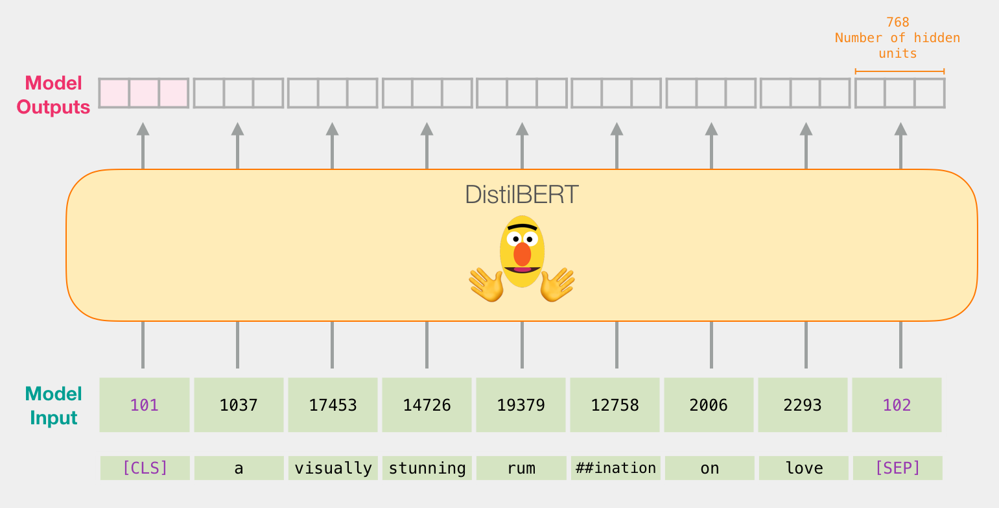
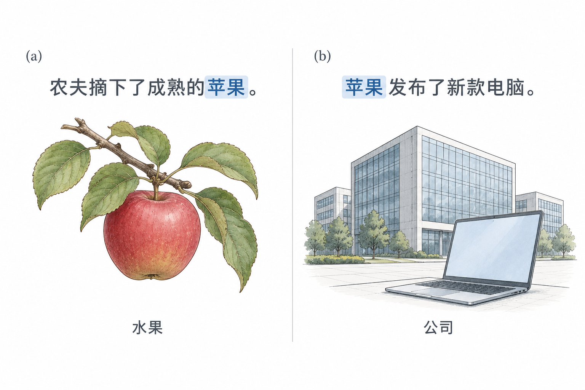
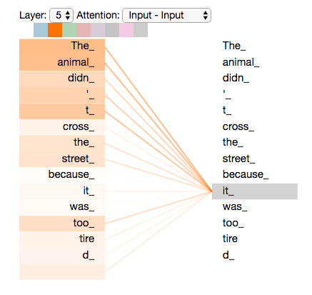

# 1.1 从 Representation Learning 到 Attention 机制

语言模型生成一句话，需要根据已有文本判断接下来可能出现什么。但文本中的信息并不彼此独立：一个词的含义可能取决于邻近的修饰语，一处代词可能指向前文的人物，回答问题所需的线索也可能分散在多个段落中。

模型如何表示这些信息，又如何将不同位置的信息联系起来？本节先介绍模型如何表示数据，再说明上下文建模的需求，以及注意力机制（Attention Mechanism）如何汇总不同位置的信息。

## 表示学习（Representation Learning）

模型需要先将文本、图像等输入转换为可计算的数值形式，这种形式称为表示（Representation）。表示学习（Representation Learning）让模型通过训练学习这些表示，使其中的特征能够支持预测、分类等任务，而不完全依赖人工设计特征。[Goodfellow et al., 2016，Chapter 1](https://www.deeplearningbook.org/contents/intro.html)

以一句英文影评为例，模型接收文本后，会将其转换为一组向量，用于后续分类或预测。图 1-1 从下向上展示了这一过程：英文文本被切分为 Token、转换为编号，再经过 DistilBERT 模型，得到各位置的输出向量。

<figure align="center">

<figcaption>
图 1-1　从文本到向量表示
</figcaption>
</figure>

图中每个输入位置对应一个 768 维输出向量，整个输入序列对应一组向量。`[CLS]` 与 `[SEP]` 分别是位于序列开头和结尾的特殊 Token。

图中的 `rumination` 被分成 `rum` 和 `##ination`，其中 `##` 表示接续同一单词的子词。因此，**Token 不固定对应一个字或一个单词**，具体切分取决于分词器（Tokenizer）及其词表。编号用于索引词表中的 Token。

模型内部，嵌入层（Embedding Layer）先按 Token 编号查找一个初始向量，后续网络再结合上下文逐层更新它。图中顶部展示的是经过模型处理后的表示；原教程进一步取 `[CLS]` 位置的输出向量作为整句的分类特征，用于判断影评情感。[Jay Alammar，教程与代码](https://jalammar.github.io/a-visual-guide-to-using-bert-for-the-first-time/)

这些表示的计算依赖训练得到的参数：训练通过优化学习目标调整参数，常规推理则使用固定参数处理新文本。深度学习（Deep Learning）使用多层可学习的变换提取和组合特征，图中的文本模型就是一个例子。[Goodfellow et al., 2016，Chapter 1](https://www.deeplearningbook.org/contents/intro.html)

## 语言表示为什么需要上下文

同一个词在不同语境中可以表达不同含义。下图中的“苹果”分别指水果和公司，周围的词语提供了区分含义的线索。

<figure align="center">

<figcaption>
图 1-2　上下文与词义
</figcaption>
</figure>

本图为 AI 生成的词义教学示意；“苹果”的 Token 切分取决于所用分词器。

在相同词表与嵌入参数下，同一个 Token ID 查表得到的初始 Token Embedding 相同。模型需要在后续计算中结合上下文更新表示，才能区分当前语义；Attention 机制提供了在不同位置之间汇总信息的方式。[3Blue1Brown，Motivating Examples](https://www.3blue1brown.com/lessons/attention/)

## Attention 机制按相关性汇总信息

Attention 机制根据当前输入计算权重，并组合相应的向量。对于本书首先讨论的 Softmax Attention，可以依次理解为三个动作：比较当前位置与可访问位置的表示，将匹配分数归一化，再按权重汇总信息。Query、Key、Value 的定义与计算公式见[第 2 章 Transformer Attention 的基本原理与计算过程](../transformer-attention/README.md)。

<figure align="center">

<figcaption>
图 1-3　Self-Attention 的信息关联
</figcaption>
</figure>

图中右侧选中 `it`，左侧为参与关联的输入位置。这是 Encoder 场景，可以读取前后文，不受自回归生成的因果限制。

Attention 层输出结合上下文的向量表示。一个 Head 的权重只描述特定层、特定输入下的一次信息汇总；模型的最终输出还取决于其他 Head、后续层与输出计算。

这种汇总是动态的。模型训练得到的投影等参数在常规推理中保持固定，但更换输入或当前位置后，匹配分数和权重会随之变化。[Shazeer, 2019，§2.1—2.3](https://arxiv.org/html/1911.02150v1)

Attention 机制可以用于不同的网络架构。下一节从 Seq2Seq 的输入读取问题出发，说明它如何进一步成为 Transformer 中序列建模的核心组件。

图示来源与许可见[图表来源](../../appendices/references.md#图表来源)。

下一节：[1.2 从 RNN 到 Transformer](from-seq2seq-to-transformer.md)。
