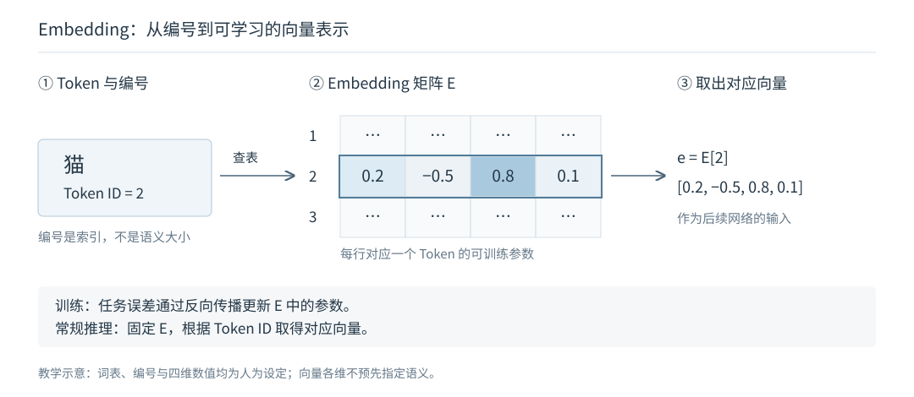

# 1.1 从 Representation Learning 到 Attention 机制

语言模型生成一句话，需要根据已有文本判断接下来可能出现什么。但文本中的信息并不彼此独立：一个词的含义可能取决于邻近的修饰语，一处代词可能指向前文的人物，回答问题所需的线索也可能分散在多个段落中。

模型如何表示这些信息，又如何将不同位置的信息联系起来？本节先介绍模型如何表示数据，再说明上下文建模的需求，以及注意力机制（Attention Mechanism）在 Transformer 与大语言模型中的作用。

## 表示学习（Representation Learning）

模型需要先将文本、图像等输入转换为可计算的数值形式，这种形式称为表示（Representation）。表示学习（Representation Learning）让模型通过训练学习这些表示，使其中的特征能够支持预测、分类等任务，而不完全依赖人工设计特征。[Goodfellow et al., 2016，Chapter 1](https://www.deeplearningbook.org/contents/intro.html)

文本中的 Embedding 是一个具体例子。Token 是文本处理单元，可以对应一个词、词的一部分或标点。分词器（Tokenizer）先将文本转换为 Token 编号，嵌入层（Embedding Layer）再用编号查找参数矩阵中的对应行，得到一个向量。编号只用于定位；向量中的数值才参与后续网络计算。[Hugging Face，Tokenizers](https://huggingface.co/learn/llm-course/chapter2/4?fw=pt)；[Vaswani et al., 2017，§3.4](https://arxiv.org/html/1706.03762v7)

图 1-1　以 Embedding 说明可学习的表示。本书依据 Transformer 原论文 §3.4 绘制；词表、编号与向量数值均为教学设定，不是模型实测结果，也不表示某一维必然对应特定语义。

训练时，任务误差通过反向传播影响 Embedding 等参数的更新；常规推理时，参数保持固定，根据编号取得向量。因此，表示学习不仅涉及“把文字变成数字”，更涉及这些数值如何通过训练适应任务。深度学习（Deep Learning）进一步使用多层可学习的变换提取和组合特征，使表示可以在网络中逐层更新。[Goodfellow et al., 2016，Chapter 1](https://www.deeplearningbook.org/contents/intro.html)

## 语言表示为什么需要上下文

同一个词在不同语境中可以表达不同含义。下图中的“苹果”分别指水果和公司，周围的词语提供了区分含义的线索。

图 1-2　相同词形在不同上下文中的含义。由本书使用 AI 生成的教学示意，不是真实事件照片或模型实验结果；例子不假定“苹果”一定被切分为一个 Token。

在相同词表与嵌入参数下，同一个 Token ID 查表得到的初始 Token Embedding 相同。模型需要在后续计算中结合上下文更新表示，才能区分当前语义；Attention 机制提供了在不同位置之间汇总信息的方式。[3Blue1Brown，Motivating Examples](https://www.3blue1brown.com/lessons/attention/)

## Attention 机制如何汇总信息

Attention 机制根据当前输入计算权重，并组合相应的向量。对于本书首先讨论的 Softmax Attention，可以依次理解为三个动作：比较当前位置与可访问位置的表示，将匹配分数归一化，再按权重汇总信息。正式的 Query、Key、Value 定义与计算公式留到下一节。

图 1-3　原教程中的 Self-Attention 可视化。右侧选中的是 `it`，左侧展示参与关联的输入位置；该图来自 Encoder 场景，不受自回归模型只能访问自身及前文的限制。引自 Jay Alammar，*The Illustrated Transformer*，原图未修改，CC BY-NC-SA 4.0。[原文及可视化背景](https://jalammar.github.io/illustrated-transformer/)；[许可](https://creativecommons.org/licenses/by-nc-sa/4.0/)。

图中的信息关联帮助解释 Attention 层的作用：它输出的是结合上下文的向量，而不是直接输出一条指代判断。一个 Head 的权重只描述特定层、特定输入下的一次信息汇总；模型的最终输出还取决于其他 Head、后续层与输出计算。

这种汇总是动态的。模型训练得到的投影等参数在常规推理中保持固定，但更换输入或当前位置后，匹配分数和权重会随之变化。区分“训练得到的参数”与“根据输入计算的权重”，是理解 Attention 机制的关键。[Shazeer, 2019，§2.1—2.3](https://arxiv.org/html/1911.02150v1)

## Attention 机制在 Transformer 与 LLM 中的位置

Attention 是一种计算机制，Transformer 是组织这些计算的网络架构。Self-Attention 在同一序列的位置之间汇总信息，前馈网络（Feed-Forward Network，FFN）则对各位置的表示分别进行变换。残差连接与归一化等组件也参与层内计算；多层网络进一步更新表示。[Vaswani et al., 2017，§3.1—3.3](https://arxiv.org/html/1706.03762v7)

图 1-4　Encoder 层内的简化数据流。先观察 Self-Attention 的跨位置计算，再观察 FFN 的逐位置变换；图中省略了残差连接与归一化。该图用于定位组件，不是 Decoder-only LLM 的完整架构。引自 Jay Alammar，*The Illustrated Transformer*，原图未修改，CC BY-NC-SA 4.0。[原文](https://jalammar.github.io/illustrated-transformer/)；[许可](https://creativecommons.org/licenses/by-nc-sa/4.0/)。

本书主要讨论基于 Transformer 的自回归大语言模型（Large Language Model，LLM）。生成时，模型根据已有文本计算下一个 Token 的概率，生成策略据此选择一个 Token，将其加入上下文，再继续预测。Decoder-only 架构直接处理这一序列，无需另设用于编码输入序列的 Encoder。

在这种架构中，Causal Self-Attention 只允许当前位置访问自身及此前位置；最后一个位置的最终表示用于计算下一 Token 的概率。Attention 层参与上下文信息汇总，输出层负责将最终表示转换为预测分数，二者承担不同作用。[Shazeer, 2019，§2.4](https://arxiv.org/html/1911.02150v1)；[Vaswani et al., 2017，§3.4](https://arxiv.org/html/1706.03762v7)

这些概念分别描述不同层面：深度学习是一类机器学习方法，Transformer 是网络架构，Attention 是计算机制，LLM 是模型类别。LLM 不规定唯一架构，Attention 机制也可以用于其他模型和任务。

随着上下文变长，需要处理的位置关系增多；逐步生成还涉及历史计算结果的保存与复用。后续章节将分析这些成本，并说明不同方法如何调整信息表示、连接范围、计算实现和缓存管理。

延伸观看：[3Blue1Brown，Attention in transformers, step-by-step](https://www.youtube.com/watch?v=eMlx5fFNoYc)。可先配合[作者图文的 Recap 与 Motivating Examples](https://www.3blue1brown.com/lessons/attention/)理解初始表示如何结合上下文，再观看 QKV 部分。本文保留必要解释，视频不作为阅读后续内容的前提。

下一节：[1.2 Attention 机制的基本计算](attention-in-llms.md)。
