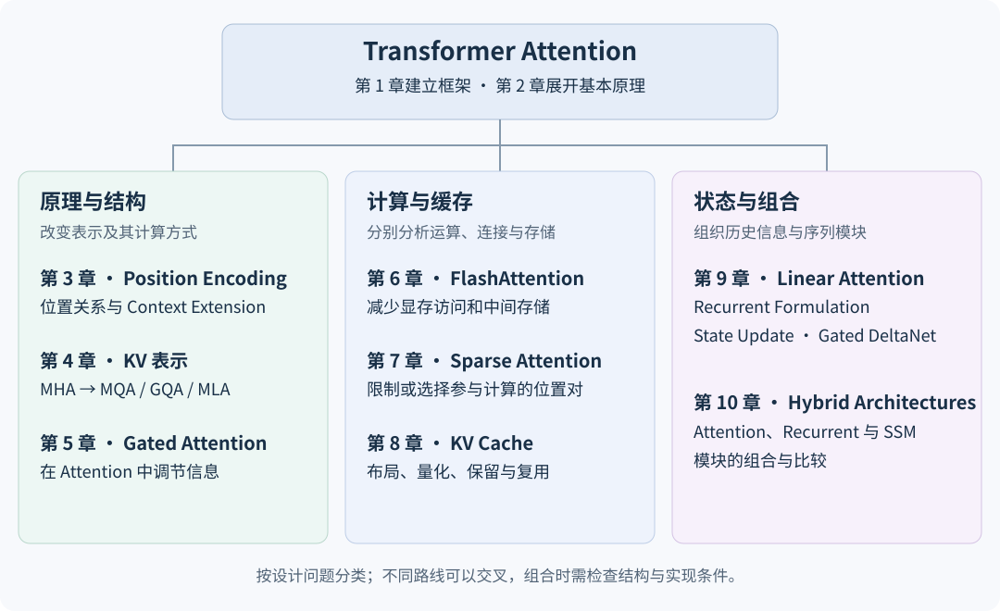

# 1.5 Attention 的结构改进、计算优化与架构扩展

Attention 方法可按其改变的计算对象分类。调整 KV 表示、减少位置对、重排 GPU 计算与改变状态更新，解决的是不同问题；方法名称相近不代表作用相同。

图 1-1e　本书绘制的技术路线图，用于定位设计问题与后续章节，不表示历史继承关系。

## 按设计问题定位方法

| 设计问题 | 代表路线 | 主要改变 | 后续章节 |
| --- | --- | --- | --- |
| 位置如何影响计算 | RoPE、ALiBi、Context Extension | 位置相关表示、分数或使用范围 | [第 3 章 Position Encoding 的演进与 Context Extension](../position-encoding/README.md) |
| KV 如何表示 | MQA、GQA、MLA | Head 共享或 Latent 表示 | [第 4 章 Key–Value 表示优化：MHA、MQA、GQA 与 MLA](../kv-representations/README.md) |
| Attention 输出如何调节 | Gated Attention | 在特定计算位置引入 Gate | [第 5 章 Softmax Attention 的结构改进：Gated Attention](../gated-attention/README.md) |
| 运算怎样在硬件上执行 | FlashAttention | 分块、在线归一化及中间数据管理 | [第 6 章 FlashAttention：Exact Attention 的 IO 优化](../flash-attention/README.md) |
| 哪些位置之间建立连接 | Sparse Attention | 允许或选择参与计算的位置对 | [第 7 章 Sparse Attention 的连接模式与动态选择](../sparse-attention/README.md) |
| 历史 KV 怎样存储和复用 | PagedAttention、量化、淘汰、共享 | 布局、精度、保留范围或复用方式 | [第 8 章 KV Cache 的存储管理与推理优化](../kv-cache/README.md) |
| 历史怎样进入状态 | Linear Attention、Gated DeltaNet | 用状态更新与读取组织计算 | [第 9 章 Linear Attention 的 Recurrent Formulation 与 State Update](../linear-attention/README.md) |
| 不同序列模块怎样组合 | Hybrid Architectures | Layer 或模块的组合 | [第 10 章 Hybrid Architectures 的结构设计与方法比较](../hybrid-architectures/README.md) |

下文给出这些分类的具体依据。表中的分组用于定位问题，不要求一个方法只能属于一组。

## KV 表示与 KV 管理

MQA 让多个 Query Head 共用一组 Key 和 Value；GQA 为每组 Query Head 分配一组 KV。两者改变模型的 Head 组织。[Shazeer, 2019，§3](https://arxiv.org/html/1911.02150v1)；[Ainslie et al., 2023，§2.2](https://arxiv.org/html/2305.13245v3)

图 1-5　MHA、GQA 与 MQA 的 Head 组织，引用自 Ainslie et al.，Figure 2，CC BY 4.0。图中 Query Head 数保持一致，KV Head 数随共享方式变化；减少 KV Head 不等于按同样比例减少 Query 的读取次数。[原图及出处](https://arxiv.org/html/2305.13245v3)

MLA 联合压缩 Key 与 Value 的表示，推理时缓存压缩后的 Latent 及必要的位置相关信息。它与 Head 共享的实现方式不同。[DeepSeek-AI, 2024，§2.1](https://arxiv.org/html/2405.04434v5)

PagedAttention 则允许 KV Cache 存储在不连续的物理块中，通过逻辑块到物理块的映射读取。它主要处理分配、碎片和共享问题；单纯采用分页布局并不删除历史 Token，也不等于 KV 量化。[Kwon et al., 2023，§4.1—4.2](https://arxiv.org/html/2309.06180v1)

## Exact Attention 与 Sparse Attention

FlashAttention 通过 Tiling、Online Softmax 等方式减少显存与片上存储之间的数据传输（Input/Output，IO），保持目标 Attention 运算的数学结果。这里的 Exact 表示没有为减少连接或替换核函数而引入近似；浮点运算顺序不同仍可能产生数值差异。[Dao et al., 2022，§3.1、Theorem 1](https://arxiv.org/html/2205.14135v2)

Sparse Attention 改变允许参与计算的位置对。固定模式可以采用局部窗口或块状连接；动态模式还需要决定当前输入应该选择哪些位置或块。[Child et al., 2019，§4](https://arxiv.org/html/1904.10509v1)；[Yuan et al., 2025，§3](https://arxiv.org/html/2502.11089v1)

| 比较项 | FlashAttention 的 Dense 路径 | Sparse Attention |
| --- | --- | --- |
| 是否保留 Dense Attention 的目标连接 | 保留给定 Mask 下的连接 | 按稀疏规则减少连接 |
| 主要节省的资源 | 中间矩阵读写与存储 | 被省略位置对的计算 |
| 需要注意的成本 | 硬件、数据布局与 Kernel 实现 | 选择开销、不规则访存及质量变化 |

这两类思路可以结合。减少连接之后，剩余连接仍需要有效的计算实现；FlashAttention 原论文也讨论了 Block-Sparse 扩展。[Dao et al., 2022，§3.3](https://arxiv.org/html/2205.14135v2)

## Position Encoding 与 Context Extension

RoPE 通过位置相关的旋转作用于 Query 和 Key，使它们的匹配包含相对位置关系；Attention with Linear Biases（ALiBi）向 Attention 分数加入与距离相关的线性偏置。它们改变位置信息进入计算的方式，不直接消除 Dense Attention 的位置对计算。[Su et al., 2021，§3.2](https://arxiv.org/html/2104.09864v5)；[Press et al., 2021，§3](https://arxiv.org/html/2108.12409v2)

Context Extension 还涉及位置范围、训练数据长度和适应训练。修改位置处理之后，仍需重新检查目标长度上的能力与资源成本。

## 从显式历史到状态更新

一个基本的 Causal Linear Attention 构造使用非负特征映射 $$\phi:\mathbb{R}^{d_k}\to\mathbb{R}^{d_\phi}$$，维护：

$$
\begin{aligned}
S_t&=S_{t-1}+\phi(k_t)v_t^\top,\\
z_t&=z_{t-1}+\phi(k_t),\\[4pt]
o_t^\top&=\frac{\phi(q_t)^\top S_t}{\phi(q_t)^\top z_t}.
\end{aligned}
$$

其中 $$q_t,k_t\in\mathbb{R}^{d_k}$$、$$v_t\in\mathbb{R}^{d_v}$$ 均按列向量书写；$$S_t\in\mathbb{R}^{d_\phi\times d_v}$$，$$z_t\in\mathbb{R}^{d_\phi}$$，初始状态为零，分母需非零。状态累积历史信息，读取时无需再次逐个访问全部历史 KV。固定特征与状态维度后，该构造的状态大小不随序列长度增加。[Katharopoulos et al., 2020，§3.2—3.4](https://proceedings.mlr.press/v119/katharopoulos20a/katharopoulos20a.pdf)

从显式历史求和到上述递推式的步骤见[附录 A 英文术语、数学符号与补充推导](../../appendices/foundations.md)。固定大小描述的是逐步推理时的状态，不表示训练时所有 Token 的激活存储也为常数。

上述递推依赖可分解的核形式。标准 Softmax Attention 不具备同样的分解，不能通过交换矩阵乘法顺序直接得到这一固定大小状态的实现。后续方法还会改变状态的衰减、写入与更新方式。

Gated DeltaNet 将控制状态衰减的 Gate 与 Delta Rule 结合；Softmax Attention 中的输出 Gating 则调节某个位置的中间结果。两者的 Gate 作用对象不同。[Yang et al., 2024，§3.1，式 (8)](https://arxiv.org/html/2412.06464v1)；[Qiu et al., 2025，§2.2](https://arxiv.org/html/2505.06708v1)

## Hybrid Architectures

Hybrid 设计允许模型在不同 Layer 或模块中使用不同的序列运算，例如将 Attention 与状态更新模块组合。收益取决于组合位置、比例、训练和实现，不能仅凭“混合”推断能力或速度更好。Mamba-2 论文研究了 Structured State Space Duality（SSD）对应的状态模块、Attention 和 Multi-Layer Perceptron（MLP）的组合，提供了具体实例。[Dao & Gu, 2024，§9.2.3](https://arxiv.org/html/2405.21060v1)

下一节：[1.6 主要技术路线的演进关系与比较维度](evolution-and-comparison.md)。
