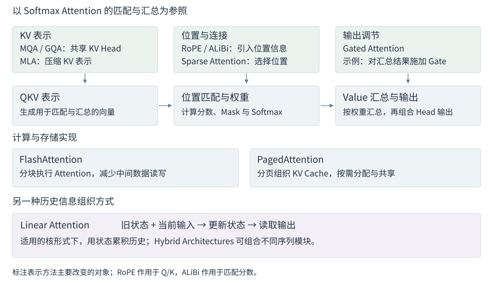

# 1.4 Attention 机制的主要发展方向与技术路线

Attention 的发展围绕模型能力和资源成本展开：模型需要识别位置关系、利用相关信息，同时控制长序列的计算与缓存开销。理解各条路线，可以从它们改变的计算环节入手。

Transformer 的 Attention 层先生成 QKV 表示，再计算匹配权重并汇总 Value。位置处理影响匹配，KV 设计影响历史信息的表示，连接模式决定读取范围；计算实现和缓存管理则决定这些操作如何在硬件上执行。图 1-12 将代表方法放在相应位置，后文依次解释其作用。

<figure align="center">

<figcaption>
图 1-12　Attention 方法的主要改进位置
</figcaption>
</figure>

## 改善位置表达与信息使用

Attention 根据内容计算匹配权重，序列建模还需要利用词语的顺序和距离。**Position Encoding** 将位置信息引入计算：RoPE 对 Query 和 Key 施加位置相关的旋转，ALiBi 在匹配分数中加入距离偏置。Context Extension 在此基础上处理更长的位置范围，并结合训练与评估确认长文本能力。[Su et al.，§3.2](https://arxiv.org/html/2104.09864v5)；[Press et al.，§3](https://arxiv.org/html/2108.12409v2)；[Chen et al.，§2.3](https://arxiv.org/html/2306.15595v2)

信息汇总后，还可以通过 **Gating** 调节其传递。例如，Qiu et al. 研究的一种设计根据当前输入生成 Gate，对每个 Head 的 Attention 汇总结果逐元素缩放。它改变输出的调节方式，具体收益需要结合 Gate 位置、模型和训练条件评估。[Qiu et al.，§2.2](https://arxiv.org/html/2505.06708v1)

位置处理与 Gating 分别展开于[第 3 章 Position Encoding 的演进与 Context Extension](../position-encoding/README.md)和[第 5 章 Gated Attention 的结构与作用](../gated-attention/README.md)。

## 降低历史信息的存储与读取成本

标准 Multi-Head Attention 中，每个 Head 独立执行一组匹配与汇总。生成时，多个 Head 都要读取历史 KV；历史越长，保存和访问这些向量的成本越高。改进可以作用于三个对象：每个位置保存的 KV、允许读取的位置，以及累积历史信息的方式。

| 改变的对象 | 代表方法 | 具体变化 | 需要评估的代价 |
| --- | --- | --- | --- |
| 每个位置的 KV 表示 | MQA、GQA、MLA | MQA/GQA 共享 KV Head；MLA 使用压缩表示 | 表示容量、训练适应与实现成本 |
| 可读取的位置 | Sparse Attention | 用窗口、块或动态选择减少参与计算的位置 | 信息覆盖、选择开销与模型质量 |
| 历史信息的累积方式 | Linear Attention | 在适用的核形式下更新状态，再从状态读取 | 状态容量、更新规则与检索能力 |

表 1-5　历史信息的三类改进

Multi-Query Attention（MQA）让 Query Head 共用一组 KV，Grouped-Query Attention（GQA）按组共享，Multi-Head Latent Attention（MLA）则使用压缩后的 Latent 表示；具体结构见[第 4 章 MQA、GQA 与 MLA 的 KV 表示优化](../kv-representations/README.md)。[Shazeer，§3](https://arxiv.org/html/1911.02150v1)；[Ainslie et al.，§2.2](https://arxiv.org/html/2305.13245v3)；[DeepSeek-AI，§2.1](https://arxiv.org/html/2405.04434v5)

Sparse Attention 保留按位置读取的计算方式，通过减少连接降低配对与读取开销；未选中的 KV 仍可能为后续 Query 保留，因此连接稀疏度与缓存容量需要分别统计。具体见[第 7 章 Sparse Attention 的连接模式与动态选择](../sparse-attention/README.md)。Linear Attention 则可将历史累积到固定维度的状态，逐步推理时的状态大小不随历史长度增加；其核形式、递推条件和更新方法见[第 9 章 Linear Attention 的 Recurrent Formulation 与 State Update](../linear-attention/README.md)。[Child et al.，§4](https://arxiv.org/html/1904.10509v1)；[Katharopoulos et al.，§3.2—3.4](https://proceedings.mlr.press/v119/katharopoulos20a/katharopoulos20a.pdf)

## 提高计算与存储效率

即使采用相同的 Attention 运算，执行顺序和数据布局也会影响速度与显存占用。**FlashAttention** 通过分块计算和 Online Softmax 减少显存与片上存储之间的数据传输，避免保存完整的分数矩阵，保持目标运算的数学结果；浮点计算顺序改变仍可能带来数值差异。其 Dense 路径依然计算给定 Mask 下的位置对。[Dao et al.，§3.1](https://arxiv.org/html/2205.14135v2)

**PagedAttention** 处理 KV Cache 的物理存储：用逻辑块到物理块的映射组织缓存，支持按需分配与共享，减少碎片。分页保留缓存内容和数值精度；KV 量化、淘汰则分别改变精度和历史保留范围，需要同时评估模型质量。[Kwon et al.，§4.1—4.2](https://arxiv.org/html/2309.06180v1)

| 方法 | 主要优化对象 | 评估重点 |
| --- | --- | --- |
| FlashAttention | Attention 中间数据的读写与存储 | 指定硬件、长度和精度下的执行时间与显存 |
| PagedAttention | KV Cache 的分配与共享 | 缓存利用率、请求并发、吞吐与延迟 |

表 1-6　计算实现与缓存管理

Prefix Caching 复用相同前缀已有的计算结果，Offloading 则在 GPU 与其他存储层之间迁移数据；二者分别涉及复用条件和传输成本。上述计算实现与缓存策略分别见[第 6 章 FlashAttention 的计算与 IO 优化](../flash-attention/README.md)和[第 8 章 KV Cache 的存储管理与推理优化](../kv-cache/README.md)。

## 组合方法并评估整体效果

不同方法可以共同作用于一个模型。Mistral 7B 同时采用 GQA 与 Sliding Window Attention：前者减少 KV Head 数，后者限制每层直接读取的位置范围。组合能否有效执行，还取决于计算实现对 Head 分组、Mask 和缓存布局的支持。[Jiang et al.，§2](https://arxiv.org/html/2310.06825v1)

**Hybrid Architectures** 在同一模型中组合不同的序列模块。例如，Gemma 2 交替使用 Local Attention 与 Full Attention 层；DeltaNet 的混合模型组合 Linear Attention 与局部或全局 Attention；Mamba-2 的混合模型则组合 State Space Model（SSM）与 Attention 层。[Gemma Team，§2](https://arxiv.org/html/2408.00118v3)；[Yang et al.，§3.4](https://arxiv.org/html/2406.06484v2)；[Dao & Gu，§9.2.3](https://arxiv.org/html/2405.21060v1)

组合比例、层间表示及状态维护都影响最终效果，详见[第 10 章 Hybrid Architectures 的结构设计与方法比较](../hybrid-architectures/README.md)。

比较结果时，应同时记录模型能力与资源收益，并明确测量对象：

| 测量对象 | 主要指标 | 必要条件 |
| --- | --- | --- |
| 模型能力 | 任务质量、长文本检索与信息整合 | 数据、训练预算、输入长度与相关信息位置 |
| Prefill / Decode | 耗时、每步延迟、峰值显存 | 输入输出长度、Batch Size、硬件与精度 |
| 服务系统 | 吞吐、并发与延迟 | 请求分布、缓存策略和延迟约束 |

表 1-7　方法比较的基本条件

技术时间线和详细比较条件见[附录 B 技术演进时间线与方法对照表](../../appendices/timeline.md)，图示来源见[图表来源](../../appendices/references.md#图表来源)。

下一章：[第 2 章 Transformer Attention 的基本原理与计算过程](../transformer-attention/README.md)。
