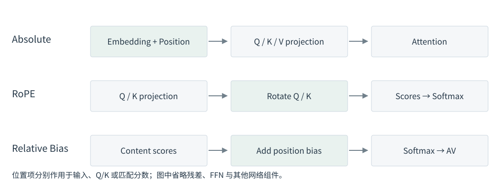

# 3.1 Attention 中的顺序与位置信息

`Alice follows Bob` 与 `Bob follows Alice` 包含相同的词，但关系方向相反。模型既需要识别内容，也需要知道内容在序列中的排列。这里以词语说明语序；实际 Token 划分由 tokenizer 决定。

## 内容匹配与顺序建模

先考虑不含位置编码、Mask 和 dropout 的单个 Self-Attention Head。将该算子记为 $$F$$，输入为 $$X$$，投影得到 $$Q,K,V$$；用置换矩阵 $$P$$ 同时重排输入行，投影结果随之变为 $$PQ,PK,PV$$。于是：

$$
\begin{aligned}
F(PX)
&=\operatorname{softmax}_{\mathrm{row}}\!\left(\frac{PQK^\top P^\top}{\sqrt d}\right)PV\\
&=P\operatorname{softmax}_{\mathrm{row}}\!\left(\frac{QK^\top}{\sqrt d}\right)V
=PF(X).
\end{aligned}
$$

重排输入只会相应重排输出，这称为 **Permutation Equivariance**。上式由矩阵乘法和逐行 Softmax 直接推得：在这些条件下，算子通过内容计算位置间的联系，没有额外的顺序信号。Position Encoding 为这种计算加入位置或距离信息。[Vaswani et al.，§3.5](https://arxiv.org/html/1706.03762v7)；[D2L，§11.6.3](https://d2l.ai/chapter_attention-mechanisms-and-transformers/self-attention-and-positional-encoding.html)

## Causal Mask 与位置表示

Decoder 的 Causal Mask 规定位置 $$i$$ 只能读取 $$j\le i$$ 的内容。这个固定三角结构本身与顺序有关，因此上面的无 Mask 置换等变推导不能直接套用于 Causal Attention。

但 Mask 主要回答「是否允许读取」，位置表示还可以影响「怎样匹配」。例如某个 Query 对三个合法 Key 的内容点积相同，单靠 Causal Mask 不会为这三个 Key 赋予不同的距离偏好；加入 ALiBi 的距离项后，其分数就会按距离改变。后者的计算在 3.3 展开。

| 信息 | 作用对象 | 例子 |
| --- | --- | --- |
| 内容 | Q/K 匹配与 V 汇总 | 两个位置的表示是否匹配 |
| 可见范围 | Mask | 当前 Query 能否读取某个 Key |
| 位置或距离 | 输入表示、Q/K 或分数 | Key 位于哪里、与 Query 相距多远 |

表 3-2　内容、可见范围与位置信息

## 位置信息进入计算的三种方式

后面的主要方法可以按作用位置理解：

<figure align="center">

<figcaption>
图 3-1　位置信息的作用位置
</figcaption>
</figure>

Absolute Position Encoding 通常给输入位置一个向量；RoPE 对投影后的 Q/K 施加随位置变化的旋转；T5 Relative Bias 与 ALiBi 则在 Softmax 前加入位置相关分数。Shaw 方法还允许把相对位置向量加入 Value 汇总，下一节会单独说明。[Vaswani et al.，§3.5](https://arxiv.org/html/1706.03762v7)；[Shaw et al.，§3](https://aclanthology.org/N18-2074.pdf)；[Raffel et al.，§2.1](https://arxiv.org/html/1910.10683v4)

图示来源见[图表来源](../../appendices/references.md#图表来源)。

下一节：[3.2 Absolute 与 Relative Position Encoding](absolute-and-relative.md)。
