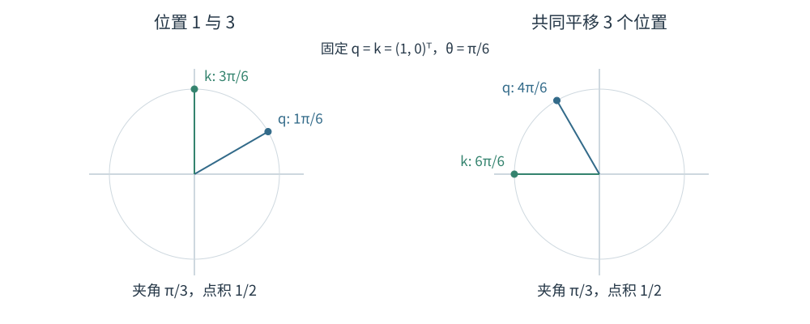
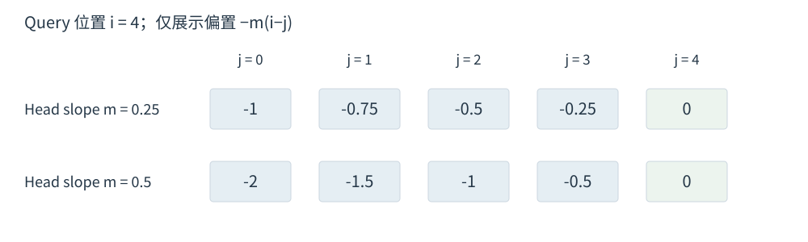

# 3.3 RoPE 与 ALiBi 的位置建模

RoPE 与 ALiBi 都把位置信息带入 Attention 匹配，但采用不同的计算方式：RoPE 旋转 Q/K 的成对维度，ALiBi 直接给分数加上距离偏置。理解它们的区别，需要分别观察向量和分数如何变化。

## RoPE 将位置转化为旋转角度

Rotary Position Embedding（RoPE）先计算内容向量 $$q_i,k_j\in\mathbb{R}^d$$，再施加旋转。设 $$d$$ 为偶数，第 $$r$$ 对相邻维度的角频率为 $$\theta_r=b^{-2r/d}$$，其中 $$r=0,\ldots,d/2-1$$；原始 RoPE 取 $$b=10000$$。

对任一二维列向量，旋转矩阵为：

$$
R(\alpha)=\begin{bmatrix}\cos\alpha&-\sin\alpha\\\sin\alpha&\cos\alpha\end{bmatrix}.
$$

将各维度对的旋转组合为分块对角矩阵 $$R_i=\operatorname{diag}(R(i\theta_0),\ldots,R(i\theta_{d/2-1}))$$，得到：

$$
\widetilde q_i=R_iq_i,\qquad \widetilde k_j=R_jk_j.
$$

旋转保留向量长度，只改变方向。高频维度每前进一个位置转过更大角度，低频维度变化较慢。[Su et al.，§3.2，式 (13)—(15)](https://arxiv.org/html/2104.09864v5)

<figure align="center">

<figcaption>
图 3-3　RoPE 的共同旋转与相对角度
</figcaption>
</figure>

## 相对位置来自旋转矩阵的乘积

对固定的内容向量 $$q_i,k_j$$，旋转后的点积满足：

$$
\widetilde q_i^\top\widetilde k_j
=q_i^\top R_i^\top R_jk_j
=q_i^\top R_{j-i}k_j.
$$

原因是每个二维块都有 $$R(\alpha)^\top R(\beta)=R(\beta-\alpha)$$。位置在点积中以偏移 $$j-i$$ 出现；两端位置共同平移时，点积保持不变。图 3-3 固定内容向量展示的就是这一性质。[Su et al.，§3.2.2](https://arxiv.org/html/2104.09864v5)

例如取 $$q=k=(1,0)^\top$$、单对维度的 $$\theta=\pi/6$$：位置 1 与 3 的点积为 $$\cos(2\theta)=1/2$$；改到位置 4 与 6，结果仍为 $$1/2$$。这是教学设定，实际 Head 由多个不同频率的维度对组成。

这个结论限定了**位置变换的形式**。深层 Q/K 已包含前层上下文，移动文本还可能改变其内容表示；RoPE 也不保证单个点积随距离单调下降。上述二维例子产生的是余弦曲线，足以说明周期变化。长度泛化仍需要单独检验。

标准做法是在 Q/K 上应用 RoPE，V 保留为内容向量。实现可以把相邻维度配对，也可以在相应参数排列下将前后半段配对；加载模型时必须匹配其既定维度布局。固定位置规则下，已旋转的 Key 可以缓存；频率改变时的处理见下一节。

## ALiBi 给距离增加线性惩罚

Attention with Linear Biases（ALiBi）为每个 Head 设置固定正斜率 $$m_a$$。在本章的 Causal Attention 约定下：

$$
s^{(a)}_{ij}=\frac{(q_i^{(a)})^\top k_j^{(a)}}{\sqrt d}-m_a(i-j)+M_{ij},
\qquad j\le i.
$$

距离越远，附加项越负；不同斜率使各 Head 的距离偏好不同。偏置加在缩放后的内容分数上，随后统一做 Softmax。斜率在原方法中预先设定，不通过训练更新。[Press et al.，§3 及脚注 9—10](https://arxiv.org/html/2108.12409v2)

<figure align="center">

<figcaption>
图 3-4　ALiBi 的距离偏置
</figcaption>
</figure>

图中只展示偏置。如果两个合法 Key 的内容分数相同，较近位置会获得较高权重；内容分数不同，则最终权重由内容与距离共同决定。因此，ALiBi 的距离惩罚构成偏好，并不把远处信息直接屏蔽。

| 比较项 | RoPE | ALiBi |
| --- | --- | --- |
| 作用对象 | 投影后的 Q/K | Softmax 前的分数 |
| 位置关系 | 多频率旋转形成相对相位 | 距离乘以 Head 固定斜率 |
| 对向量的影响 | 纯旋转保留 Q/K 的范数 | 不直接变换 Q/K |
| 距离偏好 | 由频率和内容向量共同决定 | 明确加入线性 recency bias |
| 长序列问题 | 未见相位组合及距离范围需要适配 | 可计算更远偏置，效果仍依赖训练与评估 |

表 3-4　RoPE 与 ALiBi 的计算差异

图示来源见[图表来源](../../appendices/references.md#图表来源)。

下一节：[3.4 RoPE Scaling 与上下文扩展](context-extension.md)。
