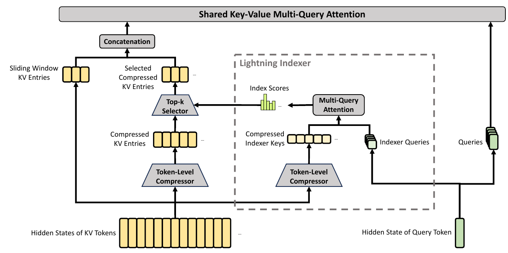
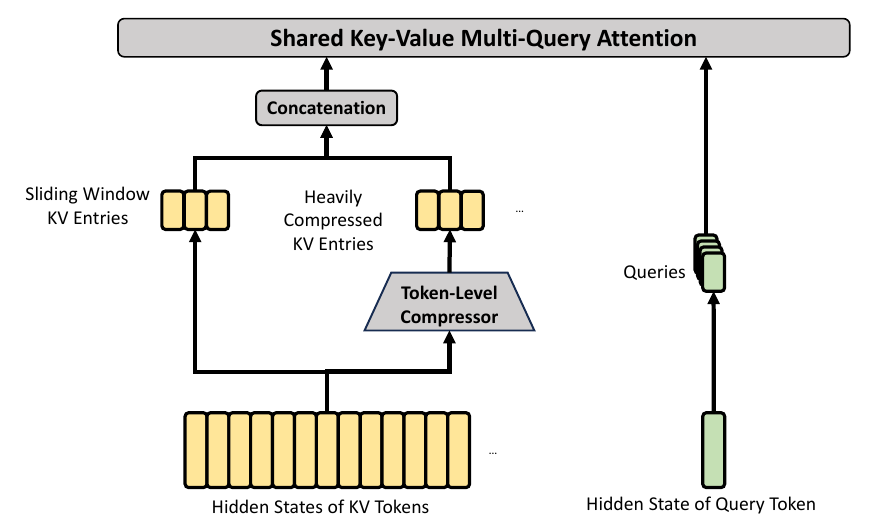

# 7.5 DeepSeek-V4 的 CSA 与 HCA

上一节的 DSA 通过 Indexer 减少本次读取，但仍保存供后续查询的历史条目。DeepSeek-V4 在这一设计基础上进一步压缩条目数量，提出 Compressed Sparse Attention（CSA）与 Heavily Compressed Attention（HCA），并在模型中交替使用。这两个名称对应 DeepSeek-V4 报告中的具体架构；本节借此说明序列压缩如何与稀疏选择、局部窗口共同工作。[DeepSeek-V4，§2.3](https://arxiv.org/html/2606.19348v1#S2.SS3)

## CSA 在压缩历史中选择条目

CSA 先将一组位置汇总为一个 KV 条目，再由当前 Query 选择部分条目。它保留了输入相关的选择能力，同时缩短索引需要扫描的历史序列。

图 7-4 中，下方的 Token-Level Compressor 汇总历史表示；右侧 Lightning Indexer 生成选择分数；左侧 Top-k Selector 决定主 Attention 读取的压缩条目。局部窗口中的原始 KV 同时参与计算，保留近期细节。

<figure>

<figcaption>
图 7-4　CSA 的压缩与稀疏选择
</figcaption>
</figure>

计算按三个步骤进行：[§2.3.1，式（9）—（19）](https://arxiv.org/html/2606.19348v1#S2.SS3.SSS1)

1. **压缩历史。** 每前进 $$m$$ 个 Token 产生一个条目。CSA 使用当前块与前一块的两组投影，按通道归一化压缩权重，再加权汇总。相邻条目的输入有重叠；压缩后的条目数约为原长度的 $$1/m$$，每个条目通常涉及 $$2m$$ 个位置。
2. **选择条目。** Indexer 使用独立的压缩 Key，为当前 Query 的候选历史块评分。其打分结构沿用 DSA，Top-k 的对象改为压缩条目。
3. **读取信息。** 主 Attention 在选中条目上重新计算权重。这里使用 Shared Key-Value MQA：各 Query Head 共享同一组条目，同一个压缩向量同时承担 Key 与 Value 的作用。

NSA 的 Selection 分支读取选中块内的原始 KV；CSA 读取选中的压缩 KV。前者保留被选区域的逐位置细节，后者同时减少历史条目数量与本次读取数量。CSA 的序列压缩也与第四章 MLA 的表示维度压缩有所不同：两者改变张量的不同维度。

## HCA 读取全部压缩历史

HCA 将更长的、不重叠的块压缩为单个 KV 条目，省去 Indexer，直接在全部因果可见的压缩条目上执行 Attention。图 7-5 保留了局部窗口分支，压缩历史负责较远的信息，未压缩窗口负责近期位置。[§2.3.2—2.3.3](https://arxiv.org/html/2606.19348v1#S2.SS3.SSS2)

<figure>

<figcaption>
图 7-5　HCA 的压缩历史与局部窗口
</figcaption>
</figure>

报告中的 CSA 压缩率为 $$m=4$$、最多选择 512 个压缩条目；HCA 压缩率为 $$m'=128$$，两者局部窗口均为 128。DeepSeek-V4 在模型内部交替使用 CSA 与 HCA 层。具体起始层配置因 Flash 与 Pro 而异。[§4.2.1](https://arxiv.org/html/2606.19348v1#S4.SS2.SSS1)

| 机制 | 历史表示 | 当前 Query 的读取集合 | 主要代价 |
| --- | --- | --- | --- |
| DSA | 位置级 MLA 条目 | Indexer 选中的位置 | 索引扫描与位置级缓存 |
| CSA | 较低压缩率的重叠块表示 | Top-k 压缩条目及局部窗口 | 压缩、索引扫描与稀疏读取 |
| HCA | 较高压缩率的非重叠块表示 | 全部可见压缩条目及局部窗口 | 压缩与压缩历史上的 Dense Attention |

表 7-5　DSA、CSA 与 HCA 的历史读取

## 因果性与计算成本

一个压缩条目汇总了块内多个位置。为避免读入未来信息，Query 只访问已经完成的前序压缩块；当前块内的可见位置由局部窗口补充。窗口 KV 与压缩 KV 一起进入主 Attention。报告还使用可学习的 Attention Sink Logit，参与归一化分母，使实际 KV 上的权重和可以小于 1。[§2.3.3，式（27）](https://arxiv.org/html/2606.19348v1#S2.SS3.SSS3)

按报告的扫描与读取规则，固定 Head 维度、压缩率、Top-k 预算 $$k$$ 和窗口宽度 $$w$$，对长度 $$N$$ 的完整 Prefill 可得到以下配对规模：

- CSA 主 Attention 约为 $$O(N(k+w))$$，但 Indexer 仍需扫描约 $$N/m$$ 个压缩候选，累计索引项为 $$O(N^2/m)$$。
- HCA 对压缩历史的配对项为 $$O(N^2/m')$$，局部窗口项为 $$O(Nw)$$。

这是按候选数量推导的复杂度，不是实测延迟。固定压缩率降低二次项的系数；压缩表示仍随上下文增长。实际缓存还包含 Indexer 状态、局部窗口和未完成块的压缩状态，具体管理方式见报告 [§3.5.1](https://arxiv.org/html/2606.19348v1#S3.SS5.SSS1)。

图表来源与本地文件信息见[附录 C 参考文献、教学资源与本地源文件索引](../../appendices/references.md)。
