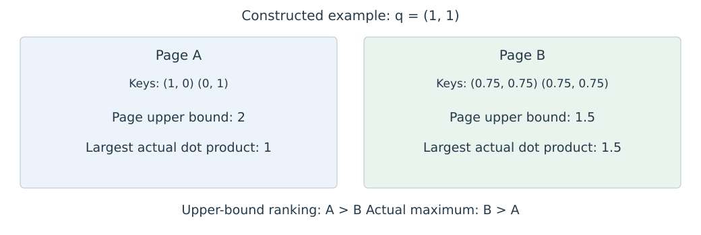

# 7.4 基于内容的动态选择

固定窗口和全局位置预先规定读取范围，但相关线索也可能出现在这些范围之外。动态选择使用当前 Query 或输入表示产生候选集合，再在选中 KV 上执行 Attention。以下按选择过程组织案例：先用 Hash/Clustering 分组，再用低成本分数挑选页面或块，最后介绍与模型共同训练的 Indexer。

## Hash 与 Clustering 的候选分组

**Reformer** 使用 Locality-Sensitive Hashing（LSH），让方向相近的表示以较高概率进入同一桶。其 Shared-QK 设计共用 Query/Key 投影，并归一化 Key；按桶编号及原位置排序后，将相邻项分块计算。多轮 Hash 降低相近向量被分到不同桶而漏选的概率。原论文 [§2、Figure 2](https://arxiv.org/html/2001.04451v2#S2) 展示“分桶 → 排序 → 分块”的过程；排序和多轮处理也计入执行成本。

**Routing Transformer** 使用在线 k-means 学习共享的聚类中心，依据 Q/K 与中心的关系组织候选集合。为形成大小规则的计算块，实现按每个中心选取定额位置；一个位置可能被多个中心选中。训练时以移动平均更新中心。其原始位置可能相距很远，因内容相近而参与同一组 Attention。[Roy et al.，§4.1、Algorithm 1、Figure 1](https://arxiv.org/html/2003.05997v3#S4.SS1)

两者先形成内容相关的分组，再计算组内的详细权重；这与下面按当前 Query 给已有 KV 页面评分的方式不同。分组近似会影响候选覆盖，规则块又会引入容量约束，评估需同时记录分组、重排和 Attention 的成本。

用于自回归计算时，分组后的 Mask 仍须依据原始位置。最终 Mask 限制被读取的 Key；若定额选择或排序分块还依赖整段输入，前缀复用则需另查选择过程是否受后缀影响，见[8.5 Prefix Caching 与 Offloading](../kv-cache/reuse-offloading.md)。

## Quest 的页面评分

内容分组需要组织或重排候选。对于已经按页保存的 KV，另一种思路是保留布局，利用页面摘要估计当前 Query 应优先读取哪些页。

Quest 按页管理 KV，保存每页 Key 各维度的最小值和最大值。当前 Query 用这些统计量估计页面分数，再读取选中的页。[Tang et al.，§3.4](https://arxiv.org/html/2406.10774v1#S3.SS4)

设页 $$B$$ 中第 $$a$$ 维的最小值和最大值为 $$m_{B,a}$$、$$M_{B,a}$$。忽略所有页共有的正缩放系数，可以定义：

$$
U_B(q)=\sum_{a=1}^{d_h}\max(q_a m_{B,a},q_a M_{B,a}).
$$

对任意 $$j\in B$$，每一维都有 $$q_a k_{j,a}\le\max(q_a m_{B,a},q_a M_{B,a})$$，相加即得 $$q^\top k_j\le U_B(q)$$。因此，它是未归一化点积的上界；各维度最大项可能来自不同位置，上界未必能由某个真实 Key 取得。

图 7-3 给出本书构造的二维例子。Query 为 $$q=(1,1)$$，页 A 包含 $$(1,0)$$ 和 $$(0,1)$$，页 B 包含两个 $$(0.75,0.75)$$。页面上界偏向 A，但实际最高点积位于 B。

<figure>
  
  <figcaption>
图 7-3　页面上界与实际点积
</figcaption>
</figure>

页面选择减少本次读取的数据，未选中页仍可供后续 Query 使用。若永久淘汰这些页，则改变了未来可访问的信息范围，属于第八章讨论的缓存保留策略。

## MInference 的模式选择与 Prefill 稀疏化

Quest 的页面评分面向当前 Query 的历史访问。长 Prompt 的 Prefill 则同时包含许多 Query，可以利用 Head 的连接模式组织整段计算。

MInference 1.0 面向已有模型的长 Prompt Prefill，无需额外训练。它先离线为每个 Head 选择模式及预算，运行时再根据输入生成索引，并调用相应的稀疏 Kernel。[Jiang et al.，§2.2—3.2](https://arxiv.org/html/2407.02490v1#S3)

三类模式使用不同的索引方式：

- **A-shape**：读取初始位置和局部窗口，连接集合固定。
- **Vertical-Slash**：用末尾少量 Query 估计重要列及相对位置偏移，再形成整段 Prompt 的连接集合。
- **Block-Sparse**：对 Q/K 分块平均，计算粗粒度分数并选择块。

离线固定的是模式及配置，动态分支的具体索引仍随输入变化。论文的比较设置仅在 Prefill 使用稀疏计算，Decode 保留 Dense Attention；因此，Prefill 计算减少不能直接解释为 KV Cache 容量缩小。[§3.2，Algorithms 1—3；§4，Baselines](https://arxiv.org/html/2407.02490v1#S4)

这种索引过程还影响前缀复用。Vertical-Slash 用 Prompt 末尾的 Query 选择整段输入的连接；相同前缀接上不同后缀时，较早位置的选择集合可能改变。最终乘法中的 Causal Mask 约束被读取的 Key，但不使索引选择本身独立于后续输入。因此，复用这类 Prefill 的中间状态时，还需检查选择器的输入范围与配置；第二章标准 Causal Transformer 的前缀不变性不能直接推广到整个稀疏化流程。这是根据 Algorithm 2 的依赖关系推得的复用限制，具体缓存条件见[8.5 Prefix Caching 与 Offloading](../kv-cache/reuse-offloading.md)。

## NSA 的压缩与块选择

前述 Quest 和 MInference 侧重已有模型的推理计算。Native Sparse Attention 将选择与压缩纳入模型结构，使网络在训练时适应这些读取路径。

Native Sparse Attention（NSA）组合三个分支：压缩块级 KV、读取选中块的原始位置，以及局部窗口。压缩分支的 Attention 权重用于产生块选择分数；GQA 组内的 Query Heads 汇总评分，共享被选中的 KV 块。三个分支独立计算 Attention，再通过输入相关的 Sigmoid Gate 合并。[Yuan et al.，§3.2—3.4](https://arxiv.org/html/2502.11089v1#S3)

| 分支 | 读取对象 | 输出所含信息 |
| --- | --- | --- |
| Compression | 块级压缩 KV | 较粗粒度的历史表示 |
| Selection | 选中块内的位置级 KV | 被选区域的细节 |
| Sliding Window | 最近位置的 KV | 局部上下文 |

表 7-4　NSA 的三个读取分支

这三个输出分别归一化后再合并；各 Gate 也不要求总和为 1。因此，将三组 KV 直接拼接后统一做一次 Softmax，会定义另一个算子。

压缩序列仍随历史增长。若压缩步长固定为 $$s$$，长度为 $$t$$ 的前缀含 $$O(t/s)$$ 个压缩条目；即使选中块数与窗口固定，对全部 Query 的压缩分支求和仍有 $$O(N^2/s)$$ 的配对规模。固定压缩率降低了系数，并未自动消除这一项。

## DeepSeek 的 DSA 与可训练 Indexer

DeepSeek Sparse Attention（DSA）是 DeepSeek-V3.2 报告采用的稀疏 Attention 设计。与利用压缩分支 Attention 权重选择块的 NSA 相比，它引入独立的 Lightning Indexer，用低成本评分选择历史位置，再由主 Attention 读取对应 MLA 条目。其分数为：

$$
I_{t,j}=\sum_{h=1}^{H_I}w_{t,h}^{I}\operatorname{ReLU}\!\left((q_{t,h}^{I})^\top k_j^{I}\right).
$$

$$H_I$$ 是 Indexer Head 数，$$q^I,k^I$$ 为索引表示，$$w^I$$ 为当前输入产生的系数。按 $$I_{t,j}$$ 选取 Top-k 位置后，主 Attention 使用自己的表示计算权重。索引分数与最终 Attention 权重承担不同任务。[DeepSeek-V3.2，§2.1](https://arxiv.org/html/2512.02556v1#S2.SS1)

训练分为两个阶段。Dense warm-up 冻结主模型，将主 Attention 各 Head 的权重相加并沿位置归一化，作为 Indexer 的 KL 对齐目标。随后引入稀疏选择，继续训练主模型与 Indexer；这一阶段的 KL 对齐只在选中集合上计算。Indexer 的输入经过 detach，其参数只接收 KL 损失的训练信号，主模型则由语言建模损失优化。[§2.1.1](https://arxiv.org/html/2512.02556v1#S2.SS1.SSS1)

主 Attention 的选中配对数可降为 $$O(Nk)$$，但 Indexer 仍计算各 Query 与前缀位置的分数，总体保留 $$O(N^2)$$ 的索引项。[§2.3](https://arxiv.org/html/2512.02556v1#S2.SS3) 比较效率时，应同时计入索引、选择和主 Attention，而非只报告最后一步。

DSA 的位置选择进一步与序列压缩结合，形成[7.5 DeepSeek-V4 的 CSA 与 HCA](compressed-attention.md)讨论的历史访问方式。

图表来源与本地文件信息见[附录 C 参考文献、教学资源与本地源文件索引](../../appendices/references.md)。
