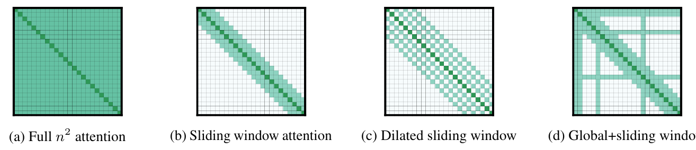
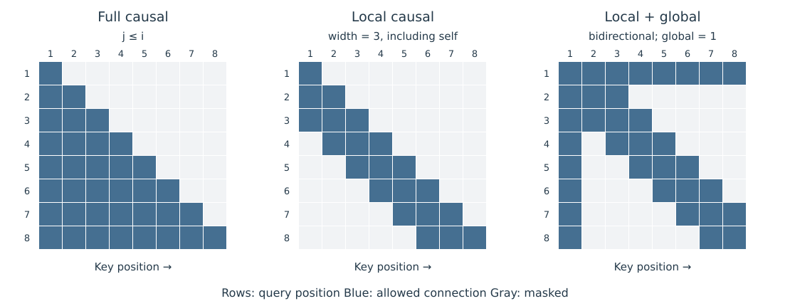

# 7.2 Sliding Window 与 Local–Global Attention

固定连接模式以位置关系确定读取范围。Sliding Window 保留近邻；Global 位置提供跨区域的信息通道；间隔连接或随机连接则增加远距离路径。选择模式时，需要同时考察每层连接数量，以及信息经过多少层才能到达目标位置。

Longformer 的原图从左到右展示全连接、滑动窗口、扩张窗口和局部加全局连接。绿色格子是可访问的位置对；扩张窗口在相邻连接之间留出间隔，全局位置则形成贯穿行列的连接。原图展示双向模式，用于理解 Encoder 中的连接设计；自回归使用时还需施加因果约束。[原论文 Figure 2，PDF 第 3 页](https://arxiv.org/pdf/2004.05150v2#page=3)

<figure>
  
  <figcaption>
图 7-1　Longformer 的局部、扩张与全局连接
</figcaption>
</figure>

## Sliding Window 的跨层传播

采用含自身共 $$w$$ 个位置的 Causal 窗口：

$$
\mathcal A_i=\{\max(1,i-w+1),\ldots,i\}.
$$

每层最多向前覆盖 $$w-1$$ 个位置。若连续 $$L$$ 层均采用该窗口，且其余操作只作用于各自位置，那么位置 $$i$$ 在连接图上可接收的最早输入位置为 $$\max(1,i-L(w-1))$$。这个边界通过逐层将可访问区间向前扩展 $$w-1$$ 得到，Residual 只保留已有路径。

例如 $$w=3$$ 时，位置 8 在一层后可读取位置 6—8 的表示；两层后，可间接依赖原始位置 4—8。中间表示已将信息加权混合，路径可达并不保证某段信息被完整保存或被模型有效使用。

Mistral 7B 将 Sliding Window 用于自回归语言模型，并以 Rolling Buffer 保存窗口内 KV。其报告用堆叠层解释窗口外信息的间接传播。[Jiang et al.，§2](https://arxiv.org/html/2310.06825v1#S2) 本节明确采用“窗口宽度包含自身”的计数约定；比较不同实现时，需要检查窗口端点是否包含在内。

## Local–Global 的信息通道

Longformer 在局部窗口之外，为少量任务相关位置设置 Global Attention。例如分类使用 `[CLS]`，问答可将问题中的位置设为 Global。这些位置读取整个序列，普通位置也能读取它们。Longformer 还为 Global Attention 设置独立的 Q/K/V 投影，与局部 Attention 的投影分别学习。[Beltagy et al.，§3.1](https://arxiv.org/html/2004.05150v2#S3.SS1)

在双向图中，若位置 $$g$$ 是 Global，原始位置 $$j$$ 的信息可以先进入下一层的 $$g$$，再由后一层的目标位置 $$i$$ 读取。这条经 Global 位置转发的路径跨越两层；已有直接连接的位置之间仍可在一层传递信息。同一层各位置并行计算，不能先读取该层刚算出的 Global 输出。

图 7-2 用统一网格对照三种连接。每行代表 Query，每列代表 Key；深色格子表示允许读取的位置。第三幅为双向 Local–Global 结构，前两幅为 Causal 结构，边界条件在图内分别标明。

<figure>
  
  <figcaption>
图 7-2　局部与全局连接模式
</figcaption>
</figure>

将双向 Global 设计移入自回归模型时，每条边都必须满足因果顺序。序列开头的 Global Token 只能汇总它之前的信息，无法在当前前向中作为整个未来序列的摘要。自回归结构需要使用满足位置顺序的汇总节点或其他长距离连接。

## 远距离连接的选择

| 模式 | 增加的路径 | 需要检查的条件 |
| --- | --- | --- |
| Dilated Window | 按固定间隔读取更远的位置 | 仅用同一间隔时可能遗漏中间位置，需要结合局部或其他间隔 |
| Local–Global | 通过少量共享位置跨区域传递 | Global 数量、位置与因果方向 |
| Local–Random–Global | 随机连接补充位置路径 | 随机图的具体配置、块化方式与训练条件 |

表 7-2　局部连接的补充方式

Longformer 研究了 Dilated Window 与 Global Attention；BigBird 则组合局部、随机和全局连接。[Longformer §3.1](https://arxiv.org/html/2004.05150v2#S3.SS1)；[BigBird §2](https://arxiv.org/html/2007.14062v2#S2) 对窗口半径、随机连接数和 Global 数量都固定的模式，总连接数为 $$O(N)$$；若这些预算随长度增加，应按实际增长关系重新计数。

图表的来源与本地文件信息见[附录 C 参考文献、教学资源与本地源文件索引](../../appendices/references.md)。
