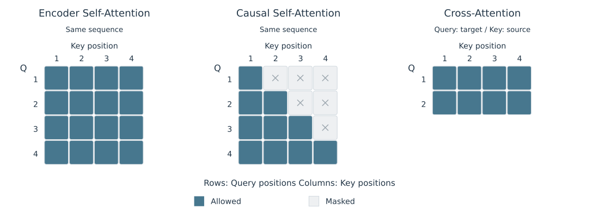

# 2.3 Self-Attention、Cross-Attention 与 Causal Attention

QKV 来自哪里，决定 Attention 在哪些序列之间传递信息；Mask 则决定每个 Query 可以访问哪些 Key。这两个维度可以分别设置。

## 信息来源与访问范围

| 形式 | Query 来源 | Key / Value 来源 | 典型访问范围 |
| --- | --- | --- | --- |
| Encoder Self-Attention | Encoder 当前子层输入 | 同一输入 | 全部有效输入位置 |
| Decoder Causal Self-Attention | Decoder 当前子层输入 | 同一输入 | 当前及此前的有效位置 |
| Encoder–Decoder Cross-Attention | Decoder 中进入该子层的表示 | Encoder 最终输出 | 全部有效源序列位置 |

表 2-5　Attention 的信息来源与访问范围

Self-Attention 使用同一序列产生 QKV，但各投影参数可以不同，因此 Q、K、V 通常并不相等。Cross-Attention 的 Query 数量由目标序列决定，Key 和 Value 的数量由源序列决定，分数矩阵可以是矩形。Causal Attention 描述的是访问约束；本章主要讨论它在 Decoder Self-Attention 中的使用。[Vaswani et al.，§3.2.3](https://arxiv.org/html/1706.03762v7)

## Causal Mask 按位置限制读取

对长度为 $$N$$ 的完整序列，使用从 1 开始的位置编号，Causal Mask 为：

$$
M_{ij}=\begin{cases}
0,&j\le i,\\
-\infty,&j>i.
\end{cases}
$$

行对应 Query，列对应 Key。图 2-3 中，每行深色格表示可访问的位置；Key 维度上的 Softmax 只对这些位置分配权重。

<figure align="center">

<figcaption>
图 2-3　信息来源与访问范围
</figcaption>
</figure>

Causal Self-Attention 允许访问对角线，是因为位置 $$i$$ 的输入 Token 已知，其输出用于预测位置 $$i+1$$。训练数据的输入与预测目标相差一个位置；Mask 与这一错位共同防止模型读取待预测的答案。[Vaswani et al.，§3.1](https://arxiv.org/html/1706.03762v7)

## Padding 与增量计算中的 Mask

同一 batch 中的序列可以用 padding 补齐长度。Padding Mask 排除无效 Key，防止有效 Query 读取补齐位置。补齐的 Query 行即使产生输出，也应从有效结果和相应 loss 中排除；仅屏蔽 Key 不会自动将这些行的输出置零。[D2L，§11.3.2.1](https://d2l.ai/chapter_attention-mechanisms-and-transformers/attention-scoring-functions.html)

按本章的 Softmax 定义，每个参与计算的 Query 行至少需要一个有限的有效分数。若整行都是 $$-\infty$$，归一化分母为零，公式无定义；实现若保留这种补齐行，需要单独约定其输出并处理数值运算。

采用 KV cache 时，要按**实际位置**构造因果关系。假设缓存中已有 $$p$$ 个位置，本轮一起处理 $$m$$ 个新位置，第 $$i$$ 个新 Query 的绝对位置是 $$p+i$$，它可以访问的 Key 满足：

$$
j\le p+i,\qquad i=1,\ldots,m;\quad j=1,\ldots,p+m.
$$

例如已有 3 个历史位置，本轮处理位置 4 和 5，两行允许访问的范围分别为 $$(1,2,3,4)$$ 与 $$(1,2,3,4,5)$$。这是将同一因果规则应用到带历史偏移的矩形矩阵；若错误地按 $$j\le i$$ 处理，就会屏蔽应当可读的历史。单步 decode 仅含一个新 Query，所有有效历史 KV 和当前 KV 都可以参与计算。[Shazeer，§2.4](https://arxiv.org/html/1911.02150v1)

图示来源见[图表来源](../../appendices/references.md#图表来源)。

下一节：[2.4 Multi-Head Attention 的结构与 Output Projection](multi-head.md)。
