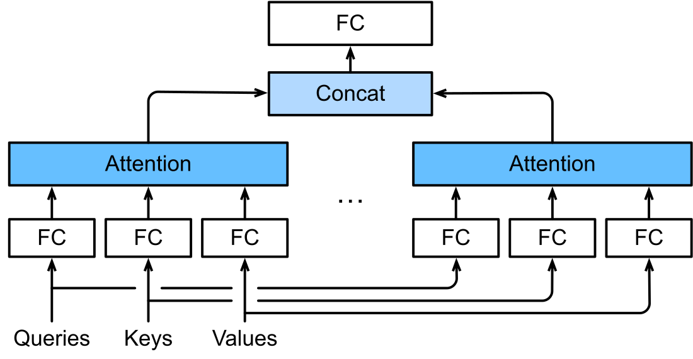

# 2.4 Multi-Head Attention 的结构与 Output Projection

单个 Head 为每个 Query 产生一组读取权重。Multi-Head Attention 使用多组独立投影，同时计算多组匹配与汇总，再将结果组合为一个输出表示。

## 独立投影与并行汇总

设共有 $$h$$ 个 Head。沿用前文输入 $$X$$ 和 $$Z$$，第 $$a$$ 个 Head 的计算为：

$$
\begin{aligned}
Q_a&=XW_{Q,a},\qquad K_a=ZW_{K,a},\qquad V_a=ZW_{V,a},\\
H_a&=\operatorname{softmax}_{\mathrm{row}}\left(\frac{Q_aK_a^\top}{\sqrt{d_k}}+M\right)V_a.
\end{aligned}
$$

各 Head 独立沿 Key 维度归一化，输出 $$H_a\in\mathbb{R}^{n_q\times d_v}$$。图 2-4 从下向上展示投影、并行 Attention、拼接和输出变换。原图底部的 Queries、Keys、Values 指投影前的输入，对应本节的 X、Z、Z；FC 表示可学习的线性投影。多个 Head 可以学习不同的匹配方式，具体分工由训练形成。[D2L，§11.5.1](https://d2l.ai/chapter_attention-mechanisms-and-transformers/multihead-attention.html)

<figure align="center">

<figcaption>
图 2-4　Multi-Head Attention
</figcaption>
</figure>

## 拼接与 Output Projection

沿特征维度拼接各 Head，并映射回模型维度：

$$
Y=\operatorname{Concat}(H_1,\ldots,H_h)W_O,
\qquad W_O\in\mathbb{R}^{hd_v\times d_{\mathrm{model}}}.
$$

因此，拼接结果为 $$n_q\times hd_v$$，最终输出为 $$n_q\times d_{\mathrm{model}}$$。把 $$W_O$$ 按输入行拆成 $$h$$ 个块 $$W_{O,a}\in\mathbb{R}^{d_v\times d_{\mathrm{model}}}$$，可以直接推得：

$$
Y=\sum_{a=1}^{h}H_aW_{O,a}.
$$

这说明 Output Projection 学习如何组合各 Head 的特征；它对每个位置分别操作，跨位置读取已经在各 Head 的 Attention 中完成。以上省略输出偏置。[Vaswani et al.，§3.2.2](https://arxiv.org/html/1706.03762v7)；[Shazeer，§2.2](https://arxiv.org/html/1911.02150v1)

## 从公式到 batch 张量

取标准 MHA 配置 $$d_k=d_v=d_h$$，且 $$hd_h=d_{\mathrm{model}}$$。对 batch size 为 $$B$$、长度为 $$N$$ 的 Self-Attention，可先用一个大矩阵计算所有 Head 的 Query，再 reshape 并交换轴；K 和 V 同理。

| 对象 | 形状 | 变化 |
| --- | --- | --- |
| 输入 $$X$$ | $$B\times N\times d_{\mathrm{model}}$$ | 每个位置一个表示 |
| 合并投影后的 Q | $$B\times N\times (hd_h)$$ | 各 Head 的投影结果排列在末维 |
| 拆分 Head 后的 Q、K、V | $$B\times h\times N\times d_h$$ | 将 Head 维移到位置维之前 |
| 分数与权重 | $$B\times h\times N\times N$$ | 每个 Head 独立计算 |
| 各 Head 的输出 | $$B\times h\times N\times d_h$$ | 对 Value 汇总 |
| 拼接并输出投影 | $$B\times N\times d_{\mathrm{model}}$$ | 合并各 Head 的特征 |

表 2-6　标准 MHA 的 batch 张量布局

这里先投影再拆分 Head；各 Head 的参数是大投影矩阵的不同列块。实现可以采用其他内存布局，但必须保持 Head 与位置的对应关系。[D2L，§11.5.2](https://d2l.ai/chapter_attention-mechanisms-and-transformers/multihead-attention.html)

例如 $$d_{\mathrm{model}}=512$$、$$h=8$$ 时，每个 Head 的维度为 64。按上述配置，Q、K、V 和输出的四个投影共含 $$4d_{\mathrm{model}}^2$$ 个权重元素，不计偏置；这是由矩阵形状相乘得到的计数。MQA、GQA 和 MLA 会改变 KV 的组织与参数形式，见[第 4 章 Key–Value 表示优化：MHA、MQA、GQA 与 MLA](../kv-representations/README.md)。

图示来源与许可见[图表来源](../../appendices/references.md#图表来源)。

下一节：[2.5 Training、Prefill 与 Decode 的计算差异](training-prefill-decode.md)。
