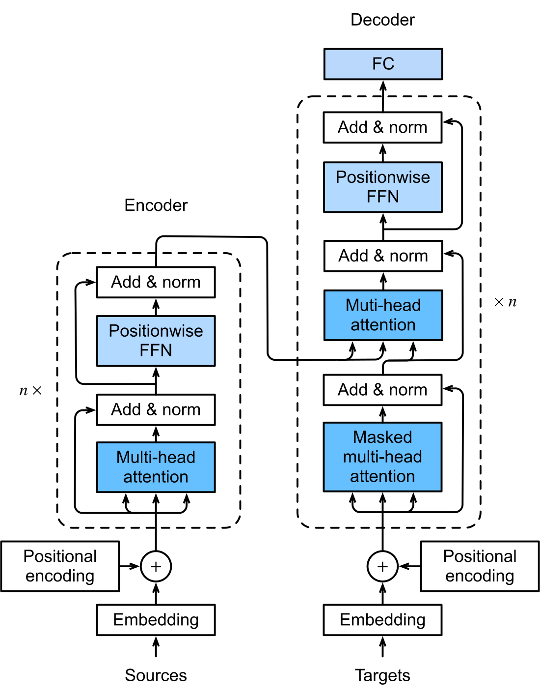

# 2.1 Transformer 中的 Attention 结构与计算流程

一个 Transformer 层需要完成两类操作：通过 Attention 在位置之间汇总信息，再通过逐位置的前馈网络变换表示。先明确 Attention 在网络中的输入和输出，才能把后面的公式与实际模型对应起来。

## Attention 在网络中的位置

图 2-1 展示原始 Encoder–Decoder Transformer。Encoder 的 Self-Attention 读取输入序列；Decoder 的 Masked Self-Attention 读取目标序列中已经可见的内容，随后通过 Encoder–Decoder Attention 读取 Encoder 的输出。

<figure align="center">

<figcaption>
图 2-1　Transformer 中的 Attention 子层
</figcaption>
</figure>

图中的 Add & Norm 表示残差相加后进行 Layer Normalization，这是原始 Transformer 的排列。Positionwise FFN 对各位置使用相同的网络参数，但分别处理各行表示。最上方的 FC（Fully Connected Layer）把 Decoder 输出映射为词表分数，再由图中省略的 Softmax 转换为词表概率。Attention 内部的 Softmax 则沿输入位置归一化，产生读取权重。[D2L，§11.7.1—11.7.3](https://d2l.ai/chapter_attention-mechanisms-and-transformers/transformer.html)；[Vaswani et al.，§3.1、§3.4](https://arxiv.org/html/1706.03762v7)

本章采用原始结构定位计算组件；Decoder-only 场景沿用 Causal Self-Attention，后面的 prefill 与 decode 分析针对这一场景。位置编码的具体方式在[第 3 章 Position Encoding 的演进与 Context Extension](../position-encoding/README.md)展开。

## 从输入表示到 Attention 输出

每个位置首先有一个向量表示。在网络底层，它来自 Token embedding 与位置处理；在更深层，它来自前序计算。因此，同一个 Token 在不同层的 QKV 通常不同。

| 步骤 | 输入与操作 | 产生的结果 |
| --- | --- | --- |
| 投影 | 用可学习参数将输入表示映射为 Q、K、V | 用于匹配和汇总的向量 |
| 匹配 | 计算 Query 与 Key 的点积并缩放 | 每个 Query 对各 Key 的分数 |
| 约束与归一化 | 按 Mask 限制访问范围，再沿 Key 维度做 Softmax | 非负且逐行和为 1 的权重 |
| 汇总 | 用权重对 Value 加权求和 | 每个 Query 对应的输出向量 |
| 多 Head 合并 | 拼接各 Head 的结果，再进行 Output Projection | 返回模型表示维度的输出 |

表 2-2　Attention 的计算步骤

这里描述未施加 attention dropout 的基础计算。训练学到的是投影等参数；QKV 和 Attention 权重由当前输入计算得到，会随上下文变化。[Vaswani et al.，§3.2](https://arxiv.org/html/1706.03762v7)

图示来源与许可见[图表来源](../../appendices/references.md#图表来源)。

下一节：[2.2 Query、Key、Value 与 Scaled Dot-Product Attention](scaled-dot-product.md)。
