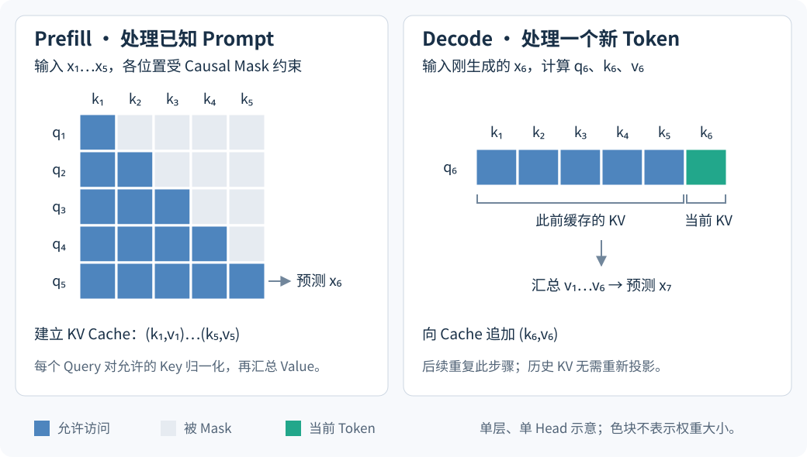

# 2.5 Training、Prefill 与 Decode 的计算差异

同一组 Attention 参数可以处理完整序列，也可以在 KV cache 的支持下逐步处理新位置。区别来自本轮 Query 的数量、历史 KV 的来源，以及是否需要计算梯度。

## 完整序列与增量计算

以下讨论 Decoder-only 模型的 Causal Self-Attention，设完整序列长度为 $$N$$，一步 decode 时可访问的历史与当前位置总数为 $$t$$。

| 阶段          | 单个 Head 的本轮 Query / Key 数量 | 历史与梯度                              |
| ----------- | -------------------------- | ---------------------------------- |
| Training    | $$N / N$$                  | 已知训练序列，在 Causal Mask 下计算各位置并反向传播   |
| Prefill     | 未分块时为 $$N / N$$            | 处理 Prompt，建立各层 KV cache，推理时不计算参数梯度 |
| 常规单步 Decode | $$1 / t$$                  | 读取缓存并追加当前 KV，输出供后续生成使用             |

表 2-7　三种阶段的计算对象

训练时，各位置的目标已知，可以使用同一训练序列中前面的真实 Token 作为条件。给定一层输入后，各位置的矩阵运算可并行执行，Causal Mask 仍限制每个位置能读取的内容。生成时，后续输入依赖前一步选出的 Token，因此常规 decode 按步骤推进。[Shazeer，§2.3—2.4](https://arxiv.org/html/1911.02150v1)

<figure><figcaption>
图 2-5　Prefill 与单步 Decode 的读取范围
</figcaption></figure>

Prefill 的最后一个位置用于产生首个新 Token 的概率分布；下一轮处理这个新 Token，再产生后续分布。图中只显示 Attention 的位置关系，概率输出还需要模型后续计算。Chunked prefill 将已知 Prompt 分成多块，每块按实际位置读取历史与当前块中的合法位置。[Kwon et al.，§2.2](https://arxiv.org/html/2309.06180v1)；[Jiang et al.，§2](https://arxiv.org/html/2310.06825v1)

## KV cache 为什么能保持计算结果

对一个 Head，令 $$q_t,k_t,v_t$$ 为当前输入投影得到的列向量。将新 KV 追加到缓存：

$$
K_{1:t}=\begin{bmatrix}K_{1:t-1}\\k_t^\top\end{bmatrix},
\qquad
V_{1:t}=\begin{bmatrix}V_{1:t-1}\\v_t^\top\end{bmatrix}.
$$

当前位置的输出为：

$$
o_t^\top=\operatorname{softmax}\left(\frac{q_t^\top K_{1:t}^\top}{\sqrt{d_k}}\right)V_{1:t}.
$$

对固定参数、相同前缀及相同位置处理，Causal Transformer 的旧位置在各层都无法读取后来追加的内容。关闭 dropout 等随机操作后，历史 KV 因而可以复用；上式与完整因果计算中第 $$t$$ 行使用相同的 Query、Key、Value。两种计算在数学上等价，具体 kernel 和浮点运算顺序可能造成数值差异。若改变前缀或位置处理，缓存需要与新的计算条件保持一致。[Shazeer，§2.4](https://arxiv.org/html/1911.02150v1)

本章用固定输入分别运行完整因果计算、逐 Token 缓存计算和分块计算，核对各位置输出。检查对象为一个 Head 的 Attention 核心，脚本为 `scripts/verify_transformer_attention.py`。

## 运算量、缓存与中间矩阵

设 batch size 为 $$B$$、Head 数为 $$h$$，并取 $$d_k=d_v=d_h$$。下表由矩阵形状直接计数，只统计一层 Attention 核心，省略投影、FFN、反向传播和系统调度。

| 对象                              | 数量级                   | 计数依据                        |
| ------------------------------- | --------------------- | --------------------------- |
| 长度 $$N$$ 的完整 Dense Attention 前向 | $$\Theta(BhN^2d_h)$$  | $$QK^\top$$ 和 $$AV$$ 都涉及位置对 |
| 可访问 $$t$$ 个位置的一步 Decode         | $$\Theta(Bhtd_h)$$    | 每个 Head 只有一个 Query          |
| 显式保存完整分数或权重矩阵                   | $$\Theta(BhN^2)$$ 个元素 | 每个 Head 一张 $$N\times N$$ 矩阵 |
| 标准 MHA 的单层 KV cache             | $$2Bhtd_h$$ 个元素       | Key 与 Value 各保存 $$t$$ 个位置   |

表 2-8　Attention 核心的计算与存储成本

Causal Mask 保留 $$N(N+1)/2$$ 个有效位置对，仍是二次增长。FlashAttention 可以避免把完整中间矩阵保存到显存，因此显式矩阵容量不是所有实现都必须付出的存储成本。[Vaswani et al.，Table 1](https://arxiv.org/html/1706.03762v7)；[Dao et al.，§3](https://arxiv.org/html/2205.14135v2)

完整序列计算中，全部 QKV 与输出投影还需要 $$\Theta(BN d_{\mathrm{model}}^2)$$ 量级的运算；这个结论使用标准 MHA 的 $$hd_h=d_{\mathrm{model}}$$。因此，核心 Attention 的复杂度不能直接当作整层成本。常规 decode 的实际延迟还取决于 batch、参数和 KV 的读取量、硬件与 kernel；小 batch 下可能受到带宽限制。[Shazeer，§2.3.1、§2.4.1](https://arxiv.org/html/1911.02150v1)

图示来源见[图表来源](../../fu-lu/references.md#图表来源)。

下一章：[第 3 章 Position Encoding 的演进与 Context Extension](../position-encoding/)。
