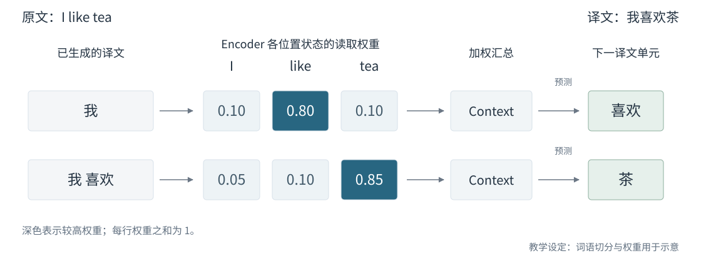

# 1.2 从 RNN 到 Transformer

在机器翻译中，模型既要表示原文，也要在生成译文时读取相关信息。本节沿这两个问题展开：先看 RNN 如何编码序列，再看 Attention 如何改善输入读取，最后说明 Self-Attention 如何成为 Transformer 的核心组件。

## RNN 中的序列表示

循环神经网络（Recurrent Neural Network，RNN）按顺序处理输入：每一步结合当前 Token 与上一步的隐藏状态，更新已读内容的表示。早期的序列到序列（Sequence-to-Sequence，Seq2Seq）模型用一个 RNN 作为编码器（Encoder）读取原文，再由另一个 RNN 作为解码器（Decoder）生成译文。

下面的例子将英语 “They are watching.” 翻译为法语 “Ils regardent.”。图中的 RNN 按时间步展开，各方框表示同一网络在不同位置的计算；Encoder 的最终状态传给 Decoder，成为生成译文的依据。`<bos>` 与 `<eos>` 分别标记序列开始和结束。[Zhang et al.，Dive into Deep Learning，§10.7](https://d2l.ai/chapter_recurrent-modern/seq2seq.html)

<figure><figcaption>
图 1-4　RNN Encoder–Decoder
</figcaption></figure>

这种设计需要将原文的必要信息集中在一个固定维度的表示中。输入越长，需要保留的细节越多，单一表示就可能成为信息传递的瓶颈。Seq2Seq 描述序列到序列的建模框架，可以采用不同的网络架构和中间表示。[Bahdanau et al.，§1—2](https://arxiv.org/html/1409.0473v7)

## Attention 按需读取输入信息

Attention 改变了 Encoder 向 Decoder 提供信息的方式：保留各输入位置的状态，在每个生成步骤重新计算权重，再将这些状态加权汇总。于是，生成不同的译文 Token 时，Decoder 可以读取不同的原文信息。

以 “I like tea” → “我喜欢茶” 为例：生成“喜欢”时，图中对 `like` 的权重较高；生成“茶”时，较高权重转向 `tea`。每一步都汇总全部输入位置的状态，只是各位置的贡献不同。

<figure><figcaption>
图 1-5　翻译过程中的 Attention
</figcaption></figure>

图中按词语划分输入与译文单元，切分和权重均为教学设定。模型根据 Decoder 状态计算读取权重，得到上下文向量（Context Vector）；Decoder 再结合该向量与自身状态预测后续内容。图中省略了 RNN 状态更新与输出层的细节。[Bahdanau et al.，§3.1](https://arxiv.org/html/1409.0473v7#S3.SS1)

Bahdanau 等人的模型采用这一动态汇总思路，但 Encoder 和 Decoder 仍是 RNN：Attention 改善了信息读取，序列表示仍需沿时间步递推。[原论文 §3](https://arxiv.org/html/1409.0473v7#S3)；计算定义见[Bahdanau Attention 的计算](../../fu-lu/foundations.md#bahdanau-attention-的计算)。

## Self-Attention 建模序列内部关系

另一个问题是：输入序列中的每个位置，能否直接读取其他位置的信息来更新自身表示？Self-Attention 将 Attention 用于同一序列内部；例如表示 “it” 时，可以汇总同一句话中 “animal” 所在位置的信息。

| 比较对象           | 信息如何到达当前位置     | 位置之间的计算依赖         |
| -------------- | -------------- | ----------------- |
| RNN            | 通过相邻时间步传递隐藏状态  | 当前状态依赖前一步状态       |
| Self-Attention | 按权重直接汇总允许访问的位置 | 给定该层输入后，多个位置可并行计算 |

表 1-2　RNN 与 Self-Attention

Self-Attention 在 Transformer 之前已用于阅读理解、摘要等任务。它使 Attention 可以承担序列内部的表示计算，为进一步替代 RNN 的递推计算提供了基础。[Vaswani et al.，§2](https://arxiv.org/html/1706.03762v7#S2)

## Attention 成为 Transformer 的核心机制

在前述 RNN 翻译模型中，RNN 负责计算原文和译文的序列表示，Attention 帮助 Decoder 读取原文。Transformer 将 Attention 的职责扩展到整个序列建模过程：原文内部、译文内部，以及原文与译文之间的信息交互，都由 Attention 完成。[Vaswani et al.，§1、§3.2.3](https://arxiv.org/html/1706.03762v7)

| 建模任务            | Bahdanau 等人的 RNN 翻译模型     | 原始 Transformer         |
| --------------- | ------------------------- | ---------------------- |
| 结合原文前后文计算输入表示   | 双向 RNN                    | Encoder Self-Attention |
| 根据已有译文计算当前位置的表示 | Decoder RNN               | Causal Self-Attention  |
| 为生成译文读取原文信息     | Encoder–Decoder Attention | Cross-Attention        |

表 1-3　Attention 在序列建模中的职责变化

这一改变同时影响计算方式：给定一层的输入后，Self-Attention 可以并行处理多个位置；允许相互访问的位置可以在一层内直接交换信息。原论文据此比较了并行计算需求与长距离依赖的传递路径。常规自回归生成仍需根据前一步结果产生下一个 Token。[Vaswani et al.，§3、§4 与 Table 1](https://arxiv.org/html/1706.03762v7)

下图中的三处 Attention 对应表中的三项任务。前馈网络（Feed-Forward Network，FFN）对各位置分别进行变换，Attention 负责跨位置的信息交互；这些组件在多层网络中共同更新表示。

<figure><figcaption>
图 1-6　Transformer 中的 Attention
</figcaption></figure>

Decoder 的因果自注意力（Causal Self-Attention）只读取当前位置及此前的译文信息，跨序列注意力（Cross-Attention）读取 Encoder 输出。图中省略了因果限制、残差连接与归一化；完整结构见原论文 Figure 1。[Vaswani et al.，§3.1—3.3](https://arxiv.org/html/1706.03762v7)

Transformer 的常见结构包括 Encoder–Decoder、侧重输入表示的 Encoder-only，以及根据已有文本继续生成的 Decoder-only。后文以 Decoder-only 大语言模型（Large Language Model，LLM）为主要分析场景，下一节介绍生成过程中的 Attention 计算与缓存成本。[Hugging Face，Transformer Architectures](https://huggingface.co/learn/llm-course/chapter1/6)

图示来源与许可见[图表来源](../../fu-lu/references.md#图表来源)。

下一节：[1.3 LLM 中的 Attention 成本与长上下文需求](bottlenecks-and-context.md)。
